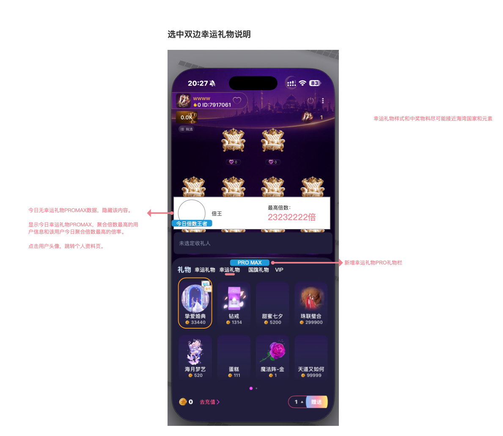
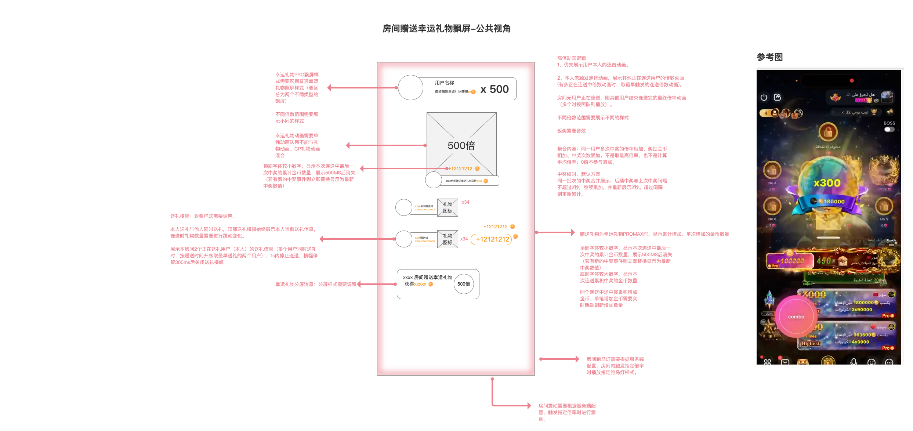
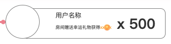
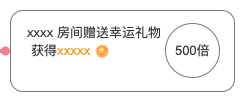

# TOPKHALIJ 幸运礼物PRO MAX 客户端需求文档

| 文档信息 | 内容 |
|---|---|
| 版本 | V1.0 |
| 适用对象 | 产品、设计、Android／iOS客户端、服务端、测试 |
| 需求范围 | PRO MAX礼物栏、连击动画优化、个人中奖聚合、倍率动画、中奖飘屏、房间跑马灯、房间震动、房间动画设置、双用户送礼横幅、公屏消息、返奖音效及今日倍数王者展示 |
| 文档依据 | 第八章人工确认方案；当前Axure《幸运礼物2。0》的4个页面及画布旁注；现行服务端开发测试版；模拟器仅作历史交叉参考，不作为正式连送逻辑 |
| 状态 | 已按最新Axure更新王者无数据隐藏／头像跳转、横幅本人置顶／双用户选择／时序与金额说明、跑马灯指定样式及房间震动；未变更的人工确认继续沿用。原型仍不明确的金额累计粒度、选人冲突及计时边界保留待确认 |

## 一、需求概述与范围

### 1.1 需求目标

在房间礼物面板中新增幸运礼物PRO MAX礼物栏，优化本人连续赠送的操作与动效，并在服务端成功结算后展示中奖倍率、奖励金币及对应房间反馈。房间内聚合倍率命中服务端配置的指定倍率条件时，在该房间播放配置对应的跑马灯样式；新增按服务端指定倍率配置触发房间震动，震动倍率口径及具体表现见6.9／D15。同一用户的连续中奖按“同批合并、后续中奖间隔不超过2秒继续累加”的方案展示。

### 1.2 功能范围

| 模块 | 本次要求 | 对应原型 |
|---|---|---|
| 礼物栏 | 新增PRO MAX分类；区分普通幸运礼物；展示礼物信息与选中态；保留原型中的今日倍数王者展示要求 | 礼物栏 |
| 连击动画 | 调整连送按钮大小、位置；礼物缩放及投向收礼位置；持续连击出现英文反馈；优化连送流畅性 | 连击动画优化 |
| 中奖展示 | 同用户正奖聚合；本人优先的倍率动画；PRO MAX独立飘屏；按配置触发指定跑马灯样式及房间震动；横幅本人置顶、展示2名送礼用户、赠送数量跳动；上方最新中奖金币显示500毫秒，下方连送累计金币实时跳动；公屏样式；返奖音效 | 幸运礼物PRO MAX |
| 房间动画设置 | 新增本人／非本人PRO MAX高倍率动画独立开关，分别控制对应动画触发后的播放 | 房间动画设置 |
| 客户端与结算衔接 | 按实际成功份数更新送礼结果；处理0倍、正奖、部分成功、结果未知；展示不改变账务和个人策略 | 现行服务端规则、个人联动模拟器 |

本次不新增模拟器中的实验切换、用户切换、自动赠送开关、展示方案选择器、手动清零、参数面板、RTP图表、策略诊断、概率表、实验充值弹窗或本地存档功能。不根据右侧“参考图”新增其独有入口、榜单或装饰字段。

### 1.3 资料使用口径

- **服务端结算、金额和策略**：以现行《高倍幸运礼物全服共享池PRD_V1.0_开发测试版》为准。该稿已采用UTC+3近30自然日滚动，不能沿用模拟器中的全程累计统计替代。
- **页面范围、文案、展示优先级及视觉方向**：以当前Axure页面及画布旁注为准。此前3页未配置可执行交互事件；本次新增“房间动画设置”页也未配置交互事件，页面说明与控件Note为空；画布上的文字旁注是本次需求来源，不把静态原型当成已实现交互。
- **个人中奖聚合**：Axure旁注明确采用模拟器的默认方案1。本稿只定义方案1，不增加固定2秒分段方案或方案切换入口。
- 最新原型明确更新的王者空状态与头像跳转、横幅规则、跑马灯样式和房间震动按本轮源材料修订；未涉及的人工确认继续沿用。第八章保留人工原文作为历史决策，并在落实结果中注明已被新原型覆盖的子项。新旧说明冲突或新旁注自身存在歧义时保留具体缺口，不将未采纳建议转成默认规则。D11／D12本轮不扩展。

## 二、角色与业务对象

| 对象 | 定义 | 客户端处理范围 |
|---|---|---|
| 本人 | 当前查看房间的登录用户 | 在各自设备上判断“本人动画”优先级，不能把某位房主固定当成本人 |
| 送礼用户 | 当前成功送出礼物、对应单份开奖结果的用户 | 中奖倍率和返奖金币按该用户归属聚合，不与其他用户合并 |
| 收礼用户 | 当前赠送行为的接收对象 | 原型支持多个头像；多收礼人的份数拆分与头像数量对应规则仍待确认，连送途中不可更换收礼对象 |
| 一份成功礼物 | 服务端成功扣费、开奖并完成结算的最小单位 | 包含最终0倍和正奖；不能将一次点击直接当作一份成功 |
| 一批赠送 | 一次赠送所包含的若干份礼物 | 服务端逐份处理；客户端区分计划份数与实际成功份数 |
| 一段连送 | 房间中被识别为开始、持续、结束的赠送过程 | 驱动连击表现、横幅持续刷新及倍率动画调度；正式结束条件见待确认项D05 |
| 一段中奖聚合 | 同一用户按本稿2秒续时规则合并的正奖展示 | 有独立的倍率合计、奖励金币合计和中奖次数，不等于连送成功份数或账务结算单位 |
| 倍率动画／中奖飘屏／送礼横幅／公屏消息 | 原型中四种不同的中奖反馈载体 | 分别按第六章处理，不用修改其中一种代替全部反馈 |
| 房间跑马灯 | 房间内聚合倍率命中服务端配置条件时播放的反馈 | 聚合倍率取3.3本段累计倍率；匹配与调度见6.7／D13，不直接沿用倍率动画优先级 |
| 本人／非本人PRO MAX动画开关 | 从当前查看者视角，分别控制本人和其他用户触发的PRO MAX高倍率动画是否播放 | 两项独立判断，只控制对应动画播放；状态默认值、保存范围与生效边界见6.8／D14 |

## 三、核心规则

### 3.1 结算结果与客户端展示边界

1. 每份礼物由服务端独立扣费、计提、开奖、返奖，产生唯一最终倍率。客户端不得自行抽奖、按动画次数计算奖励，或把多个奖励来源叠加为同份奖励。
2. 本份奖励金币＝本份实际单价×本份最终倍率。现行价格为40／80／120／200／400／600／1000／2000／3000金币；各礼物名称、图片及价格映射以正式礼物资料为准，不能使用底图中的普通礼物示例价格替代。
3. 成功0倍仍计一次成功赠送和相应投入，但奖励为0，不进入正奖聚合。赠送失败不增加成功份数、中奖次数或奖励。
4. 本人可消费余额以服务端实际资产结果为准。本次单份余额变化＝扣除该份价格＋计入该份实际奖励；一批礼物前份返奖可用于后份消费，不能在客户端把整批总价不足直接等同于必然整批失败。
5. 批量中部分成功时，保留已成功各份及其实际奖励，只停止未成功部分。不能因批次最终未全部完成，撤销已成功结果或隐藏其中奖反馈。
6. 客户端2秒展示到期、连击结束、切换礼物或退出展示不产生补发、退款、重抽或策略重置。
7. PRO MAX返奖区展示上方最新中奖金币与下方本次连送累计金币。最新旁注将上方改写为“本次连送中最后一次中奖的累计金币数量”，累计范围尚需D10澄清，不能继续定为单份、批次或2秒聚合金额。两处只表达已结算奖励，不新增入账；下方在对应横幅展示期间始终保留本次连送累计。多收礼人份数归属仍按D02补齐。

### 3.2 时间与状态口径

| 对象 | 时间口径 | 对客户端的约束 |
|---|---|---|
| 服务端投入、返奖、成功份数、大奖次数及RTP判断 | UTC+3含当日至当前业务时刻的最近30个自然日 | 只影响服务端当前开奖判断，不作为前端2秒聚合周期；窗口移动不撤销历史实际奖励 |
| 个人冷却、后续目标、连续未中及大奖暂停记忆 | 持续保存，不因统计记录滚出而清零 | 不因重新登录、切换礼物或展示消失而重置；客户端不增加这些内部策略的进度展示 |
| 用户历史大奖已结算标记 | 账号历史中实际成功结算过≥1000倍后永久保留 | 不把“近期没中奖”当作重新获得首次资格；客户端不展示保证下一份中奖的提示 |
| 本人中奖聚合 | 同批正奖合并；跨组正奖间隔≤2秒续接；每次有效更新后重新展示2秒 | 不按自然日或30日累计；2秒是中奖展示规则，不是赠送会话结束定义 |
| 上方最新中奖金币 | 最新旁注为“本次连送中最后一次中奖的累计金币数量”；显示500毫秒，新中奖立即替换 | 累计粒度及替换后计时衔接见D10；横幅与倍率动画均有此说明，不能默认等于单份或下方总累计 |
| 横幅下方连送累计金币 | 对应横幅展示期间，始终保留本次送礼已结算的累计中奖金币，随中奖实时更新 | 上方500毫秒到期、0倍或2秒聚合另起段不清零；横幅按新增停止后停留300毫秒规则关闭，1秒含义见D10 |
| 送礼横幅关闭 | 最新旁注“1s内停止连送，横幅停留300ms后关闭” | 保留1秒与300毫秒，不自行合成1.3秒超时；起算点及再赠送处理见D10，不据此定义正式连送结束 |
| 今日倍数王者 | 全服PRO MAX礼物，UTC+3当日，比较聚合倍率 | 面板打开、王者变化或跨日刷新；并列与跨日聚合归属仍见D03，不与近30日窗口混用 |

服务端自然大奖资格、首次补偿、后续目标、连续未中补偿、98%暂停／90%恢复、100份冷却及单份4,500,000金币上限均由服务端判断。客户端仅接收最终结算结果，不通过连击速度、英文反馈档位或聚合倍率改变这些条件。

### 3.3 个人中奖聚合规则

#### 3.3.1 聚合字段

| 字段 | 说明 | 统计方式 | 数据来源 |
|---|---|---|---|
| 本段累计倍率 | 本段已纳入正奖的最终倍率之和 | 当前中奖聚合段累计；不是最高倍率、平均倍率或RTP | 服务端各成功份最终倍率 |
| 本段奖励金币 | 本段已纳入正奖的实际奖励金币之和 | 当前中奖聚合段累计；每份按其结算值相加，不重新发奖 | 服务端实际金币奖励 |
| 本段中奖次数 | 本段纳入聚合的正奖份数 | 一份正奖加1；0倍和失败不增加 | 成功正奖结果 |
| 上次纳入聚合的中奖时间 | 判断后续组是否续接的时间基准 | 当前聚合段最近一份正奖发生时间；生产时钟与乱序规则见D06 | 成功正奖的发生时间 |
| 本次实际成功份数 | 当前批次真正成功的份数 | 当前批次；正奖与0倍都计入，不以请求份数替代 | 服务端本批实际处理结果 |
| 本段连送成功份数 | 当前连送过程已成功的礼物份数 | 当前连送段，按成功份数增长，不按点击数或中奖次数增长；正式结束定义见D05 | 实际成功赠送结果 |

累计倍率＝纳入聚合的各正奖倍率之和；累计奖励金币＝纳入聚合的各正奖实际奖励之和。单份金额上限约束每份服务端实际奖励，不对展示段的奖励合计再次截奖。

横幅另有两层金币展示：上方取最新旁注所述“最后一次中奖的累计金币数量”，其累计范围见D10；下方为本次连送累计，均按6.4执行。下方不直接复用本表“本段奖励金币”，一次连送可包含多个2秒聚合段。上方500毫秒及横幅1秒／300毫秒说明均不改变2秒聚合、实际奖励或正式连送状态。

**计算示例**：同价80金币的两份结果分别为100倍和150倍，实际奖励分别为8,000和12,000金币；若属于同一聚合段，则展示累计250倍、累计20,000金币、中奖2次。不是按某一份礼物重新结算250倍，也不是把中奖次数当作送礼总次数。

#### 3.3.2 同批合并与跨批续时

1. 先识别服务端本次实际返回的成功结果。只有最终倍率＞0且实际奖励金币＞0的记录进入中奖聚合；不能把未兑现候选、后续目标或等待中的结果当作中奖。
2. 同一批次中连续归为同组的中奖结果先合并展示，不把该组内各中奖记录机械拆成多个固定2秒窗口。批次归组信息只用于展示，不合并各份账务。
3. 以下续接判断仅适用于时间顺序正常的中奖结果：对后续中奖组，比较“该组第一份正奖发生时间”与“当前聚合段最后一份正奖发生时间”，时间差在0～2秒之间（含0和2秒）则续接；大于2秒则开始新的聚合段。首次没有聚合内容时直接新建。时间倒序／乱序不进入已确定的正常续接判断，具体展示策略仍见D06，本轮D11不扩展既有乱序处理；不能因负时间差小于2秒就直接续接。
4. 纳入一组后，分别累加倍率、奖励金币、中奖次数，并将该组最后一份正奖时间记为新的比较基准；本次展示更新后重新计时2秒。
5. 中间发生0倍，不增加以上三项，也不单独延长中奖展示。后续正奖能否续接，仍取决于距上次正奖的时间，不取决于0倍发生时间。
6. 2秒内没有新的有效中奖展示更新，则隐藏本段中奖展示。后续是否能接回原聚合，仍按正奖发生时间比较，不能仅以页面是否已经隐藏决定。
7. 不同用户的中奖分别聚合。连送途中不可更换礼物和收礼对象，不建立连送中换礼物／换对象的分支。连送结束后另次赠送使用新礼物价格时，不将新价格结果接入原价格展示段，已结算账务及服务端策略保留；其他聚合归属及时间边界见D06。
8. 生产批次归组、统一时间基准与乱序展示尚未由本轮确认；不采用模拟器的时间倒序另起段作为正式恢复规则。异常处理沿用已有能力，本轮不新增D11所列恢复链路。

#### 3.3.3 聚合不改变单份规则

- 一段累计倍率可以不是服务端单份奖档，也可能超过单份最高7500倍；不得将其当成新增单份奖档、大奖次数或保证收益。
- 各份奖励按各自实际单价结算。不得用“当前价格×历史累计倍率”重算奖励；连送途中不可换礼物，另次赠送的价格也不改写此前奖励。
- 0倍成功份增加送礼成功份数，不增加中奖次数；两种计数必须独立。
- 前端展示清理不清除个人投入、真实余额、冷却、目标或历史首次标记。

### 3.4 客户端业务总流程

下图只表达客户端送礼、接收结果、中奖聚合、动画选择、本人／非本人动画开关判断、横幅两层金币更新及服务端配置触发的房间跑马灯；服务端内部开奖条件沿用正式服务端文档，不在客户端复制一套算法。

```mermaid
%%{init: {"theme":"base","fontFamily":"PingFang SC, Microsoft YaHei, sans-serif","htmlLabels":false,"flowchart":{"curve":"linear","wrappingWidth":290,"nodeSpacing":35,"rankSpacing":40},"themeVariables":{"fontSize":"15px","primaryColor":"#f6f9fd","primaryTextColor":"#243246","primaryBorderColor":"#9caec2","lineColor":"#8798ad"}}}%%
flowchart TB
    A["进入房间并打开礼物面板"] --> B["切换PRO MAX分类<br/>选择礼物、收礼对象及数量"]
    B --> LK["连送途中固定礼物与收礼对象<br/>结束本次连送后才可重新选择"]
    LK --> C["触发赠送或继续连送"]
    C --> D["服务端逐份扣费、开奖、结算<br/>每份独立产生最终结果"]
    D --> E{"本次结果是否已经明确？"}
    E -->|否| U["等待结果确认<br/>不凭动画补发或直接认定失败<br/>沿用现有结果确认与失败处理<br/>D11本轮不扩展"]
    E -->|是| F{"本次是否存在实际成功份？"}
    F -->|否| X["不增加成功数与中奖数<br/>按明确失败结果反馈<br/>本次结果处理结束"]
    F -->|是| G["更新实际成功份数与真实余额<br/>部分成功保留已结算份"]
    G --> H{"成功结果中是否存在正奖？"}
    H -->|否| Z["0倍不累计中奖倍率、金币、次数<br/>不延长中奖展示<br/>本次结果处理结束"]
    BC["收到房间内其他用户的<br/>已结算正奖展示结果"] --> BW["横幅按实际中奖事实独立更新<br/>上方最后一次中奖的累计金币显示500毫秒<br/>新中奖立即替换；累计粒度及计时衔接见D10<br/>下方在横幅存在时保留连送累计<br/>无新奖／上方到期／聚合新段均不清零"]
    BW --> I["按同用户、本批归组信息<br/>先合并同组成功正奖"]
    I --> ORD{"中奖结果是否出现<br/>时间倒序／乱序？"}
    ORD -->|是| RORD["倒序／乱序展示策略待确认<br/>不直接套用正常2秒续接<br/>见D06／D11"]
    ORD -->|否| J{"本用户存在可续接聚合且<br/>首奖距上次末奖为0～2秒？"}
    J -->|否| K["新建本段聚合<br/>倍率、金币、中奖次数从0起算"]
    J -->|是| L["续接已有聚合<br/>保留此前倍率、金币、中奖次数"]
    K --> M["加入本组倍率、实际金币、中奖次数<br/>记录本组末次中奖时间<br/>本次更新后重新展示2秒"]
    L --> M
    M --> N["飘屏及倍率动画按聚合倍率触发／分档<br/>公屏生成口径及音效节奏仍待确认"]
    H -->|是| BW
    M --> MQ["聚合更新后取本段累计倍率<br/>按服务端配置判断跑马灯触发<br/>具体值、匹配及重触发见D13"]
    MQ --> MQD{"是否命中服务端配置的指定倍率？"}
    MQD -->|是| MP["在触发房间播放配置指定的跑马灯样式<br/>映射、资源异常及播放调度见D13"]
    MQD -->|否| MN["本次不触发跑马灯<br/>不改变其他展示载体各自规则"]
    MQD -->|配置或触发口径未明确| MU["按D13补齐配置与触发口径<br/>客户端不自设倍率或兜底规则"]
    SE["进入房间动画设置<br/>具体入口路径见D14"] --> SD["分别查看或切换<br/>本人／非本人PRO MAX动画开关"]
    SD --> SV["已生效的对应开关状态用于播放判断<br/>状态需记录到服务端<br/>默认值、生效及同步对象见D14"]
    CS["房间连送状态变化<br/>或当前倍率动画播放结束"] --> O{"本人是否触发PRO MAX高倍率动画？"}
    O -->|是| P["优先选中本人PRO MAX高倍率动画"]
    O -->|否| Q{"其他用户是否正在连送？"}
    Q -->|是| R["多个他人正在连送时<br/>选中最早触发的连送倍数动画<br/>服务端统一时间、同刻稳定顺序"]
    Q -->|否| S{"最终待播队列是否有内容？"}
    S -->|是| QS["按连送结束顺序选取最早待播项<br/>不在此时才入队或开始计时"]
    QS --> QE{"选取时该条是否已过期？"}
    FE["连送结束／最终汇总更新事件<br/>不等待房间无人连送"] --> SF{"本次连送有正奖且当前查看者<br/>未完整看到同版本最终汇总？"}
    SF -->|否| FN["不生成本次最终中奖待播项"]
    SF -->|是| T["按连送结束顺序入最终队列<br/>整段正奖倍率及实际金币分别求和<br/>同连送仅保留一条最新汇总"]
    T --> QC["待播最多20条，超限丢最旧项<br/>从入队开始等待10秒过期<br/>中断未完成最终动画最多回队一次"]
    QC --> QW["队列等待，等待期持续计时<br/>其他人仍在连送也不暂停<br/>超时丢弃，不重置等待起点"]
    QW -.->|入队触发调度| CS
    QE -->|是| QD["丢弃该条，后续调度选择下一条"]
    QD --> W
    S -->|否| V["等待新的可展示动画"]
    P --> AT{"所选PRO MAX高倍率动画<br/>是否属于当前查看者本人？"}
    R --> AT
    QE -->|否| AT
    SV -.-> AT
    AT -->|是| AS{"本人PRO MAX动画开关是否开启？"}
    AT -->|否| AO{"非本人PRO MAX动画开关是否开启？"}
    AS -->|开启| OC{"普通／CP动画是否占用<br/>共用展示区域？"}
    AO -->|开启| OC
    OC -->|是| OW["等待区域空闲，不打断其他类别<br/>最终待播项仍受20条／10秒限制"]
    OW --> W
    OC -->|否| PI{"本人动画触发且<br/>他人倍率动画正在播放？"}
    PI -->|是| PR["中断他人倍率动画<br/>实时项后续获选展示最新状态<br/>最终未完成项最多回队一次"]
    PR --> AP["播放本条PRO MAX高倍率动画"]
    PI -->|否| AP
    AS -->|关闭| AX["不播放本条PRO MAX高倍率动画<br/>是否转播及队列处理见D14"]
    AO -->|关闭| AX
    AP --> FC["仅完整看到连送最终汇总时<br/>记录当前查看者已完成该版本展示"]
    FC --> W["本轮选择完成<br/>后续状态变化或播放结束时再次调度"]
    AX --> W
    V --> W
    N --> O
    classDef decision fill:#fff5d6,stroke:#c5a24c,color:#3b3426
    classDef hold fill:#f8eeee,stroke:#c18f8f,color:#563737
    classDef playback fill:#ecf5ed,stroke:#7ca58a,color:#294536
    A --> WK["打开面板获取今日倍数王者<br/>全服PRO MAX礼物、UTC+3当日、聚合倍率<br/>王者变化／跨日刷新，获取失败不冒充空榜"]
    WK --> WE{"已确认当日无记录？"}
    WE -->|是| WN["隐藏整个今日倍数王者展示块<br/>不再显示旧空榜文案"]
    WE -->|否且结果有效| WV["展示王者头像、名称及最高聚合倍率<br/>并列及跨日聚合归属仍见D03"]
    WE -->|未就绪或获取失败| WF["沿用已有获取异常处理<br/>不当作确无数据，不生成虚假王者"]
    EX["退房／切房"] --> EC["清理该房间待播倍率动画<br/>不影响已结算资产"]
    BG["进入后台／恢复前台"] --> BR["后台不补播倍率动画<br/>前台恢复当前有效状态"]
    BR --> O
    WV -->|点击王者头像| WP["进入该用户个人资料页<br/>不扩为整卡点击、榜单或额外奖励"]
    G --> BS["送礼横幅：本人同时送礼时顶部固定本人<br/>连送时礼物数量跳动变化"]
    BE["收到本房间送礼／横幅连送状态更新<br/>包含已成功0倍赠送"] --> BS
    BS --> BT["展示本房间2名正在送礼用户<br/>多人按送礼时间升序取最早两名<br/>与本人置顶冲突、同刻及补位待确认，见D10"]
    BT --> BH{"对应横幅是否已停止连送？<br/>原型1秒判停含义及起算待确认，见D10"}
    BH -->|未停止| BU["继续更新对应横幅数量和金额<br/>不套用倍率动画单人选择或最终队列"]
    BH -->|已停止| BX["停留300毫秒后关闭对应横幅<br/>再赠送及两行计时衔接待确认，见D10<br/>不据此结束正式连送或清除2秒聚合"]
    RT["按服务端震动配置判断触发条件<br/>所用倍率粒度及触发时点待确认，见D15<br/>不固定接到横幅更新、聚合更新或连送结束"] --> RV{"是否命中服务端指定的震动倍率条件？<br/>倍率口径及匹配方式见D15，不套用跑马灯配置"}
    RV -->|命中| RH["触发房间震动<br/>表现、作用范围、时长及开关联动见D15"]
    RV -->|未命中| RN["不触发房间震动<br/>不改变结算或其他已确认展示"]
    RV -->|口径未明确| RU["按D15补齐，不自定阈值或默认联动"]
    AP --> HM["倍率动画顶部较小金币<br/>最后一次中奖的累计金币显示500毫秒<br/>新中奖立即替换；累计粒度及计时衔接见D10"]
    class E,F,H,ORD,J,O,Q,S,MQD,AT,AS,AO,SF,QE,OC,PI,WE,BH,RV decision
    class U,MU hold
    class AP,MP playback
```

**读图边界**：倍率动画在选择后检查对应开关，通过后仍须等待普通／CP共用展示区空闲；本人有效动画可中断他人倍率动画，但不能打断其他类别。最终汇总在连送结束时独立入队并开始计时，是否无人连送只决定播放选择，不决定入队；按整段连送汇总、每位查看者去重与20条／10秒队列约束处理，回队一次的计时衔接仍见D08。连送途中礼物及收礼对象固定。横幅本人置顶、展示2名及1秒／300毫秒说明独立于倍率动画队列；上方最新中奖累计金币显示500毫秒、新奖立即替换，累计粒度见D10，下方在横幅存在时保留连送累计。跑马灯按3.3聚合倍率命中配置并播放指定样式，房间震动单独按服务端配置判断，倍率口径见D15。今日王者按全服UTC+3当日聚合倍率展示，无数据隐藏，点击头像进入个人资料页；不把同一聚合直接当成整段最终倍率。其余未确认项不由流程图补成默认规则。

## 四、礼物栏

### 4.1 入口与PRO MAX分类

**功能说明**：在现有房间礼物面板内增加幸运礼物PRO MAX礼物栏，与普通幸运礼物分类区分。原型中普通“幸运礼物”与带“PRO MAX”标记的“幸运礼物”同时存在，不合并成同一个分类。

**对应原型**：礼物栏整页，包含当前选中示意、PRO MAX标记及原始旁注。

**前置与触发**：用户已进入房间并打开礼物面板；选择新增PRO MAX分类后查看对应礼物。原型中的“未选定收礼人”、赠送数量选择、余额和去充值入口保留各自既有作用；当前素材没有定义新的收礼人选择、数量选项或充值流程，本稿不另行扩展。

| 字段 | 说明 | 统计方式 | 数据来源 |
|---|---|---|---|
| 普通幸运礼物分类 | 原有普通玩法入口 | 当前面板分类状态 | 现有客户端礼物分类 |
| PRO MAX分类与标记 | 新增玩法分类，统一对外名称为“幸运礼物PRO MAX” | 当前面板分类状态 | 人工确认D01、正式视觉稿 |
| 礼物图片、名称、单价 | 当前PRO MAX礼物的展示信息 | 当前所选礼物；单价为实际金币价格 | 正式礼物资料；价格基线见3.1 |
| 礼物选中态 | 当前将要赠送的礼物 | 当前选择，原型为完整卡片高亮描边 | 本页选择状态 |
| 收礼对象 | 本次赠送接收人 | 连送途中固定，不能更换；多收礼人份数拆分仍见D02 | 现有收礼人选择结果 |
| 赠送数量 | 当前计划赠送份数 | 本次选择，不等同于成功份数 | 现有数量选择结果 |
| 可消费金币余额 | 用户当前实际可消费资产 | 实时资产，不按30日窗口截断 | 服务端账户结果 |

**交互与状态**：

1. 普通幸运礼物与PRO MAX使用各自分类标识和礼物资料。不能因底图复用了旧礼物列表，就把普通礼物示例认作新增PRO MAX礼物清单。
2. 点击礼物后更新整张卡片的选中表现，并以所选礼物实际价格参与后续赠送。原型未定义新的默认选中项、分页数量或首次进入默认分类，不新增固定值。
3. 连送途中不可更换礼物和收礼对象；须先结束当前连送，再进行新的选择。新的选择不删除已结算结果；另次赠送价格变化按3.3隔离展示，服务端个人统计和持续策略不重置。
4. 礼物尚未确定、收礼对象不完整或赠送结果未明确时，不能通过播放中奖效果伪造赠送成功。具体入口校验与提示沿用已存在流程，素材未定义的新提示不自拟固定文案。

**系统后台核心逻辑**：服务端按本次实际礼物价格和逐份规则结算；前端分类与视觉标记不改变概率、资金约束或奖励路径。普通幸运礼物与PRO MAX的正式礼物组边界及共池关系见D01／D12，不因放在同一面板就合并账务。

**边界与异常**：礼物资料缺失、下架、价格变化或余额变化时，不把界面旧值当作成功结算依据；具体已有提示与失败处理复用原流程，本轮按D11不新增异常链路。原型未展示新空列表、错误页或活动限制页面，不据此增建。

### 4.2 今日倍数王者展示

**功能说明**：礼物面板上方展示今日幸运礼物PRO MAX聚合倍率最高的用户头像、名称、“今日倍数王者”标记和该用户今日最高聚合倍率。今日无PRO MAX数据时隐藏整个王者展示块；点击王者头像跳转该用户个人资料页，不新增榜单、领奖或额外王者奖励。

| 字段 | 说明 | 统计方式 | 数据来源 |
|---|---|---|---|
| 用户头像、名称 | 当日倍数王者对应用户 | 全服PRO MAX礼物的当日王者 | 正式王者结果 |
| 今日倍数王者 | 当日展示标记 | UTC+3当日，自00:00至次日00:00前 | 人工确认D03 |
| 最高倍数 | 当日最高聚合倍率 | 使用3.3的聚合倍率，不使用单份倍率或整段连送最终倍率替代 | 已确认成功结果形成的聚合、正式王者结果 |

**计算与刷新**：按全服PRO MAX礼物、UTC+3当日的聚合倍率比较；各用户可产生多个聚合段，王者展示当日最高聚合倍率对应用户。打开礼物面板时获取，面板展示期间王者变化或跨日时刷新。当前用户个人窗口、近30日RTP不参与王者比较。

**空状态、点击与异常**：今日确无幸运礼物PRO MAX数据时隐藏整个王者展示块，替代此前的空榜文案；不保留虚假头像或倍率。点击有效王者用户头像进入该用户个人资料页；不扩为整卡点击或新增榜单入口。获取失败不等于确无数据，不以失败触发“今日无数据”的确定判断；失败展示沿用已有能力。相同聚合倍率的并列规则、跨UTC+3日界线聚合段的归属与持续更新口径尚未确认，保留D03，不自动采纳原建议中的单份结算时间排序。跨日刷新王者展示，不清除正在进行的2秒聚合或真实资产。

### 4.3 视觉物料方向

PRO MAX礼物样式、中奖物料尽可能接近海湾国家与地域元素，落实到礼物图片、倍率效果、飘屏和返奖表现。该要求是美术方向，不新增国籍判断、国家准入、语言切换入口或差异化中奖规则。具体物料以最终视觉稿为准。

## 五、连击动画优化

### 5.1 本人连续赠送与礼物运动

**功能说明**：连击动效直接迁移wechill既有源码逻辑，不在本稿重复定义连击阈值、发送节奏、动画时长、英文档位升级或重置算法。

| 项目 | 本次处理 |
|---|---|
| 连送按钮 | 按原型调整大小与位置，适配沿用迁移逻辑及正式视觉稿 |
| 礼物运动 | 保留原型礼物缩小→放大→缩小并投向收礼位置的表现，动效主体是礼物 |
| 英文反馈 | 保留good、Nice、Great的既有顺序，具体大小写、阈值和重置行为随源码迁移，不另拟一套 |
| 实际成功份数 | 按实际成功结果增长，成功0倍也计入；点击反馈与成功结算仍须区分 |
| 收礼位置 | 对应本次实际收礼对象；连送途中不可更换礼物和收礼对象 |

**业务边界**：迁移动效不改变逐份扣费、开奖、实际返奖、个人策略或本稿已确认的2秒中奖聚合。迁移前须取得可用的wechill参考源码；当前未取得或核验其具体实现，不声明源码已验证，也不拿模拟器参数填补。

### 5.2 连送状态与结束边界

| 状态／场景 | 处理规则 | 边界 |
|---|---|---|
| 当前连送持续成功 | 成功份数按实际结果增长，有正奖才增加中奖聚合 | 正式起止及结束信号依现有正式连送能力接入；D05未给出新的具体时长 |
| 连送途中选择礼物／收礼对象 | 不可更换；先结束本次连送再作新选择 | 不增加同段切价、换礼物或换对象后的重分组分支 |
| 一批部分成功 | 保留已成功各份及奖励，未成功份不增加计数 | 既有失败处理沿用，D11本轮不扩展 |
| 中奖展示2秒到期 | 隐藏该中奖聚合段的展示，不撤销奖励，不清零下方本次送礼累计金币 | 2秒展示到期不能直接判定连送结束 |
| 连送结束后另次赠送 | 本次成功结果保留；新价格不续接旧价格聚合展示 | 新连送初始化及整条横幅隐藏边界尚未确认，见D05／D10 |
| 送礼失败或结果未知 | 不凭按钮反馈计成功，保留已有确认结果 | 沿用现有失败与结果确认能力，不新增D11方案 |

正式连送不采用模拟器逻辑，不使用其5秒实验清理规则。本稿仅保留Axure已明确确认的同批合并与2秒中奖聚合；该展示规则不等同于正式连送起止。D05仅确认排除模拟器方案，不能据此把原建议的首份建段、服务端起止或5秒超时写成已批准规则。

## 六、幸运礼物PRO MAX中奖展示

### 6.1 公共视角与展示载体

**功能说明**：房间内按当前查看者的本人／他人关系展示倍率动画，并分别调整PRO MAX飘屏、送礼横幅和公屏消息；房间跑马灯按聚合倍率与服务端配置的指定倍率条件判断触发。以下原始画布右侧带“参考图”的截图只作视觉参考，不向本版复制其中独有字段或交互。

| 载体 | 作用 | 与其他载体的区别 |
|---|---|---|
| 中奖飘屏 | 带用户信息、返奖信息、倍率的飘屏表现 | PRO MAX与普通幸运礼物须区分为两种类型 |
| 倍率动画 | 突出当前用户或他人的倍率表现 | 按6.3优先级选择，使用独立动画队列；PRO MAX高倍率动画播放须6.8对应开关开启 |
| 送礼横幅 | 本人置顶、2名送礼用户、礼物／数量跳动及两层金币 | 上方最新中奖累计金币显示500毫秒、新奖替换，粒度见D10；下方连送累计；停止后300毫秒关闭，1秒计时含义待确认 |
| 公屏消息 | 房间消息区域的幸运礼物返奖卡片 | 独立调整公屏样式，不以飘屏或横幅替代 |
| 房间跑马灯 | 房间内聚合倍率命中服务端配置条件时播放 | 聚合取3.3本段累计倍率；是否与PRO MAX中奖飘屏共用载体及调度见D13，不直接视为倍率动画队列成员 |

接收房间内他人的中奖结果时，只更新对应用户的展示，不增加本人的连送成功份数、中奖次数或账户余额。房间连送状态变化和当前倍率动画结束均可触发下一轮调度，不必等待本人下一次送礼。

### 6.2 PRO MAX中奖飘屏

**对应原型**：顶部飘屏局部控件，保留头像、名称、奖励描述、金币标记和倍率区域。

**前置与触发**：存在已成功结算的正奖且满足正式飘屏展示条件。旁注确认需要PRO MAX类型与分档样式，但没有定义全服广播、跨房间范围或最低触发倍率，具体见D07，不把“公共视角”自动解释为全服飘屏。新增房间跑马灯的已确认触发规则见6.7；两者是否共用载体及配置见D13，不用跑马灯旁注替代本节尚未确认的飘屏分档与范围。

| 字段 | 说明 | 统计方式 | 数据来源 |
|---|---|---|---|
| 用户头像、名称 | 本条展示的中奖用户 | 当前中奖展示对象 | 用户资料及成功结果归属 |
| 赠送／返奖描述 | 用户赠送幸运礼物并获得奖励的描述 | 表达对应中奖聚合段，与本条聚合倍率保持同一口径 | 正式结果及最终文案 |
| 奖励金币 | 对应中奖聚合段的实际奖励金币之和 | 使用3.3本段奖励金币，与聚合倍率归属同段，不重新结算 | 成功结算奖励 |
| 倍率标记 | 本条对应的聚合倍率 | 使用3.3本段累计倍率，并按聚合倍率判断触发条件及样式分档 | 已确认中奖聚合 |
| 类型与样式档 | PRO MAX类型与对应倍率范围的视觉效果 | 当前展示类型、分档 | 最终分档规则与物料 |

**交互与状态**：普通幸运礼物和PRO MAX必须可区分，不仅替换文案。不同倍率范围使用不同样式；触发判断及样式分档使用聚合倍率；具体门槛数值、范围边界、样式、播放时长和溢出处理仍见D07。原建议的100倍门槛与四档数值未获采纳，不能当作正式配置；原型“x500”也不是固定档位。

**系统后台核心逻辑与异常**：展示不新增奖励，不将尚未实际支付的候选奖广播为中奖。未得到已确认展示条件和素材时，不以随机样式或自定阈值补齐。

### 6.3 倍率动画、优先级与独立队列

**前置与触发**：已确认的中奖结果形成可展示倍率，按聚合倍率判断触发及分档；具体数值门槛仍见D07。PRO MAX高倍率动画播放前必须检查6.8对应本人／非本人开关，关闭项不能因本人优先或已入队而绕过。

| 字段 | 说明 | 统计／选择口径 | 数据来源 |
|---|---|---|---|
| 展示用户 | 当前动画的中奖用户 | 与当前查看者关系决定对应开关 | 实际中奖归属 |
| 实时展示倍率 | 连送中实时倍率 | 当前2秒中奖聚合段累计倍率，按3.3更新 | 已确认中奖聚合 |
| 最终展示倍率 | 连送结束后的汇总倍率 | 本次连送各成功正奖倍率之和，涵盖全部2秒聚合段 | 本次连送成功正奖 |
| 最终奖励金币 | 最终动画对应金币 | 本次连送实际中奖金币之和，不用某一单价乘展示倍率重算 | 各成功份实际返奖 |
| 连送状态 | 用户正在连送或已结束 | 正式连送状态；不采用模拟器超时 | 现有正式连送能力 |
| 触发／结束顺序 | 多人选择及最终排队依据 | 服务端统一触发时间、同刻稳定顺序；最终动画按连送结束顺序 | 正式房间结果与连送状态 |
| 样式档位 | 动画所用倍率范围 | 按该条实时或最终聚合倍率分档；具体数值见D07 | 正式分档及物料 |
| 顶部较小金币 | 最新旁注所述“本次连送中最后一次中奖的累计金币数量” | 展示500毫秒后消失，新中奖立即替换；累计粒度及替换后的计时衔接见D10，不默认为单份或连送总额 | 已确认中奖事实及待明确的金额归组口径 |

**调度与抢占**：

1. 本人触发的PRO MAX高倍率动画优先；本人开关开启、满足展示条件时，可以中断正在播放的他人倍率动画。仅开始点击或本人开关关闭，不构成抢占许可。
2. 本人未触发连送动画时，选择其他正在连送用户中最早触发的连送倍数动画；以服务端统一触发时间及同刻稳定顺序比较，不按倍率、金币或最后中奖时间重排。本人项关闭后的转播仍见D14，不能自动当作本人未触发。
3. 连送结束形成最终汇总时，按连送结束顺序入队并开始等待计时，不以房间无人连送为入队条件。房间无人正在连送时，仅从已有最终队列选择有效待播项；其他人继续连送不会暂停其10秒等待或绕过20条容量限制。
4. 被中断的他人实时动画不从头恢复；该用户仍在连送且再次获选时，展示最新实时状态。被中断且未完成的最终动画允许回队一次；同一条内容不能反复回队。
5. 倍率动画队列独立，不与普通礼物及CP礼物混排。三类动画共用展示区域时互斥，互不打断其他类别，仅在区域空闲时启动；本人抢占仅作用于本倍率动画内部的他人内容。具体遮挡图层由设计确定，不因共用展示区域合并队列。

**最终队列限制**：

| 场景 | 规则 |
|---|---|
| 同一连送多次形成汇总 | 待播队列只保留该连送一条最新汇总，不复制多条 |
| 队列容量 | 待播最终动画上限20条，超限丢弃最旧待播项 |
| 等待过期 | 连送结束形成最终汇总并入队后开始等待10秒，过期不再播放；不等待房间无人连送才入队，其他人连送时仍持续计时。中断后回队的计时衔接仍见D08，不擅自重置或延长 |
| 退房／切房 | 清理该房间待播倍率动画，不影响实际资产 |
| 后台与恢复前台 | 后台不补播倍率动画；回到前台恢复当前有效状态，不回放已结束历史 |
| 开关关闭 | 不播放对应归属动画；播放中切换、待播清理与重新开启补播仍见D14，不能因本轮采纳D08而自动采纳D14旧建议 |

**最终汇总与展示去重**：最终倍率＝本次连送各成功正奖倍率之和；最终金币＝本次连送各成功正奖实际金币之和。0正奖连送不产生最终中奖动画。每位查看者已完整看到该连送最终汇总状态的，不再重复播放同版本最终动画；未完整看到的保留一次最终动画机会，仍受对应开关、队列和过期限制。“保留一次”不是保证必播，更不触发额外开奖或派奖。

### 6.4 送礼横幅与两层金币实时跳动

**功能说明**：调整返奖样式。本人和他人同时送礼时，顶部送礼横幅始终展示本人当前送礼信息；连送过程中礼物数量跳动变化。本房间展示2名正在送礼用户，多人同时赠送时按送礼时间升序取最早两名。返奖区展示上方较小金币及下方较大连送累计金币。

原型现已明确展示2名送礼用户，不再保留“两组横幅是否同时展示”的旧缺口。但本人不是最早两名时的取舍、本人是否占两个名额之一，旁注尚未闭合，列D10；不擅自规定“本人固定占一席、他人占一席”。粉色连线是旁注指示，不是横幅装饰。

| 字段 | 说明 | 统计方式 | 数据来源 |
|---|---|---|---|
| 送礼用户头像、名称 | 对应横幅赠送者；本人同时送礼时顶部固定本人 | 本房间展示2名，多人按送礼时间升序取最早两名；名额冲突见D10 | 送礼用户资料及实际送礼时间 |
| 收礼用户信息 | 名称及头像组合，原型含多个收礼人 | 当前赠送对象；头像聚合与省略规则见D02／D10 | 正式收礼对象 |
| 礼物图标 | 当前赠送礼物 | 当前礼物，不串用另一横幅的信息 | 正式礼物物料 |
| 赠送数量 | x数量区域，连送时跳动变化 | 随实际赠送更新；按本批或本次连送成功份数仍见D10，不能当作中奖次数 | 成功赠送结果 |
| 上方较小金币数字 | 最新旁注：“本次连送中最后一次中奖的累计金币数量” | 显示500毫秒后消失，新中奖立即替换最新中奖数值。累计范围仍见D10，不继续写死为单份、同批合计或2秒聚合合计，也不默认等于下方总额 | 已结算中奖事实及待明确的金额归组口径 |
| 下方本次连送累计中奖金币 | 底部较大数字，带金币标记 | 横幅存在期间始终显示本次连送各份实际中奖金币之和；无新正奖时保留当前值，不只取最后一个2秒聚合段 | 归属当前赠送者、本次连送的实际中奖金币 |
| 横幅停止与关闭 | 最新旁注：“1s内停止连送，横幅停留300ms后关闭送礼横幅” | 保留1秒与停止后停留300毫秒要求；1秒判停含义和起算点尚未明确，不推定最后一份后1.3秒关闭 | 最新PRO横幅旁注；具体时序见D10 |

**交互与刷新规则**：

1. 本人置顶、两名送礼用户选取是横幅自己的规则，不复用6.3倍率动画单人选择、本人抢占或最终动画队列。两名归属与所有头像、礼物、数量、金币保持一致，不能将他人奖励加到本人累计。
2. 同一连送中奖时，原型要求累计增加金币和单次增加金币实时跳动刷新，不等待连送结束或2秒聚合完成。“单次增加”与上方“最后一次中奖的累计金币”的具体归组尚未明确，不能擅删“累计”或定为单份金额。
3. 上方数字显示500毫秒后消失；新中奖事件立即替换为最新中奖数值，不排队等待旧值播完。累计粒度、同批／同刻事件先后及替换后的500毫秒计时衔接见D10。该500毫秒同样出现在6.3倍率动画顶部金额旁注，不改变倍率动画自身的2秒聚合节奏。
4. 下方累计金币＝归属本次连送的各份实际中奖金币之和，每份确认金额只累加一次；跳动重播、上方替换或批次归组都不再加一遍。上方数值不能再次加进钱包，两个数字不代表双方各得一笔奖励。
5. 下方在对应横幅展示期间始终保留。上方到期、无新中奖、成功0倍、2秒到期或新聚合段均不使其隐藏或清零。对应横幅关闭只结束展示，不表示奖励扣回或连送累计数据清零；不能扩为退房后常驻。
6. 0倍和失败不新增中奖金币，不增加下方累计，也不作为新正奖替换上方；原累计保留。同批各成功份奖励仍计入下方，不能凭客户端收到批次次序自定最新中奖事件；重复、晚到、断线补发与未知结果沿用已有保护，不凭未知结果增奖或重复入账。
7. 按原型保留停止后停留300毫秒关闭横幅；“1s内停止连送”的判停含义、计时起点、再赠送如何影响关闭及两行是否独立计时仍见D10。不将其直接定义为正式连送结束或最终动画入队时点，也不取消3.3的2秒中奖聚合。
8. 连送途中不可换礼物和收礼对象；正式结束及新连送初始化仍见D05／D10。新连送累计不承接上一连送；初始未中奖显示0还是隐藏未确认，不采纳旧建议的“未中奖隐藏两层金币”。

**状态与异常边界**：

| 场景 | 已确认行为 | 尚需明确 |
|---|---|---|
| 本人与他人同时送礼 | 顶部固定本人，房间展示2名送礼用户，数量随连送跳动 | 本人不是最早两名时的取舍、同刻顺序、离场补位及头像省略见D10 |
| 新增有效中奖 | 上方更新最新中奖数值，下方增加实际中奖金额，实时跳动 | 上方累计粒度、同批先后、横幅出现门槛、初始空状态及金额格式见D10 |
| 上方显示期间又中奖 | 立即替换最新中奖数值，下方继续累加 | 替换后的500毫秒计时衔接见D10 |
| 上方显示满500毫秒 | 仅上方到期消失，下方在横幅存在期间保留连送累计 | 不结束2秒聚合或正式连送；替换后的计时衔接仍见D10 |
| 同次连送跨越2秒聚合段 | 新正奖触发新段时，上方按新中奖立即替换；聚合到期或新段本身不另触发上方隐藏，下方累计保留 | 上方隐藏只按其500毫秒规则；最终动画仍汇总整段正奖，不复用最后一段 |
| 横幅停止连送 | 原型有1秒说明，停止后停留300毫秒关闭横幅 | 起算点、再次送礼、两条横幅独立计时及正式连送状态关系见D05／D10 |
| 重复、晚到、断线补发或未知结果 | 只按实际确认奖励展示，不重复入账或凭未知结果增奖 | 展示去重及恢复范围见D10／D11，本轮不扩建D11链路 |

**系统后台核心逻辑**：横幅只消费已确认奖励及连送归属，不新增结算。成功部分保留，本次连送累计与2秒聚合金币分别统计，不能互相覆盖；数值、图标和跳动次数不触发再次派奖。

### 6.5 幸运礼物公屏消息

**功能说明**：单独调整幸运礼物公屏卡片样式，表现赠送用户、幸运礼物返奖描述、金币奖励及倍率标记，不用横幅或飘屏替代。

| 字段 | 说明 | 统计方式 | 数据来源 |
|---|---|---|---|
| 用户／赠送描述 | 原型中的用户赠送幸运礼物描述 | 对应本条消息的赠送事实 | 用户资料、正式展示文案 |
| 获得金币 | 本条消息对应的实际奖励 | 单份还是聚合消息见D10；必须与消息倍率口径一致 | 实际金币奖励 |
| 倍率标记 | 原型右侧独立倍率区域 | 与本条消息奖励口径一致 | 结算倍率或已确认聚合结果 |
| 卡片样式 | 幸运礼物消息的外观 | 当前消息类型及视觉规范 | 最终视觉稿 |

**触发与状态**：原型没有定义每份发一条、每段发一条、仅结束后发、触发倍率、保留条数或点击跳转。按D10确认生成与刷新口径，不将每个数字更新都自行扩成新消息。

**系统后台核心逻辑与异常**：消息表达真实已结算奖励，不能将每份最终倍率拼成另一笔资产。延迟展示或重复消息的处理与D11衔接，不通过公屏补发金币。

### 6.6 返奖音效与物料

旁注明确“返奖需要音效”，本次须配套返奖音效，不以仅有倍率画面代替。PRO MAX飘屏和倍率动画按不同倍率范围区分视觉效果，整体物料遵循海湾地域方向。6.8新增开关仅明确控制PRO MAX高倍率动画，是否同时影响返奖音效见D14，不据此新增音效联动规则。

是否每份返奖播放、按聚合更新播放还是按最终动画播放，及多个音效的叠加、限频、与既有音量设置的关系见D07。素材未给定前不新增音效开关、不固定播放次数，也不把高倍率字样认作新的中奖档位。

### 6.7 房间跑马灯

**对应原型**：见6.1最新PRO MAX整页原型底部旁注：“房间跑马灯需要根据服务端配置，房间内触发指定倍率时播放指定跑马灯样式。”本轮补齐指定倍率与指定样式的配置关系，未提供独立跑马灯控件或后台配置页面，不据此新增页面字段或后台操作功能。

**触发与播放规则**：

1. 房间跑马灯根据服务端配置触发。房间内已成功结算的正奖按3.3更新聚合倍率，聚合倍率命中服务端配置条件时，在触发房间播放配置指定的跑马灯样式；不限定为当前查看者本人中奖才播放。
2. 未命中指定倍率，不因本次中奖触发跑马灯；其他倍率动画、飘屏、横幅、公屏仍按各自规则处理。不能把“任意正奖”“达到1000倍大奖”或原型中的“500倍”示例直接作为固定跑马灯触发条件。
3. 触发取3.3本段累计聚合倍率，不取单份最终倍率或整段连送最终倍率。聚合更新后按服务端配置判断；具体倍率值及精确匹配／达到阈值等匹配方式仍见D13，不自行定为“达到某倍率及以上”。
4. 本条已确认的是触发房间内播放，不据此新增全服或跨房间广播。跑马灯与6.2 PRO MAX中奖飘屏是否共用载体／配置，以及播放位置、内容与物料，见D13。聚合触发不代表已确认每次更新都重播，重触发规则仍需补齐。

6.8的本人／非本人PRO MAX高倍率动画开关是否联动房间跑马灯，原型未说明，见D14；本节服务端配置触发规则不因此自动取消。

**服务端配置与展示衔接**：下表为业务配置／结果口径，不代表新增后台表单或客户端可见字段。

| 项目 | 已确认口径 | 尚需明确 |
|---|---|---|
| 跑马灯指定倍率 | 由服务端配置决定触发条件，使用3.3本段累计聚合倍率判断 | 具体倍率值与匹配方式；同段多次命中、跨档及重触发口径 |
| 触发归属 | 中奖结果归属房间内的对应用户，在触发房间播放 | 适用礼物范围及是否与普通幸运礼物共用配置 |
| 播放内容与样式 | 对应实际已结算中奖事实，按服务端配置播放指定跑马灯样式；不新增奖励 | 具体倍率到样式映射、文案、字段、金额口径、资源及位置；缺失或失效样式的处理 |
| 配置生效与获取异常 | 以服务端配置为依据，不自设默认倍率或沿用模拟器参数 | 配置更新何时生效、待播内容采用哪版规则、未配置／读取失败时的处理 |

**状态、调度与异常**：

- 命中配置时播放指定样式，未命中不触发；不自行用固定默认样式代替。配置、映射或资源异常按D13补齐，不将缺口解释为默认阈值或默认开关。跑马灯与新增房间震动不默认共用配置或同时触发。
- 跑马灯是否排队、多人同时触发时的顺序／频控、与其他动画的层级或互斥关系，见D13；不直接沿用6.3的“本人优先”或幸运礼物独立倍率动画队列。
- 重复、晚到、乱序、断线重连以及退房／切房时的去重、待播清理与补播，见D11／D13。一次播放、重复播放或播放失败均不改变已结算金额、中奖次数及个人策略，也不触发再次派奖。

### 6.8 房间动画设置

**页面定位与范围**：在原型“Room settings”面板的“Accessibility”区域，新增两个幸运礼物PRO MAX动画开关。页面底部从左到右为既有“Clear Screen”、新增“非本人动画”、新增“本人动画”。本节只补两项新增设置，既有房间管理、普通动效、座驾动效、举报和清屏功能沿用；既有“幸运礼物震动”控件不重做，本轮新增震动触发说明见6.9，其与既有控件的联动尚待确认。

**新增字段与状态**：

| 页面字段 | 位置／类型 | 业务定义 | 开启 | 关闭 | 来源与取值边界 |
|---|---|---|---|---|---|
| 幸运礼物PRO MAX动画（非本人动画） | 新增区域左侧，独立开关 | 当前查看者设备上，其他用户触发的幸运礼物PRO MAX高倍率动画播放控制 | 对应他人高倍率动画触发时播放 | 对应他人高倍率动画触发时不播放 | 画布旁注中的“他人”对应控件“非本人”；原型显示“开启”，不代表默认值已确认 |
| 幸运礼物PRO MAX动画（本人动画） | 新增区域右侧，独立开关 | 当前查看者设备上，本人触发的幸运礼物PRO MAX高倍率动画播放控制 | 对应本人高倍率动画触发时播放 | 对应本人高倍率动画触发时不播放 | 归属按动画对应用户与当前查看者关系判断；原型显示“开启”，不代表默认值已确认 |

两项对外命名统一为幸运礼物PRO MAX本人／非本人动画，不新增第三个开关。

**交互与播放判断**：

1. 用户可分别切换本人、非本人两项。切换其中一项，不联动修改另一项；当前查看者的“本人／非本人”不能按房主、收礼人或固定用户划分。
2. 动画触发后，按动画归属读取对应设置；对应项开启时按6.3调度播放，关闭时不播放对应的PRO MAX高倍率动画。不是关闭整个幸运礼物玩法，也不是停止送礼或屏蔽结算结果。
3. 本人优先与开关控制同时成立：优先级不能使已关闭的本人动画继续播放，非本人动画也不能通过正在连送或最终倍率队列绕过关闭状态。本人项关闭后是否立即改播他人，原型未说明，见D14；不擅自新增回退、抢占或恢复规则。
4. 两项控制对象仅为旁注明确的PRO MAX高倍率动画。不将其扩为5.1礼物缩放、投向收礼人、按钮及good／Nice／Great连击反馈的总开关；飘屏、横幅、公屏、房间跑马灯和返奖音效及房间震动是否与其联动，资料未说明，见D14／D15，原有各模块规则不因本节自动改写。
5. 原型没有定义点击即生效、单独保存或退出保存，也未展示新增确认、取消、成功提示或关闭按钮。不新增这些交互；具体入口路径、状态加载、保存方式与生效时点见D14。

**两项组合与对应触发结果**：下表以对应设置状态已生效为前提，只定义动画触发时的播放许可；具体生效时点见D14，同时触发顺序仍按6.3／D08处理。

| 本人项 | 非本人项 | 本人PRO MAX高倍率动画触发 | 他人PRO MAX高倍率动画触发 |
|---|---|---|---|
| 开启 | 开启 | 允许按原调度播放 | 允许按原调度播放 |
| 开启 | 关闭 | 允许按原调度播放 | 不播放 |
| 关闭 | 开启 | 不播放；是否转播他人见D14 | 允许按原调度播放 |
| 关闭 | 关闭 | 不播放 | 不播放 |

**后台衔接与异常边界**：

- 开关只控制对应动画播放，不改变扣费、逐份结算、实际返奖、2秒聚合统计、成功份数及个人策略，也不将当前查看者的关闭操作变成其他用户设备的统一禁播规则。
- 两项开关状态均需记录到服务端，不采用原建议的仅本机保存。同步对象及生效范围尚待澄清：人工原文为“多调研同步”，当前不擅自替换成“多端同步”。默认状态、读取／保存失败、重进恢复及播放中切换等其余边界仍见D14；不因服务端记录就新增本期未确认的默认值、即时生效或队列清理规则。
- 播放中切换是否立即停止、已入队动画是否保留／清理、再次开启是否补播关闭期间内容、切房时如何处理见D14，并与D08／D11衔接。明确不播放不等于已确认“删除队列”或“下次全部补播”。
- 开启／关闭业务来自Axure旁注，服务端记录要求来自人工确认；静态原型未配置交互事件，不表述为已经实现或完成多端验证。

### 6.9 房间震动

**原型依据**：见6.1最新PRO整页底部新增旁注：“房间震动需要根据服务端配置，触发指定倍率时进行震动”。不新增独立页面或从参考图反推效果。

| 项目 | 已确认规则 | 待明确边界 |
|---|---|---|
| 触发依据 | 根据服务端配置，触发指定倍率时进行房间震动；未命中则不触发 | 具体倍率值与匹配方式，不自行写死阈值 |
| 倍率口径与触发时点 | 原型仅写“指定倍率” | 单份、2秒聚合段或最终连送倍率及其触发时点仍见D15；不固定由横幅更新驱动，也不复用跑马灯已确认的聚合口径 |
| 展示表现 | 触发房间震动效果，不新增返奖 | 设备振动／房间画面抖动、作用范围、强度／次数／时长未定义，见D15 |
| 配置与开关 | 依服务端震动配置执行 | 与既有“幸运礼物震动”控件、两个PRO MAX动画开关及跑马灯配置的关系见D14／D15，不默认联动或新增第三个开关 |
| 其他载体及异常 | 震动不重算或撤回奖励，不改变已确认的其他载体规则 | 重复触发、冷却／合并、前后台／切房、配置与资源异常处理见D15，不套用倍率动画队列或计时 |

## 七、跨模块边界与异常

| 场景 | 客户端确定行为 | 边界／本轮处理范围 |
|---|---|---|
| 成功0倍 | 更新实际成功份数与账户结果，不新增中奖倍率／金币／次数，不延长中奖展示；横幅下方保留本次送礼累计 | 不据此清除策略或结束连送；0正奖整段不产生最终中奖动画 |
| 一批多份正奖 | 逐份账务不变，按3.3同批归组合并聚合 | 不共用一次开奖，不将批次数当中奖次数 |
| 正奖间隔恰好2秒／超过2秒 | 正常顺序0～2秒续接，超过2秒新段，更新后重新展示2秒 | 不把连送成功数、下方本次送礼累计或真实资产清零 |
| 同批中途余额不足 | 保留此前已成功结果及奖励，未成功部分不计数 | 沿用现有失败处理，不回滚整批 |
| 连送途中选择礼物／收礼对象 | 不可更换，先结束当前连送再重新选择 | 不增加同段切价、换礼物或换对象分支 |
| 连送结束后另次赠送价格改变 | 新价格不续接旧价格展示，历史每份金额不重算 | 冷却、目标和历史首次标记不重置 |
| 聚合倍率超过7500倍 | 保持累计倍率与实际奖励之和含义，按聚合倍率参与展示分档 | 不是单份新奖档；具体格式及分档数值仍见D07 |
| UTC+3跨日 | 今日倍数王者按全服PRO MAX礼物当日聚合倍率刷新；服务端下一份按滚动窗口判断 | 不清当前聚合或真实资产；跨日聚合段归属及王者并列仍见D03 |
| 本人动画触发且他人倍率动画在播 | 本人项开启、满足条件时可以中断他人；他人实时动画不从头恢复，后续获选展示最新状态 | 普通／CP动画不被打断；本人仅点击或开关关闭不触发抢占 |
| 多个他人正在连送 | 本人未触发连送动画时，取服务端统一时间下最早触发者，同刻按稳定顺序 | 不按倍率或金币重排；本人关闭后的转播仍见D14 |
| 无人连送、多个最终动画待播 | 按连送结束顺序，待播最多20条、入队等待10秒过期，超限丢最旧项 | 同连送只留最新一条；被中断未完成最终动画最多回队一次，回队计时衔接仍见D08 |
| 已完整看到本次连送最终汇总 | 当前查看者不再播放同版本最终动画 | 未完整看到可保留一次，仍受开关、队列和过期限制，不保证必播 |
| 普通／CP占用共用展示区 | PRO MAX倍率动画等待区域空闲，类别间互不打断、队列不混排 | 图层由设计确定；待播最终项等待时仍受容量及过期限制 |
| 对应本人／非本人开关关闭 | 不播放该归属的PRO MAX高倍率动画，另一项独立，开关状态需服务端记录 | 默认值、保存生效、播放中关闭／补播及其他载体联动仍见D14，不采纳仅本机保存建议 |
| 聚合倍率命中跑马灯指定条件 | 聚合更新后按服务端配置判断，在触发房间播放指定样式 | 具体映射、匹配、重复命中、资源异常与调度见D13，不扩为全服广播 |
| 房间震动指定条件 | 根据服务端指定倍率配置触发房间震动，不改变结算或其他已确认载体 | 倍率口径、表现、范围、计时、开关联动及异常见D15，不套用跑马灯配置或倍率动画队列 |
| 今日王者无数据／头像点击 | UTC+3当日无PRO MAX数据时隐藏王者块；有有效记录时点击头像进入该用户个人资料页 | 获取失败不当作确无数据；不扩为整卡点击、榜单或王者奖励 |
| 同次连送新增中奖金币 | 上方按“最后一次中奖的累计金币”立即替换、显示500毫秒；下方在横幅存在期间保留连送累计并增加 | 上方累计粒度、替换计时与同批先后见D10，不当作再次入账 |
| 本人和多名用户同时送礼 | 顶部本人固定，房间展示2名，多人按送礼时间升序取最早两名，数量跳动 | 本人不在最早两名时的取舍、补位与同刻顺序见D10，不复用倍率动画选人 |
| 上方到期、无新奖或2秒聚合新段 | 横幅存在时下方保留累计，不独立隐藏或清零；停止后停留300毫秒再关闭横幅 | 原型1秒说明的判停及起算、再赠送与两行计时、新连送初始化见D05／D10；不据此结束正式连送 |
| 网络超时、重复／晚到／乱序、重新登录及跨设备 | 保留已确认结果，不伪造奖励，不把重复通知当成新奖励 | D11按人工方案本轮不扩展；沿用既有异常处理，未采纳建议不转成新增修复要求 |
| 退房／切房、前后台 | 倍率待播队列切房清理，后台不补播，前台恢复当前有效状态；资产和持续策略不变 | D08只明确倍率动画范围，不扩为飘屏、公屏或跑马灯共用清理规则 |
| 旧数据迁移及接入归属扩展 | 沿用现行服务端文档与已有能力 | D12本轮无需处理，不新增迁移、重算或账号接入规则 |

本轮按最新原型更新明确变化，未涉及的人工确认继续沿用；资金结算边界保持原规则。D11／D12未采纳的建议不构成本次新增范围，不能据“无需处理”删除已有成功／失败与账务保护。

## 八、待确认事项

> 本章继续保留“人工确认方案”原文，并按最新原型同步正文与总流程；D03旧空榜文案／仅展示限制已被最新无数据隐藏及头像跳转覆盖，D10旧上方单份口径已改为新旁注原文并保留累计粒度缺口。“已确认要求”及“本轮落实结果”记录实际采用规则，“剩余决策及影响章节”仅保留尚未回答的子项；不代表整项仍未处理。人工确认仅回答部分内容时，不自动采纳其他旧建议。D11／D12本轮不扩展，已有能力保留。人工填写原文逐字保留，包括D14“多调研同步”，不擅自修正其含义。

| 编号 | 主题 | 已确认要求 | 剩余决策及影响章节 | 本轮落实结果 | 人工确认方案 |
|---|---|---|---|---|---|
| D01 | 分类名称与礼物范围 | 统一对外称呼“幸运礼物PRO MAX”，分类、正文、动画设置同名。 | 正式礼物名称、图片、九档价格映射及普通／PRO MAX礼物组共池边界仍未回答。影响4.1、6.2；接入扩展依D12本轮不新增。 | 已按人工方案统一“幸运礼物PRO MAX”命名，不追加未确认物料或共池规则。 | 统一称呼幸运礼物PRO MAX |
| D02 | 原范围清理与多收礼人边界 | 按人工方案移除相应玩法逻辑及描述；保留独立的多收礼人原型与未决归属，不据截图增加结算。 | 多收礼人是否按人拆份、费用与中奖归属、头像数量对应规则仍未确认；不再保留已移除玩法的币种或收益问题。影响2、3.1、4.1、5.1、6.4。 | 已清理原相关规则、字段与未决描述；原建议中的收益分配／换算方案不再采用，多收礼人独立缺口保留。 | 去掉双边幸运礼物相关逻辑和描述 |
| D03 | 今日倍数王者 | 全服PRO MAX礼物、UTC+3当日、聚合倍率；面板打开、王者变化及跨日刷新。最新原型改为今日无数据隐藏王者块，点击王者头像进入该用户个人资料页。 | 相同聚合倍率并列、跨UTC+3日界线聚合段的计日和更新、正式结果提供口径。影响3.2、3.4、4.2、7。 | 已同步正文、字段、总流程、异常及原型图；最新明确更新替代人工原文中的空榜文案与仅展示限制，人工原文作为历史决策保留。不新增榜单或王者奖励。 | 按全服PRO礼物、UTC+3当日，使用聚合倍率；打开面板时获取，展示期间王者变化或跨日刷新；确无记录显示“今日暂无倍数王者”，获取失败不伪装空榜。仅展示，不新增点击榜单或王者奖励。 |
| D04 | 连击动效规格 | 连击动效直接迁移wechill源码逻辑，不重复制定节奏、档位或重置参数。 | 迁移所需源码及版本需交付；参数随迁移逻辑，不作为本稿重新设计的待决策项。影响5.1。 | 已改为源码迁移，不将原建议的成功份数升级、大小写或重置算法写成新规则。 | 直接搬迁源码逻辑，无需重复定义 |
| D05 | 正式连送起止 | 正式连送不采用模拟器逻辑；已确认的2秒中奖展示聚合继续保留，不作为连送结束条件。 | 正式连送起止信号、结束条件及停止／失败衔接仍未具体确认；新增横幅1秒／300毫秒只处理该载体，不据此确定正式连送结束或采用旧建议5秒。影响2、3.4、5.2、6.3、6.4。 | 已排除模拟器连送及5秒实验超时；不误删Axure已确认的2秒中奖聚合，也不擅定生产起止。 | 不采用模拟器逻辑。 |
| D06 | 聚合归组与时间 | 连送途中不可更换礼物和收礼对象；本轮不增加中途切换处理。 | 不再追问连送中换礼物／换对象；批次归组、统一时间基准、跨房间与乱序等未回答子项保留，既有异常能力本轮不扩展。影响3.3、7。 | 已在礼物选择、连送状态、聚合、横幅、总流程与异常中增加不可中途更换约束，移除对应切换分支。 | 无需处理，流程上，连送途中不可更换礼物和收礼对象。 |
| D07 | 倍率分档、飘屏与音效 | 已确认载体的倍率触发判断与样式分档使用聚合倍率；上方金额最新旁注改为“最后一次中奖的累计金币”，累计粒度见D10；新增震动未明确倍率口径，单列D15。 | 具体倍率门槛、范围边界、分档数值、飘屏时长、金额格式、音效资源及叠加／频次仍未确认；公屏生成与消息金额口径见D10。影响6.2、6.3、6.5、6.6。 | 已将飘屏及倍率动画触发／分档口径统一为聚合倍率；未采纳原建议的100倍门槛、四档数值、飘屏单份口径或音效节奏。 | 各载体触发门槛及范围、使用聚合倍率分档 |
| D08 | 倍率动画队列调度 | 已采纳原建议的优先级、统一时间与同刻顺序、本人抢占、最终结束顺序、回队一次、20条／10秒、切房清理、后台不补播及类别互斥。 | 回队一次后的10秒等待计时衔接及设计图层仍需明确；不得重新将已采纳的20条／10秒、抢占或最终队列顺序列为待定。影响3.4、6.3、7。 | 已在6.3、总流程及异常落实：本人有效触发可中断他人倍率动画；实时不从头恢复，最终未完成最多回队一次；最终按结束顺序、同段最新一条、待播20条／等待10秒，超限丢最旧；切房清理、后台不补播，普通／CP共区互斥且不互相打断，队列仍独立。 | 按照你的建议方式处理 |
| D09 | 最终倍率动画口径 | 最终动画汇总整段连送成功正奖倍率及实际金币；0正奖不生成，每位查看者完整展示后不重复同版本。 | 汇总范围、0正奖和每查看者去重已落实；仅依赖D05正式连送结束、D07数值门槛及D08／D14播放许可，不重复待定。影响3.4、6.3、7。 | 已落实整段成功正奖求和、0正奖不出最终动画、按查看者及最终汇总版本去重；未完整看到可保留一次，仍受队列／过期／开关限制。 | 按照你的建议方式处理 |
| D10 | 横幅与公屏规格 | 本人同时送礼时顶部固定本人；房间展示2名正在送礼用户，多人按送礼时间升序取最早两名，数量随连送跳动。上方“最后一次中奖的累计金币”显示500毫秒、新奖立即替换；下方横幅存在期间保留连送累计；原型有1秒说明及停止后停留300毫秒关闭。 | 本人不在最早两名时的取舍／是否占名额、同刻顺序及补位；上方“累计”粒度及与“单次增加”的对应、替换后500毫秒衔接；1秒判停含义与起点、300毫秒起点／再赠送／两行计时；出现门槛、初始0／空、x数量按批或整段、金额格式、头像省略、新连送初始化及公屏生成。影响3.2、3.4、6.3、6.4、6.5、7。 | 已按最新旁注更新本人置顶、2名展示、数量跳动、关闭时序及上方金额原文；不再将两横幅关系全列待定，也不继续定为单份金额。下方不随上方隐藏、0倍或2秒新段清零；不擅定1.3秒总时长、名额替换算法或金额累计范围。 | 下方需要始终展示本次送礼累计获得的金币 |
| D11 | 正式异常与多端衔接 | 人工确认本轮无需处理，已有成功／失败及账务保护保留。 | 本轮不新增查询、重试、重连／多端恢复或补偿方案；原建议不生效，原有能力沿用。影响4.1、5.2、7。 | 本轮不处理；仅标注范围，不落实原建议或移除原有保护。 | 无需处理 |
| D12 | 服务端接入归属 | 人工确认本轮无需处理，沿用已有接入及服务端规则。 | 本轮不新增账号归属、旧数据迁移或配置变更方案；原建议不生效，依现行服务端文档。影响3、4.1、7。 | 本轮不处理；仅标注范围，不落实迁移与重算等原建议。 | 无需处理 |
| D13 | 房间跑马灯配置与播放 | 房间跑马灯按3.3本段累计聚合倍率判断服务端配置触发，最新原型要求播放配置指定的跑马灯样式。 | 具体倍率值／匹配与样式映射、同段重复命中／跨档、适用礼物、载体共用、生效及配置／资源异常、文案／素材／时长、排队／频控／层级与补播未确认。影响3.4、6.1、6.7、7。 | 已同步指定倍率到指定样式的配置关系，保留人工确认的聚合触发；不擅用默认样式，不采纳旧建议20条／10秒，不与震动默认联动。 | 按照聚合倍率触发 |
| D14 | 房间动画设置生效与恢复 | 本人／非本人独立开关状态需要记录到服务端；其余保存生效及同步对象不因本轮确认自动补齐。 | 人工原文“多调研同步”的同步对象／含义待澄清；默认值、保存／生效、读写失败、恢复、播放中切换、待播／补播、本人关闭转播及其他载体联动仍未确认。新增房间震动与既有震动控件／两项动画开关的关系见D15。影响3.4、6.3、6.6、6.7、6.8、6.9、7。 | 已落实服务端记录要求；原建议的仅本机保存、不做多端同步、默认开启及立即生效／清队列均不采用。同步原文按原样保留待澄清。 | 开关状态需要记录到服务端进行多调研同步。 |
| D15 | 房间震动 | 最新原型新增：根据服务端配置，触发指定倍率时进行房间震动；不新增奖励。 | 指定倍率值／匹配及单份、聚合或最终口径与触发时点；设备振动还是画面抖动、作用对象／范围、强度／次数／时长；与既有震动控件、两项动画开关和跑马灯配置关系；重复／冷却／合并、前后台／切房及配置／资源异常。影响2、3.4、6.1、6.8、6.9、7。 | 已新增独立需求与总流程配置判断，和跑马灯分开；不默认共用条件、设备全房振动、额外开关或套用动画队列。 | 尚未人工确认；依据本轮最新原型新增。 |

未确认的时间、阈值、默认值、同步对象及交互边界不以旧建议、模拟器或原型占位补齐；后续确认后继续同步其列明章节。

## 九、来源与覆盖索引

### 9.1 来源

| 来源 | 定位 | 本稿采用内容 |
|---|---|---|
| 本稿第八章人工确认方案 | D01～D14，原文保留于第八章 | 本轮命名、范围清理、王者聚合口径、源码迁移、连送限制、分档、队列／最终动画、横幅累计、跑马灯聚合触发及开关服务端记录；部分确认与不处理项按剩余决策区分 |
| 当前Axure《幸运礼物2。0》 | 文档33bad600-a2aa-4a1a-8ab9-cbcaeef33ae7；幸运礼物PRO页7165142f-e7cd-4ab6-8505-382245f46077 | 既有聚合、样式、队列、公屏、音效；新增横幅本人置顶、2名选择、数量跳动、1秒／300毫秒说明；上方最后一次中奖累计金币500毫秒及新奖替换；下方连送累计；跑马灯指定样式、房间震动 |
| 当前Axure《幸运礼物2。0》 | 礼物栏页：5cca7e9c-5640-4647-8af5-79f122d3d835 | PRO MAX分类、海湾物料方向；新增今日无数据隐藏、最高聚合倍数对应用户、点击王者头像跳个人资料页 |
| 当前Axure《幸运礼物2。0》 | 连击动画优化页：c3134dc2-2c4c-407a-b958-0c1f356cb542 | 本人视角、礼物运动、按钮大小位置、good／Nice／Great、wechill参考要求 |
| 当前Axure《幸运礼物2。0》 | 房间动画设置页：691c960a-7b69-4e73-93f4-d415282c2e19 | 本人／非本人PRO MAX高倍率动画独立开关；开启播放、关闭不播放；两项示例状态及新增位置 |
| 服务端正式依据 | [高倍幸运礼物全服共享池PRD_V1.0_开发测试版](../竞品分析/高倍幸运礼物全服共享池PRD_V1.0_开发测试版.md) | 单份／批量结算、最终奖励、价格、近30自然日统计、真实资产与个人策略连续、已成功保留、接入未决边界 |
| 可执行展示参考 | [高倍幸运礼物全服池联动体验模拟器](../竞品分析/高倍幸运礼物全服池联动体验模拟器.html) | 同批归组、正奖筛选、2秒续时、成功份数、展示与策略不混同；不采用其旧统计周期覆盖正式服务端稿 |

### 9.2 旁注逐项落点

| 原型旁注／明确控件 | 正文位置 | 处理 |
|---|---|---|
| 新增幸运礼物PRO MAX礼物栏 | 4.1 | 独立分类、区分普通幸运礼物；名称已统一PRO MAX，礼物映射仍待确认 |
| 今日无PRO MAX数据隐藏，展示今日最高聚合倍数用户和倍率，点击头像跳个人资料页 | 3.4、4.2、7、D03 | 按最新旁注隐藏整个王者块，替代旧空榜文案；点击仅限头像。全服／UTC+3及刷新沿用，并列与跨日聚合归属待确认 |
| 海湾国家和元素的礼物样式、中奖物料 | 4.3、6.6 | 视觉方向保留，不扩展国家准入 |
| 连送生硬、速度慢，参考wechill源码优化 | 5.1、D04 | 人工确认直接迁移源码，不重复定义阈值、节奏及档位逻辑；未冒称已取得或验证源码 |
| 连击按钮调整大小和位置 | 5.1 | 布局调整，具体设计参数待确认 |
| 持续连击依次good、Nice、Great | 5.1、D04 | 顺序保留，参数随源码迁移，不重复设计 |
| 礼物缩小放大缩小及投向收礼人 | 5.1 | 缩放主体是礼物，未扩成头像动画或额外派奖 |
| PRO MAX飘屏区别普通幸运礼物 | 6.2 | 两种类型，不只替换文案 |
| 不同倍数范围不同样式 | 6.2、6.3、D07 | 两种载体均用聚合倍率判断触发与分档，具体数值仍待确认 |
| 幸运礼物动画独立队列，不混普通礼物／CP | 6.3 | 按D08补齐20条／10秒、抢占、回队及普通／CP共区互斥；具体图层仍由设计确定 |
| 优先本人，其次其他正在连送；多个取最早触发；最后最终倍率队列 | 3.4、6.3、7、D08 | D08已采纳服务端统一触发时间与同刻稳定顺序、本人抢占；最终队列另按连送结束顺序，不混用两种排序 |
| 返奖需要音效 | 6.6、D07 | 音效要求保留，触发频次待确认 |
| 同用户倍率／金币／次数相加，0倍不累计 | 3.3 | 三项分别定义，不混同最高值、平均值或成功份数 |
| 默认方案1，同批合并、≤2秒续接并重展2秒 | 3.3、3.4 | 已纳入默认展示规则，不新增方案选择入口 |
| 横幅返奖样式；本人同时送礼时顶部固定本人，连送数量跳动 | 3.4、6.4、7、D10 | 已明确本人置顶及数量跳动，不与倍率动画本人优先混用 |
| 展示本房间2名用户；多人按赠送时间升序取最早两名 | 3.4、6.4、7、D10 | 已落实双用户展示；与本人置顶冲突、同刻及补位未定义，保留待确认 |
| “1s内停止连送，横幅停留300ms后关闭送礼横幅” | 3.2、3.4、6.4、7、D10 | 保留1秒／300毫秒，不自定1.3秒总时长，不将横幅计时当作正式连送或2秒聚合结束 |
| 同个连送中途中奖累积增加金币、单笔增加金币实时跳动刷新 | 3.2、3.3、3.4、6.4、7、D10 | 两层均按实际金币更新，不把连送累计与2秒聚合段混为同一统计 |
| 顶部小字“本次连送中最后一次中奖的累计金币数量”，500毫秒后消失，新奖立即替换 | 3.2、3.4、6.3、6.4、7、D10 | 倍率动画与横幅均补齐该旁注；不继续定为单份金额，累计粒度及替换后计时待确认 |
| 底部大字显示本次连送累计中奖金币 | 3.2、3.3、3.4、6.4、7 | 下方始终展示本次送礼累计，不因上方到期、无新奖或聚合另起段而隐藏／清零；连送起止仍见D05 |
| 幸运礼物公屏样式调整 | 6.5 | 独立消息卡片说明，触发和归组口径待确认 |
| 房间跑马灯按服务端配置，房间内触发指定倍率时播放指定跑马灯样式 | 2、3.4、6.7、7、D13 | 保留已确认聚合口径，补齐指定样式配置关系；不自定映射、默认样式或触发频控 |
| 房间震动按服务端配置，触发指定倍率时震动 | 2、3.4、6.8、6.9、7、D15 | 独立于跑马灯新增；倍率口径、表现、作用范围及开关联动待确认，不从参考图或相邻旁注推导 |
| 本人PRO MAX动画开关：开启触发播放，关闭触发不播放 | 3.4、6.3、6.8、7、D14 | 独立控制本人PRO MAX高倍率动画，状态记录到服务端；不扩为全部连击动效开关 |
| 非本人PRO MAX动画开关：开启触发播放，关闭触发不播放 | 3.4、6.3、6.8、7、D14 | 独立控制他人PRO MAX高倍率动画，状态记录到服务端；正在连送及最终队列均不得绕过关闭状态 |

本轮已重新读取当前Axure的4个页面、Note及礼物栏／PRO交互。Note和交互均未提供额外规则，新增要求来自画布旁注及控件。礼物栏整页、PRO整页、今日王者、倍率动画及横幅5张图已刷新，连击、飘屏、公屏与设置4张图沿用；仍为9张真实原型图。4个页面各自整页图保留在对应模块，新增震动引用6.1最新整页旁注，不新增虚构页面。服务端计算、2秒时间规则、优先级与异常没有独立UI状态图，使用正文、状态表及原生Mermaid表达，不以无关截图补齐。
