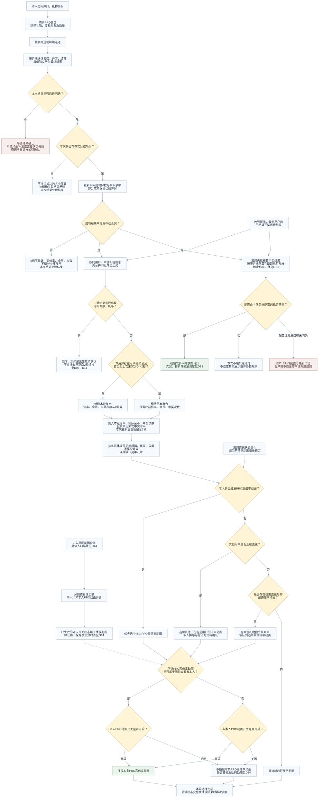
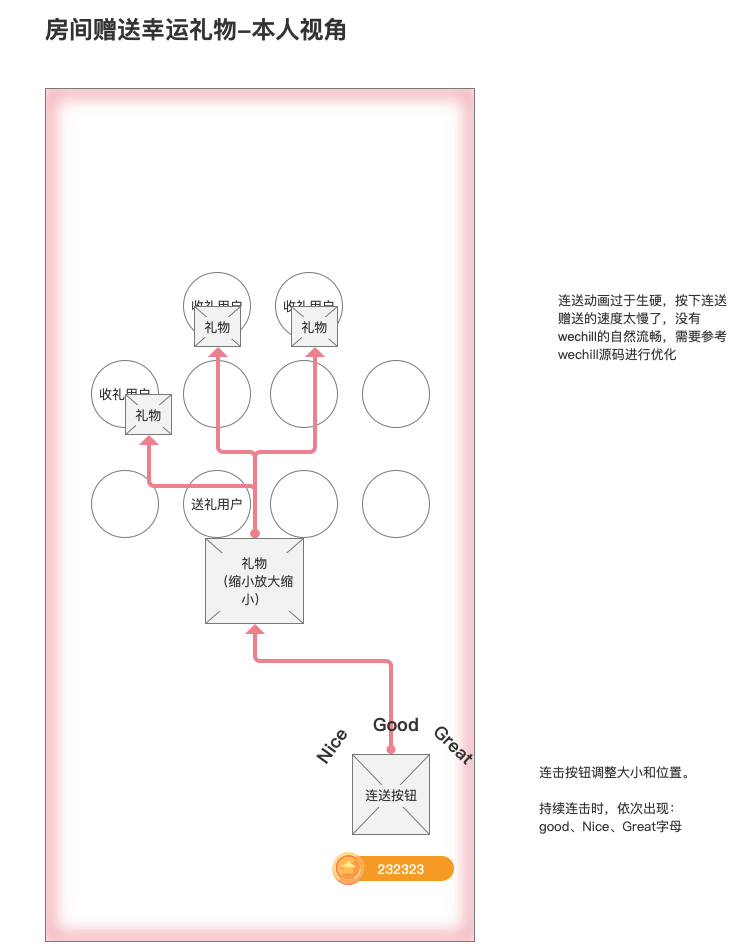
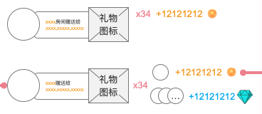
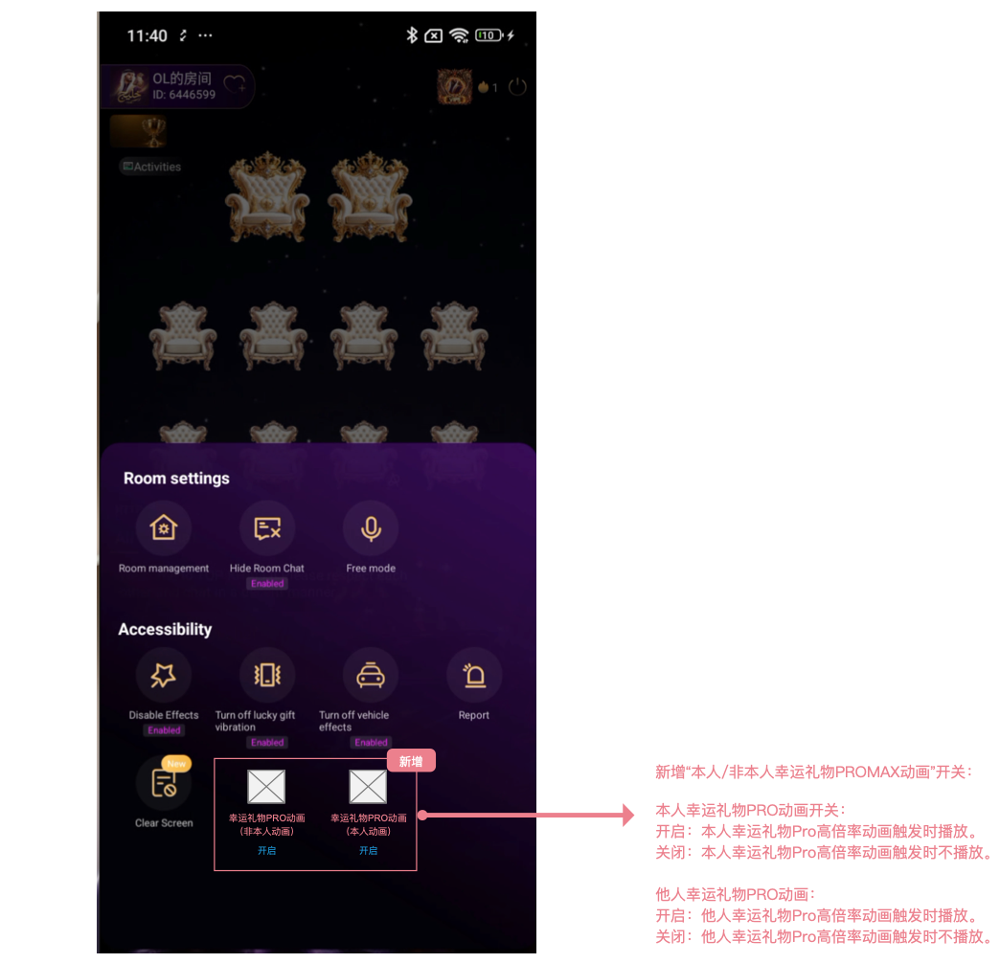

# TOPKHALIJ 幸运礼物 PRO 客户端需求文档

| 文档信息 | 内容 |
|---|---|
| 版本 | V1.0 |
| 适用对象 | 产品、设计、Android／iOS客户端、服务端、测试 |
| 需求范围 | PRO礼物栏、连击动画优化、个人中奖聚合、倍率动画、中奖飘屏、房间跑马灯、房间动画设置、送礼横幅、公屏消息、返奖音效及原型中的今日倍数王者展示 |
| 文档依据 | 当前Axure《幸运礼物2。0》的4个页面及画布旁注；现行服务端开发测试版；个人联动体验模拟器 |
| 状态 | 已确定规则按正文执行；涉及钻石结算、今日倍数王者计算及未给定的展示／调度规则，按第八章待确认项处理，不以原型占位值补齐 |

## 一、需求概述与范围

### 1.1 需求目标

在房间礼物面板中新增幸运礼物PRO礼物栏，优化本人连续赠送的操作与动效，并在服务端成功结算后展示中奖倍率、奖励金币及对应房间反馈。房间内触发服务端配置的指定倍率时，在该房间播放跑马灯。同一用户的连续中奖按“同批合并、后续中奖间隔不超过2秒继续累加”的方案展示。

### 1.2 功能范围

| 模块 | 本次要求 | 对应原型 |
|---|---|---|
| 礼物栏 | 新增PRO分类；区分普通幸运礼物；展示礼物信息与选中态；保留原型中的今日倍数王者展示要求 | 礼物栏 |
| 连击动画 | 调整连送按钮大小、位置；礼物缩放及投向收礼位置；持续连击出现英文反馈；优化连送流畅性 | 连击动画优化 |
| 中奖展示 | 同用户正奖聚合；本人优先的倍率动画；PRO独立飘屏样式；服务端配置指定倍率触发房间跑马灯；横幅返奖刷新；公屏样式；返奖音效 | 幸运礼物PRO |
| 房间动画设置 | 新增本人／非本人PRO高倍率动画独立开关，分别控制对应动画触发后的播放 | 房间动画设置 |
| 客户端与结算衔接 | 按实际成功份数更新送礼结果；处理0倍、正奖、部分成功、结果未知；展示不改变账务和个人策略 | 现行服务端规则、个人联动模拟器 |

本次不新增模拟器中的实验切换、用户切换、自动赠送开关、展示方案选择器、手动清零、参数面板、RTP图表、策略诊断、概率表、实验充值弹窗或本地存档功能。不根据右侧“参考图”新增其独有入口、榜单或装饰字段。

### 1.3 资料使用口径

- **服务端结算、金额和策略**：以现行《高倍幸运礼物全服共享池PRD_V1.0_开发测试版》为准。该稿已采用UTC+3近30自然日滚动，不能沿用模拟器中的全程累计统计替代。
- **页面范围、文案、展示优先级及视觉方向**：以当前Axure页面及画布旁注为准。此前3页未配置可执行交互事件；本次新增“房间动画设置”页也未配置交互事件，页面说明与控件Note为空；画布上的文字旁注是本次需求来源，不把静态原型当成已实现交互。
- **个人中奖聚合**：Axure旁注明确采用模拟器的默认方案1。本稿只定义方案1，不增加固定2秒分段方案或方案切换入口。
- 无来源支持的字段含义、计算公式、触发阈值、权限、埋点和异常恢复方案不作新增定义；相关缺口集中列第八章。

## 二、角色与业务对象

| 对象 | 定义 | 客户端处理范围 |
|---|---|---|
| 本人 | 当前查看房间的登录用户 | 在各自设备上判断“本人动画”优先级，不能把某位房主固定当成本人 |
| 送礼用户 | 当前成功送出礼物、对应单份开奖结果的用户 | 中奖倍率和返奖金币按该用户归属聚合，不与其他用户合并 |
| 收礼用户 | 当前赠送行为的接收对象 | 原型支持显示收礼用户及多个头像；实际多收礼人的份数拆分、钻石归属待确认 |
| 一份成功礼物 | 服务端成功扣费、开奖并完成结算的最小单位 | 包含最终0倍和正奖；不能将一次点击直接当作一份成功 |
| 一批赠送 | 一次赠送所包含的若干份礼物 | 服务端逐份处理；客户端区分计划份数与实际成功份数 |
| 一段连送 | 房间中被识别为开始、持续、结束的赠送过程 | 驱动连击表现、横幅持续刷新及倍率动画调度；正式结束条件见待确认项D05 |
| 一段中奖聚合 | 同一用户按本稿2秒续时规则合并的正奖展示 | 有独立的倍率合计、奖励金币合计和中奖次数，不等于连送成功份数或账务结算单位 |
| 倍率动画／中奖飘屏／送礼横幅／公屏消息 | 原型中四种不同的中奖反馈载体 | 分别按第六章处理，不用修改其中一种代替全部反馈 |
| 房间跑马灯 | 房间内触发服务端配置的指定倍率时播放的房间反馈 | 按6.7处理；与PRO中奖飘屏是否共用载体见D13，不直接套用倍率动画优先级或2秒聚合规则 |
| 本人／非本人PRO动画开关 | 从当前查看者视角，分别控制本人和其他用户触发的PRO高倍率动画是否播放 | 两项独立判断，只控制对应动画播放；状态默认值、保存范围与生效边界见6.8／D14 |

## 三、核心规则

### 3.1 结算结果与客户端展示边界

1. 每份礼物由服务端独立扣费、计提、开奖、返奖，产生唯一最终倍率。客户端不得自行抽奖、按动画次数计算奖励，或把多个奖励来源叠加为同份奖励。
2. 本份奖励金币＝本份实际单价×本份最终倍率。现行价格为40／80／120／200／400／600／1000／2000／3000金币；各礼物名称、图片及价格映射以正式礼物资料为准，不能使用底图中的普通礼物示例价格替代。
3. 成功0倍仍计一次成功赠送和相应投入，但奖励为0，不进入正奖聚合。赠送失败不增加成功份数、中奖次数或奖励。
4. 本人可消费余额以服务端实际资产结果为准。本次单份余额变化＝扣除该份价格＋计入该份实际奖励；一批礼物前份返奖可用于后份消费，不能在客户端把整批总价不足直接等同于必然整批失败。
5. 批量中部分成功时，保留已成功各份及其实际奖励，只停止未成功部分。不能因批次最终未全部完成，撤销已成功结果或隐藏其中奖反馈。
6. 客户端2秒展示到期、连击结束、切换礼物或退出展示不产生补发、退款、重抽或策略重置。
7. 原型出现钻石图标及刷新要求，但现行服务端规则只明确本玩法的金币奖励。钻石受益对象、数量和结算来源见D02；客户端不得把金币按自定比例换算成钻石，也不据“选中双边幸运礼物说明”推定双方获得相同奖励。

### 3.2 时间与状态口径

| 对象 | 时间口径 | 对客户端的约束 |
|---|---|---|
| 服务端投入、返奖、成功份数、大奖次数及RTP判断 | UTC+3含当日至当前业务时刻的最近30个自然日 | 只影响服务端当前开奖判断，不作为前端2秒聚合周期；窗口移动不撤销历史实际奖励 |
| 个人冷却、后续目标、连续未中及大奖暂停记忆 | 持续保存，不因统计记录滚出而清零 | 不因重新登录、切换礼物或展示消失而重置；客户端不增加这些内部策略的进度展示 |
| 用户历史大奖已结算标记 | 账号历史中实际成功结算过≥1000倍后永久保留 | 不把“近期没中奖”当作重新获得首次资格；客户端不展示保证下一份中奖的提示 |
| 本人中奖聚合 | 同批正奖合并；跨组正奖间隔≤2秒续接；每次有效更新后重新展示2秒 | 不按自然日或30日累计；2秒是中奖展示规则，不是赠送会话结束定义 |
| 今日倍数王者 | 原型写“今日”，具体日界线、范围和计算对象未定义 | 不直接套用近30日统计；不得擅自按UTC+3、全服或当前房间生成榜首 |

服务端自然大奖资格、首次补偿、后续目标、连续未中补偿、98%暂停／90%恢复、100份冷却及单份4,500,000金币上限均由服务端判断。客户端仅接收最终结算结果，不通过连击速度、英文反馈档位或聚合倍率改变这些条件。

### 3.3 个人中奖聚合规则

#### 3.3.1 聚合字段

| 字段 | 说明 | 统计方式 | 数据来源 |
|---|---|---|---|
| 本段累计倍率 | 本段已纳入正奖的最终倍率之和 | 当前中奖聚合段累计；不是最高倍率、平均倍率或RTP | 服务端各成功份最终倍率 |
| 本段奖励金币 | 本段已纳入正奖的实际奖励金币之和 | 当前中奖聚合段累计；每份按其结算值相加，不重新发奖 | 服务端实际金币奖励 |
| 本段中奖次数 | 本段纳入聚合的正奖份数 | 一份正奖加1；0倍和失败不增加 | 成功正奖结果 |
| 上次纳入聚合的中奖时间 | 判断后续组是否续接的时间基准 | 当前聚合段最近一份正奖发生时间；生产时钟与乱序规则见D06 | 成功正奖的发生时间 |
| 本次实际成功份数 | 当前批次真正成功的份数 | 当前批次；正奖与0倍都计入，不以请求份数替代 | 服务端本批实际处理结果 |
| 本段连送成功份数 | 当前连送过程已成功的礼物份数 | 当前连送段，按成功份数增长，不按点击数或中奖次数增长；正式结束定义见D05 | 实际成功赠送结果 |

累计倍率＝纳入聚合的各正奖倍率之和；累计奖励金币＝纳入聚合的各正奖实际奖励之和。单份金额上限约束每份服务端实际奖励，不对展示段的奖励合计再次截奖。

**计算示例**：同价80金币的两份结果分别为100倍和150倍，实际奖励分别为8,000和12,000金币；若属于同一聚合段，则展示累计250倍、累计20,000金币、中奖2次。不是按某一份礼物重新结算250倍，也不是把中奖次数当作送礼总次数。

#### 3.3.2 同批合并与跨批续时

1. 先识别服务端本次实际返回的成功结果。只有最终倍率＞0且实际奖励金币＞0的记录进入中奖聚合；不能把未兑现候选、后续目标或等待中的结果当作中奖。
2. 同一批次中连续归为同组的中奖结果先合并展示，不把该组内各中奖记录机械拆成多个固定2秒窗口。批次归组信息只用于展示，不合并各份账务。
3. 以下续接判断仅适用于时间顺序正常的中奖结果：对后续中奖组，比较“该组第一份正奖发生时间”与“当前聚合段最后一份正奖发生时间”，时间差在0～2秒之间（含0和2秒）则续接；大于2秒则开始新的聚合段。首次没有聚合内容时直接新建。时间倒序／乱序不进入已确定的正常续接判断，具体展示策略按D06／D11待确认，不能因负时间差小于2秒就直接续接。
4. 纳入一组后，分别累加倍率、奖励金币、中奖次数，并将该组最后一份正奖时间记为新的比较基准；本次展示更新后重新计时2秒。
5. 中间发生0倍，不增加以上三项，也不单独延长中奖展示。后续正奖能否续接，仍取决于距上次正奖的时间，不取决于0倍发生时间。
6. 2秒内没有新的有效中奖展示更新，则隐藏本段中奖展示。后续是否能接回原聚合，仍按正奖发生时间比较，不能仅以页面是否已经隐藏决定。
7. 不同用户的中奖分别聚合。模拟器在实际单价变化、切换用户或实验时清理当前中奖展示；正式客户端变更礼物价格后，不把新价格结果接入原价格展示段，已结算账务及服务端策略保留。同价不同礼物、多收礼人及跨房间聚合边界见D06。
8. 模拟器遇到后续组时间早于上一组最后中奖时间时另起聚合；该行为仅作为现有展示参考，不当作生产乱序恢复方案。重复、晚到、断线补发结果的去重和恢复边界见D06／D11。

#### 3.3.3 聚合不改变单份规则

- 一段累计倍率可以不是服务端单份奖档，也可能超过单份最高7500倍；不得将其当成新增单份奖档、大奖次数或保证收益。
- 各份奖励按各自实际单价结算。不得用“当前价格×历史累计倍率”重算奖励，更不能因后续切价改写已发奖励。
- 0倍成功份增加送礼成功份数，不增加中奖次数；两种计数必须独立。
- 前端展示清理不清除个人投入、真实余额、冷却、目标或历史首次标记。

### 3.4 客户端业务总流程

下图只表达客户端送礼、接收结果、中奖聚合、动画选择、本人／非本人动画开关判断及服务端配置触发的房间跑马灯；服务端内部开奖条件沿用正式服务端文档，不在客户端复制一套算法。

**读图边界**：图中先选择动画，再按当前查看者与动画归属判断对应开关；关闭的对应高倍率动画不播放。图中的动画选择表示调度优先级，不表示本人动画必然立即打断当前动画。完整的抢占、暂停与恢复规则见D08；开关关闭后的转播、待播保留与重新开启补播见D14，不把关闭本人动画等同于本人未触发连送。横幅、飘屏、公屏各自的触发门槛未给定，不表示每份正奖必然同时产生三种消息。跑马灯判断与中奖聚合分支分别处理；命中服务端配置的指定倍率才播放，不以2秒聚合完成、本人动画优先级或连送结束作为已确认前提。跑马灯使用单份还是聚合倍率及具体匹配规则见D13，图中不预设。

## 四、礼物栏

### 4.1 入口与PRO分类

**功能说明**：在现有房间礼物面板内增加幸运礼物PRO礼物栏，与普通幸运礼物分类区分。原型中普通“幸运礼物”与带“PRO MAX”标记的“幸运礼物”同时存在，不合并成同一个分类。

**对应原型**：礼物栏整页，包含当前选中示意、PRO标记及原始旁注。

**前置与触发**：用户已进入房间并打开礼物面板；选择新增PRO分类后查看对应礼物。原型中的“未选定收礼人”、赠送数量选择、余额和去充值入口保留各自既有作用；当前素材没有定义新的收礼人选择、数量选项或充值流程，本稿不另行扩展。

| 字段 | 说明 | 统计方式 | 数据来源 |
|---|---|---|---|
| 普通幸运礼物分类 | 原有普通玩法入口 | 当前面板分类状态 | 现有客户端礼物分类 |
| PRO分类与标记 | 新增玩法分类；原型可见PRO MAX标记 | 当前面板分类状态；最终展示名称见D01 | 正式分类资料、视觉稿 |
| 礼物图片、名称、单价 | 当前PRO礼物的展示信息 | 当前所选礼物；单价为实际金币价格 | 正式礼物资料；价格基线见3.1 |
| 礼物选中态 | 当前将要赠送的礼物 | 当前选择，原型为完整卡片高亮描边 | 本页选择状态 |
| 金币／钻石标识 | 原型在礼物附近包含两种币种标记；不据此推定双方返奖比例 | 当前礼物相关展示，具体含义见D02 | 原型控件、正式礼物及币种规则 |
| 收礼对象 | 本次赠送接收人 | 当前赠送选择；多收礼人拆分见D02 | 现有收礼人选择结果 |
| 赠送数量 | 当前计划赠送份数 | 本次选择，不等同于成功份数 | 现有数量选择结果 |
| 可消费金币余额 | 用户当前实际可消费资产 | 实时资产，不按30日窗口截断 | 服务端账户结果 |

**交互与状态**：

1. 普通幸运礼物与PRO使用各自分类标识和礼物资料。不能因底图复用了旧礼物列表，就把普通礼物示例认作新增PRO礼物清单。
2. 点击礼物后更新整张卡片的选中表现，并以所选礼物实际价格参与后续赠送。原型未定义新的默认选中项、分页数量或首次进入默认分类，不新增固定值。
3. 切换分类或礼物不能删除已结算结果。实际价格变更时，中奖聚合展示按3.3处理；服务端个人统计和持续策略不重置。
4. 礼物尚未确定、收礼对象不完整或赠送结果未明确时，不能通过播放中奖效果伪造赠送成功。具体入口校验与提示沿用已存在流程，素材未定义的新提示不自拟固定文案。

**系统后台核心逻辑**：服务端按本次实际礼物价格和逐份规则结算；前端分类与视觉标记不改变概率、资金约束或奖励路径。普通幸运礼物与PRO的正式礼物组边界及共池关系见D01／D12，不因放在同一面板就合并账务。

**边界与异常**：礼物资料缺失、下架、价格变化或余额变化时，不把界面旧值当作成功结算依据；具体已有提示与失败处理复用原流程，缺失口径见D11。原型未展示新空列表、错误页或活动限制页面，不据此增建。

### 4.2 今日倍数王者展示

**功能说明**：保留原型中位于礼物面板上方的用户展示卡片，呈现用户头像、名称、“今日倍数王者”标记及“最高倍数”。它是独立展示块，不自动扩展为可点击排行榜入口。

| 字段 | 说明 | 统计方式 | 数据来源 |
|---|---|---|---|
| 用户头像、名称 | 卡片对应用户身份；“倍王”为原型示例 | 当前展示对象 | 正式王者结果，提供方式待确认 |
| 今日倍数王者 | 原型中的展示标记 | 标签含“今日”；日界线和参选范围见D03 | 已确认标题、正式结果 |
| 最高倍数 | 原型需要显示的倍率数值 | 是单份最高、某段聚合最高还是其他口径，见D03 | 正式王者结果，不由客户端自行推算 |

**交互与状态**：原型没有配置点击跳转、奖励领取、轮播、空榜或并列状态。保留展示位置和字段，选人规则、刷新时点、空数据表现见D03；不以占位数字制定倍率上限，也不把本人的当前2秒累计倍率直接当作今日最高值。

**系统后台核心逻辑与异常**：现行共享池服务端文档未定义每日王者计算。正式口径确认前，不从近30日统计拼出榜首，不把客户端暂未拿到数据当作“当前无人中奖”，也不发放额外王者奖励。

### 4.3 视觉物料方向

PRO礼物样式、中奖物料尽可能接近海湾国家与地域元素，落实到礼物图片、倍率效果、飘屏和返奖表现。该要求是美术方向，不新增国籍判断、国家准入、语言切换入口或差异化中奖规则。具体物料以最终视觉稿为准。

## 五、连击动画优化

### 5.1 本人连续赠送与礼物运动

**功能说明**：优化当前连送动作生硬、按下连送后反馈偏慢的问题；旁注要求参考wechill源码及自然流畅的连送体验，不把模拟器自动赠送间隔作为正式客户端节奏。

**前置与触发**：用户在房间中赠送幸运礼物并持续连击；以实际成功赠送结果更新成功计数和对应反馈。客户端操作反馈与服务端已成功结算结果须区分，不能将按压次数当作真实成功份数。

| 字段 | 说明 | 统计方式 | 数据来源 |
|---|---|---|---|
| 送礼用户 | 本次赠送动作主体 | 当前赠送 | 当前用户与服务端成功结果 |
| 收礼位置 | 原型中礼物运动的目标位置 | 当前成功赠送对应对象 | 房间收礼对象及位置 |
| 礼物图片 | 当前赠送礼物的动效主体 | 当前礼物 | 正式礼物物料 |
| 连送按钮 | 连续赠送操作控件，调整大小与位置 | 当前房间交互状态 | 原型布局、最终视觉稿 |
| 连送成功份数 | 当前连送段内真正成功份数 | 按成功份数累加，含成功0倍 | 服务端成功结果 |
| 英文反馈 | 持续连击的阶段性表现 | 原型顺序good、Nice、Great；阈值见D04 | 连击状态与最终动效规范 |

**交互与视觉**：

1. 调整连送按钮的尺寸、位置，使其与原型中礼物运动路径配合；具体尺寸、点击区域与适配值以最终设计稿为准，不从Axure画布像素直接推导所有机型的实现尺寸。
2. 原型中的中央动效对象为“礼物”，依次执行缩小→放大→缩小，再按图示路径表现赠送至对应收礼位置。不得写成用户头像放大缩小。
3. 原型画出多个收礼目标，只确认需要有对应收礼位置的表现；不能据箭头推定多人同时派奖、额外复制奖励或改变单份计费方式。多人赠送规则见D02。
4. 持续连击时按旁注顺序出现good、Nice、Great。原型控件写Good、旁注写good；正式大小写、各档触发次数／时长、回退与重置条件见D04，不擅加“第几次必升级”的阈值。
5. 连送过程中的正奖按3.3更新中奖聚合；未中奖的成功赠送仍可增加送礼成功数，不能因没有正奖就把成功计数停住。
6. 原型底部数字为未标明业务含义的示例，不把它直接定义为余额、中奖金额或连击次数。最终字段位置见D04。

**系统后台核心逻辑**：连送与批量均复用逐份开奖和结算；连击英文档位、按压速度及动画是否显示不改变中奖权重和补偿资格。

### 5.2 连送状态与结束边界

| 状态／场景 | 已确定处理 | 尚需确认的边界 |
|---|---|---|
| 当前连送持续成功 | 按成功份数增加计数；有正奖才增加中奖聚合 | 正式连送起止信号与判定阈值，见D05 |
| 一批部分成功 | 已成功份保留；未成功份不增加计数和奖励 | 停止动作在正式客户端的响应边界，见D05／D11 |
| 中奖展示2秒到期 | 隐藏该段中奖表现，不撤销已发奖励 | 不能由此直接判定本段连送结束 |
| 用户切换实际礼物价格 | 新价格不续接旧价格中奖展示；个人策略不清零 | 同价换礼物、换收礼人是否重启连送，见D06 |
| 送礼失败或结果未知 | 不凭按钮反馈计成功；保留已确认结果 | 结束连送、提示、查询及重试方式，见D11 |

个人联动模拟器使用5秒无成功新增清理本页连送计数，但Axure没有确认正式连送超时采用5秒。本稿不将该实验值直接写成房间连送结束规则，也不把2秒中奖续时与5秒实验计数混成同一计时器。

## 六、幸运礼物PRO中奖展示

### 6.1 公共视角与展示载体

**功能说明**：房间内按当前查看者的本人／他人关系展示倍率动画，并分别调整PRO飘屏、送礼横幅和公屏消息；房间跑马灯按服务端配置的指定倍率触发。以下原始画布右侧带“参考图”的截图只作视觉参考，不向本版复制其中独有字段或交互。

| 载体 | 作用 | 与其他载体的区别 |
|---|---|---|
| 中奖飘屏 | 带用户信息、返奖信息、倍率的飘屏表现 | PRO与普通幸运礼物须区分为两种类型 |
| 倍率动画 | 突出当前用户或他人的倍率表现 | 按6.3优先级选择，使用独立动画队列；PRO高倍率动画播放须6.8对应开关开启 |
| 送礼横幅 | 展示送礼人与收礼人、礼物、数量及返奖增量 | 同个连送中中奖时，金币／钻石对应数量实时跳动刷新 |
| 公屏消息 | 房间消息区域的幸运礼物返奖卡片 | 独立调整公屏样式，不以飘屏或横幅替代 |
| 房间跑马灯 | 房间内触发服务端配置的指定倍率时播放 | 按6.7执行；是否与PRO中奖飘屏共用载体见D13，不直接视为6.3倍率动画队列成员 |

接收房间内他人的中奖结果时，只更新对应用户的展示，不增加本人的连送成功份数、中奖次数或账户余额。房间连送状态变化和当前倍率动画结束均可触发下一轮调度，不必等待本人下一次送礼。

### 6.2 PRO中奖飘屏

**对应原型**：顶部飘屏局部控件，保留头像、名称、奖励描述、金币标记和倍率区域。

**前置与触发**：存在已成功结算的正奖且满足正式飘屏展示条件。旁注确认需要PRO类型与分档样式，但没有定义全服广播、跨房间范围或最低触发倍率，具体见D07，不把“公共视角”自动解释为全服飘屏。新增房间跑马灯的已确认触发规则见6.7；两者是否共用载体及配置见D13，不用跑马灯旁注替代本节尚未确认的飘屏分档与范围。

| 字段 | 说明 | 统计方式 | 数据来源 |
|---|---|---|---|
| 用户头像、名称 | 本条展示的中奖用户 | 当前中奖展示对象 | 用户资料及成功结果归属 |
| 赠送／返奖描述 | 用户赠送幸运礼物并获得奖励的描述 | 本次展示内容；涉及单份还是聚合段见D07 | 正式结果及最终文案 |
| 奖励金币 | 对应展示内容的实际奖励金币 | 单份实际值或聚合值需统一确认，不能混用 | 成功结算奖励 |
| 倍率标记 | 与本条展示内容对应的倍率 | 单份或聚合口径见D07 | 最终倍率或本段累计倍率 |
| 类型与样式档 | PRO类型与对应倍率范围的视觉效果 | 当前展示类型、分档 | 最终分档规则与物料 |

**交互与状态**：普通幸运礼物和PRO必须可区分，不仅替换文案。不同倍率范围使用不同样式；阈值、样式、播放时长和溢出处理见D07。原型中的“x500”为示例，不是固定触发档位。

**系统后台核心逻辑与异常**：展示不新增奖励，不将尚未实际支付的候选奖广播为中奖。未得到已确认展示条件和素材时，不以随机样式或自定阈值补齐。

### 6.3 倍率动画、优先级与独立队列

**前置与触发**：房间内产生可展示的幸运礼物倍率动画，或当前展示／连送状态变化后需要选择下一内容。PRO高倍率动画实际播放前，还须按6.8检查对应的本人／非本人动画开关；关闭对应项时不播放。原型称“高倍动画”，但画面含500倍示例；不能直接把服务端“≥1000倍大奖”定义为该动画唯一触发门槛，正式条件见D07。

| 字段 | 说明 | 统计方式 | 数据来源 |
|---|---|---|---|
| 展示用户 | 当前动画对应的送礼／中奖用户 | 当前播放对象 | 正奖归属与当前用户关系 |
| 展示倍率 | 本人连续中奖按3.3聚合；他人结束连送时有最终倍率展示要求 | 本人当前聚合段；他人最终倍率与跨段关系见D09 | 成功结果、对应聚合与连送状态 |
| 奖励说明 | 用户与返奖信息条 | 当前播放对象对应的奖励内容 | 用户资料、成功奖励 |
| 连送状态 | 本人或他人是否正在连送、是否已经结束 | 当前房间状态，正式判定见D05 | 正式房间连送状态 |
| 样式档位 | 不同倍率范围展示不同效果 | 当前展示倍率的分档；使用单份还是聚合值见D07 | 最终分档规则 |

**调度顺序**：

1. 优先选择当前查看者本人的PRO高倍率动画；对应本人开关开启时播放，关闭时不播放。每个客户端均从自身视角判断，不要求房间所有人同时观看同一位用户。
2. 本人未触发连送动画时，选择其他正在连送用户的倍数动画；属于PRO高倍率动画时，非本人开关开启才播放。
3. 房间内没有用户正在连送时，选择其他用户结束连送后的最终倍率动画；存在多个时按队列处理。属于PRO高倍率动画时，实际播放仍须非本人开关开启，不能因已进入最终动画队列就绕过设置。
4. 幸运礼物倍率动画使用独立动画队列，不与普通礼物动画、CP礼物动画混排。该要求不等同于定义三类动画之间的遮挡层级或全局互斥。
5. 以上明确的是选择优先级。本人开始连击时是否立即打断已经播放的他人动画、多个正在连送用户的排序、被打断内容是否恢复、队列过长时如何处理，均见D08，不自行增加丢弃或强制抢占规则。
6. 本人没有正奖、本人未触发连送动画、本人PRO高倍率动画开关关闭是不同条件；不能把“本人本次0倍”或“本人动画关闭”直接写成允许转播他人动画的依据。关闭本人项后是否转播他人，见D14。

**状态与边界**：本人优先／他人连送展示／结束后的最终动画队列／无内容等待为展示状态，不是用户中奖资格。最终动画是否重复已播放的实时聚合、最终倍率涵盖整段连送还是最后一个中奖聚合段，见D09；不能默认重复播放全部历史中奖。

### 6.4 送礼横幅与金币、钻石实时跳动

**功能说明**：调整送礼横幅中的返奖表现。同一个连送过程中，中途中奖新增金币或钻石时，在对应返奖区域实时跳动刷新数量，不等整段连送结束才刷新。

原型同时画出上下两组横幅，但未标注旧版／新版。下方包含金币与钻石分列及收礼头像聚合示意；不能据此要求两组横幅同时常驻，最终采用哪种结构见D10。裁图中的粉色线条属于旁注指示，不是正式横幅装饰。

| 字段 | 说明 | 统计方式 | 数据来源 |
|---|---|---|---|
| 送礼用户头像、名称 | 横幅对应的赠送者 | 当前横幅归属 | 送礼用户资料 |
| 收礼用户信息 | 名称及头像组合；原型含多个收礼人 | 当前赠送对应对象；聚合与省略规则见D02／D10 | 正式收礼对象 |
| 礼物图标 | 当前赠送礼物 | 当前礼物 | 正式礼物物料 |
| 赠送数量 | 原型中的x34数量区域 | 需明确本批还是本段连送成功份数，见D10；不能当作中奖次数 | 成功赠送结果 |
| 金币返奖数 | 横幅对应的金币累计展示 | 同段连送中按实际奖励新增实时刷新；与2秒中奖段的汇总边界见D10 | 实际金币奖励 |
| 钻石数 | 原型要求的钻石奖励展示区域 | 同段连送中有已确认新增时实时刷新；计算与归属见D02 | 正式钻石结算结果，当前服务端稿未定义 |

**交互与状态**：

1. 已展示的同段连送横幅，在新中奖金额得到确认后更新对应数字并产生跳动效果；金额和币种必须对应，不能把金币数同步复制到钻石区域。
2. 用户、礼物及收礼对象信息须对应当前横幅，不与另一用户的中奖聚合合并。具体多人头像堆叠数量、名称省略、金额格式见D10。
3. 中奖聚合次数、连送成功份数、横幅赠送数量是不同字段。原型x34不是“中奖34次”的证明。
4. 当前正式资料没有钻石计算时，不自算、不虚增；钻石展示最终是否启用及如何取值，须按D02确认后执行。金币明确规则不被钻石缺口改写。
5. 横幅内返奖数字更新不等于再更新一次账户奖励；钱包仍按服务端实际资产结果刷新，不能重复入账。

**系统后台核心逻辑与异常**：横幅只消费已确认的赠送与奖励事实。已成功部分继续保留；结果未知不先增奖、超时后又回扣。具体延迟、重复结果和断线恢复见D11。

### 6.5 幸运礼物公屏消息

**功能说明**：单独调整幸运礼物公屏卡片样式，表现赠送用户、幸运礼物返奖描述、金币奖励及倍率标记，不用横幅或飘屏替代。

| 字段 | 说明 | 统计方式 | 数据来源 |
|---|---|---|---|
| 用户／赠送描述 | 原型中的用户赠送幸运礼物描述 | 对应本条消息的赠送事实 | 用户资料、正式展示文案 |
| 获得金币 | 本条消息对应的实际奖励 | 单份还是聚合消息见D10；必须与消息倍率口径一致 | 实际金币奖励 |
| 倍率标记 | 原型右侧独立倍率区域 | 与本条消息奖励口径一致 | 结算倍率或已确认聚合结果 |
| 卡片样式 | 幸运礼物消息的外观 | 当前消息类型及视觉规范 | 最终视觉稿 |

**触发与状态**：原型没有定义每份发一条、每段发一条、仅结束后发、触发倍率、保留条数或点击跳转。按D10确认生成与刷新口径，不将每个数字更新都自行扩成新消息。

**系统后台核心逻辑与异常**：消息表达真实已结算奖励，不能将每份最终倍率拼成另一笔资产。延迟展示或重复消息的处理与D11衔接，不通过公屏补发金币。

### 6.6 返奖音效与物料

旁注明确“返奖需要音效”，本次须配套返奖音效，不以仅有倍率画面代替。PRO飘屏和倍率动画按不同倍率范围区分视觉效果，整体物料遵循海湾地域方向。6.8新增开关仅明确控制PRO高倍率动画，是否同时影响返奖音效见D14，不据此新增音效联动规则。

是否每份返奖播放、按聚合更新播放还是按最终动画播放，及多个音效的叠加、限频、与既有音量设置的关系见D07。素材未给定前不新增音效开关、不固定播放次数，也不把高倍率字样认作新的中奖档位。

### 6.7 房间跑马灯

**对应原型**：见6.1最新PRO整页原型底部旁注：“房间跑马灯需要根据服务端配置，房间内触发指定倍率时播放跑马灯。”当前仅新增触发说明，未提供独立跑马灯控件或后台配置页面，不据此新增页面字段或后台操作功能。

**触发与播放规则**：

1. 房间跑马灯根据服务端配置触发。房间内产生已成功结算的中奖结果，命中服务端配置的指定倍率时，在触发房间播放跑马灯；不限定为当前查看者本人中奖才播放。
2. 未命中指定倍率，不因本次中奖触发跑马灯；其他倍率动画、飘屏、横幅、公屏仍按各自规则处理。不能把“任意正奖”“达到1000倍大奖”或原型中的“500倍”示例直接作为固定跑马灯触发条件。
3. “指定倍率”的具体数值、匹配方式，以及取单份最终倍率、本段聚合倍率还是连送最终倍率，见D13。客户端不得自行将其解释为“达到某倍率及以上”，也不得直接套用3.3的倍率累加结果判断触发。
4. 本条已确认的是触发房间内播放，不据此新增全服或跨房间广播。跑马灯与6.2 PRO中奖飘屏是否共用载体／配置，以及播放位置、内容与物料，见D13。

6.8的本人／非本人PRO高倍率动画开关是否联动房间跑马灯，原型未说明，见D14；本节服务端配置触发规则不因此自动取消。

**服务端配置与展示衔接**：下表为业务配置／结果口径，不代表新增后台表单或客户端可见字段。

| 项目 | 已确认口径 | 尚需明确 |
|---|---|---|
| 跑马灯指定倍率 | 由服务端配置决定触发条件，客户端不写死倍率 | 具体倍率值、匹配方式、单份／聚合／最终倍率口径 |
| 触发归属 | 中奖结果归属房间内的对应用户，在触发房间播放 | 适用礼物范围及是否与普通幸运礼物共用配置 |
| 播放内容 | 对应实际已结算的中奖事实；播放不新增奖励 | 正式文案、展示字段、倍率与奖励金额口径、资源及播放位置 |
| 配置生效与获取异常 | 以服务端配置为依据，不自设默认倍率或沿用模拟器参数 | 配置更新何时生效、待播内容采用哪版规则、未配置／读取失败时的处理 |

**状态、调度与异常**：

- 命中配置时播放；未命中时不触发。配置或触发口径未明确时，按D13补齐，不将缺口解释为固定阈值、默认开启或默认关闭规则。
- 跑马灯是否排队、多人同时触发时的顺序／频控、与其他动画的层级或互斥关系，见D13；不直接沿用6.3的“本人优先”或幸运礼物独立倍率动画队列。
- 重复、晚到、乱序、断线重连以及退房／切房时的去重、待播清理与补播，见D11／D13。一次播放、重复播放或播放失败均不改变已结算金额、中奖次数及个人策略，也不触发再次派奖。

### 6.8 房间动画设置

**页面定位与范围**：在原型“Room settings”面板的“Accessibility”区域，新增两个幸运礼物PRO动画开关。页面底部从左到右为既有“Clear Screen”、新增“非本人动画”、新增“本人动画”。本节只补两项新增设置，既有房间管理、普通动效、幸运礼物震动、座驾动效、举报和清屏功能沿用，不重新定义。

**新增字段与状态**：

| 页面字段 | 位置／类型 | 业务定义 | 开启 | 关闭 | 来源与取值边界 |
|---|---|---|---|---|---|
| 幸运礼物PRO动画（非本人动画） | 新增区域左侧，独立开关 | 当前查看者设备上，其他用户触发的幸运礼物PRO高倍率动画播放控制 | 对应他人高倍率动画触发时播放 | 对应他人高倍率动画触发时不播放 | 画布旁注中的“他人”对应控件“非本人”；原型显示“开启”，不代表默认值已确认 |
| 幸运礼物PRO动画（本人动画） | 新增区域右侧，独立开关 | 当前查看者设备上，本人触发的幸运礼物PRO高倍率动画播放控制 | 对应本人高倍率动画触发时播放 | 对应本人高倍率动画触发时不播放 | 归属按动画对应用户与当前查看者关系判断；原型显示“开启”，不代表默认值已确认 |

旁注总述使用“本人／非本人幸运礼物PROMAX动画”，具体规则及控件使用“PRO／Pro”；本稿按现有PRO称呼衔接，最终对外名称与D01统一，不拆成额外玩法或第三个开关。

**交互与播放判断**：

1. 用户可分别切换本人、非本人两项。切换其中一项，不联动修改另一项；当前查看者的“本人／非本人”不能按房主、收礼人或固定用户划分。
2. 动画触发后，按动画归属读取对应设置；对应项开启时按6.3调度播放，关闭时不播放对应的PRO高倍率动画。不是关闭整个幸运礼物玩法，也不是停止送礼或屏蔽结算结果。
3. 本人优先与开关控制同时成立：优先级不能使已关闭的本人动画继续播放，非本人动画也不能通过正在连送或最终倍率队列绕过关闭状态。本人项关闭后是否立即改播他人，原型未说明，见D14；不擅自新增回退、抢占或恢复规则。
4. 两项控制对象仅为旁注明确的PRO高倍率动画。不将其扩为5.1礼物缩放、投向收礼人、按钮及good／Nice／Great连击反馈的总开关；飘屏、横幅、公屏、房间跑马灯和返奖音效是否与其联动，资料未说明，见D14，原有各模块规则不因本节自动改写。
5. 原型没有定义点击即生效、单独保存或退出保存，也未展示新增确认、取消、成功提示或关闭按钮。不新增这些交互；具体入口路径、状态加载、保存方式与生效时点见D14。

**两项组合与对应触发结果**：下表以对应设置状态已生效为前提，只定义动画触发时的播放许可；具体生效时点见D14，同时触发顺序仍按6.3／D08处理。

| 本人项 | 非本人项 | 本人PRO高倍率动画触发 | 他人PRO高倍率动画触发 |
|---|---|---|---|
| 开启 | 开启 | 允许按原调度播放 | 允许按原调度播放 |
| 开启 | 关闭 | 允许按原调度播放 | 不播放 |
| 关闭 | 开启 | 不播放；是否转播他人见D14 | 允许按原调度播放 |
| 关闭 | 关闭 | 不播放 | 不播放 |

**后台衔接与异常边界**：

- 开关只控制对应动画播放，不改变扣费、逐份结算、实际返奖、2秒聚合统计、成功份数及个人策略，也不将当前查看者的关闭操作变成其他用户设备的统一禁播规则。
- 默认状态、账号／设备／房间维度的保存范围、重进房间和重新登录后的恢复、多端同步，以及状态读取或保存失败时的处理见D14；不自设默认开启、失败回滚或云端同步方案。
- 播放中切换是否立即停止、已入队动画是否保留／清理、再次开启是否补播关闭期间内容、切房时如何处理见D14，并与D08／D11衔接。明确不播放不等于已确认“删除队列”或“下次全部补播”。
- 本次Axure页面的交互事件、页面说明及控件Note为空；以上开启／关闭业务来自画布旁注，不能将静态稿表述为已实现的可操作演示。

## 七、跨模块边界与异常

| 场景 | 客户端确定行为 | 不能推导的行为／未决边界 |
|---|---|---|
| 成功0倍 | 更新实际成功份数与账户结果，不新增中奖倍率／金币／次数，不延长中奖展示 | 不据此清除服务端策略或强行结束整段连送 |
| 一批多份正奖 | 逐份账务不变，按3.3同批归组再展示聚合 | 不共用一次开奖、不把批次数当中奖次数 |
| 后续正奖恰好相隔2秒 | 按≤2秒续接，更新后重新展示2秒 | 不改成固定2秒分段清零 |
| 正奖间隔超过2秒 | 新建中奖聚合段 | 不据此把连送成功计数或服务端窗口统计清零 |
| 同批中途余额不足 | 保留此前已成功结果及奖励；未成功部分不计数 | 不回滚整批、不透支补足、不重放已成功份 |
| 单价改变 | 新价格不续接旧价格展示；历史每份金额不重算 | 冷却、目标、未中和历史首次标记不重置 |
| 聚合倍率超过7500倍 | 保持展示累计值与实际奖励之和的含义 | 不能当作单份超过最高奖档；展示格式见D07 |
| UTC+3跨日 | 服务端下一份按新30日窗口判断，已发奖和真实余额保留 | 不清除当前2秒展示、不重新发历史首次奖；“今日王者”另见D03 |
| 本人／非本人PRO动画项关闭 | 对应用户归属的PRO高倍率动画触发时不播放，另一项保持独立 | 播放中停止、队列保留／清理、重新开启补播、本人关闭后的转播与其他载体联动见D14；不改账务及中奖统计 |
| 本人开始连击且他人动画在播 | 后续调度遵守本人优先及6.8对应PRO高倍率动画开关判断 | 是否立即打断、恢复或丢弃，见D08 |
| 房间有多个他人正在连送 | 优先考虑正在连送用户，而非结束后的最终动画 | 多个正在连送者的排序见D08 |
| 房间无人正在连送，多个最终动画待播 | 在幸运礼物独立队列中按队列播放 | 队列顺序依据、数量上限、过期和切房清理见D08 |
| 房间内中奖命中跑马灯指定倍率 | 按服务端配置在触发房间播放跑马灯 | 单份／聚合倍率口径、匹配方式、配置生效及播放调度见D13；不自动扩为全服广播 |
| 同段中途新增金币／钻石 | 对已确认的对应币种数量实时跳动刷新 | 不自定钻石金额，不把横幅更新当作再次入账 |
| 网络超时、结果未知 | 不凭超时推断失败，不先加虚拟奖励，不直接重送已可能结算的份 | 查询、重试、防重及最终提示见D11 |
| 重复／晚到／乱序结果 | 不将其当然视为新的可发奖励，原实际结算不变 | 生产展示去重、顺序与断线恢复见D06／D11 |
| 退房、切房、前后台、重新登录 | 不改变服务端真实资产与持续策略 | 本地动画／队列保留或清理、是否补播见D08／D11 |

上述规则限定展示与账务不互相污染；不表示正式并发、退款、撤销和跨设备恢复已定义。资产中途失败、退款对个人状态的影响仍沿用服务端文档第七章待确认范围。

## 八、待确认事项

| 编号 | 主题 | 已确认要求 | 需补齐的决策及影响章节 |
|---|---|---|---|
| D01 | 分类名称与礼物范围 | 新增PRO礼物栏，原型同时显示“幸运礼物”和PRO MAX标记；房间动画设置标签写PRO、旁注总述写PROMAX | 最终对外名称及设置项命名一致性；正式PRO礼物名称、图片与九档价格映射；普通／PRO礼物组及共池边界。影响4.1、6.2 |
| D02 | 双边、多收礼人与钻石 | 画布标题含“双边”；横幅需要金币、钻石数量；图中有多个收礼人 | 谁获得金币／钻石；钻石计算与实际结算来源；多收礼人是否按人拆份、各自费用与中奖归属；头像数量对应规则。影响2、3.1、4.1、5.1、6.4 |
| D03 | 今日倍数王者 | 原型包含头像、名称、今日倍数王者、最高倍数 | 今日时区与日界线、当前房间还是全服、单份还是聚合倍率、参选礼物范围、并列、无数据、刷新和是否可点击。影响3.2、4.2 |
| D04 | 连击动效规格 | 按钮调整尺寸位置；礼物缩小→放大→缩小；依次good、Nice、Great；参考wechill源码优化 | 正式源码／实现参考位置、发送与动画节奏、各英文档位触发阈值与大小写、重置条件、底部示例数字含义、机型适配。影响5.1 |
| D05 | 正式连送起止 | 连送状态用于动画优先级和实时返奖；成功计数与中奖计数不同 | 开始／持续／结束条件，是否采用模拟器5秒实验超时、停止和失败如何结束、房间内他人连送状态如何一致。影响2、3.4、5.2、6.3 |
| D06 | 聚合归组与时间 | 同用户正奖求和；同批合并；跨组≤2秒续接 | 正式批次归组依据、统一时间基准、同价不同礼物／换收礼人／多人／跨房间边界，乱序与晚到的展示策略。影响3.3、6.3、7 |
| D07 | 倍率分档、飘屏与音效 | PRO与普通飘屏分型；不同倍率范围不同样式；返奖配音效 | 各载体触发门槛及范围、使用单份还是聚合倍率分档、分档值、超大累计值格式、飘屏时长、音效资源及频次／叠加。影响6.2、6.3、6.6 |
| D08 | 倍率动画队列调度 | 本人优先→其他正在连送→无人连送时最终倍率队列；独立于普通礼物和CP队列；PRO高倍率动画播放须对应本人／非本人开关开启 | 当前动画是否可抢占、多个正在连送者的排序、最终队列顺序依据、恢复／丢弃／去重、队列容量及过期、切房和前后台清理、层级关系。影响3.4、6.3、7 |
| D09 | 最终倍率动画口径 | 他人结束连送后需要最终倍率动画，多个按队列播放 | 最终倍率涵盖整段连送还是最后一个2秒中奖段；与已播放实时动画是否重复、0正奖连送是否产生最终动画。影响6.3 |
| D10 | 横幅与公屏规格 | 横幅返奖样式调整、同段中途金币／钻石实时跳动；公屏单独调整 | 两组横幅最终采用关系、x数量字段口径、横幅累计与2秒中奖段的边界、头像省略、名称／金额格式、公屏生成条件与单份／聚合消息策略。影响6.4、6.5 |
| D11 | 正式异常与多端衔接 | 仅成功份计数；部分成功保留；未知结果不伪造资产 | 超时查询、重试、防重、重复回执、断线重连／重新登录、跨设备、切房／前后台补播，已有入口提示与扣费后派奖失败／退款恢复。影响4.1、5.2、7 |
| D12 | 服务端接入归属 | 九档价格共用个人统计与持续策略；UTC+3近30日统计、真实资产连续 | 正式账号与礼物组、跨房间／设备归属、旧数据迁移及配置变更，继续按服务端文档第七章确认。影响3、4.1、7 |
| D13 | 房间跑马灯配置与播放 | 根据服务端配置，房间内触发指定倍率时播放跑马灯 | 指定倍率值与匹配方式、单份／聚合／连送最终倍率口径、适用礼物范围、与PRO中奖飘屏是否共用载体／配置、配置生效及读取失败处理、正式文案／字段／素材／位置／时长、多人队列／频控／层级、去重与切房／重连补播。影响2、3.4、6.1、6.2、6.7、7，并与D07／D08／D11区分关联 |
| D14 | 房间动画设置生效与恢复 | 新增本人／非本人独立开关；各自开启时对应PRO高倍率动画触发后播放，关闭时不播放；不改变结算 | 默认值、入口路径、状态加载及读取失败、保存方式／失败反馈／生效时点、账号／设备／房间保存范围、重进／登录／多端恢复；本人关闭后的转播；播放中切换、队列保留／清理、再次开启补播及切房处理；飘屏／横幅／公屏／跑马灯／音效联动。影响2、3.4、6.3、6.6、6.7、6.8、7，并与D01／D08／D11衔接 |

未确认项不能用本地模拟器的实验实现、原型示例数字或视觉参考图补成正式业务规则。各项确认后，应同步其列明的关联章节，不只在本表末尾追加答案。

## 九、来源与覆盖索引

### 9.1 来源

| 来源 | 定位 | 本稿采用内容 |
|---|---|---|
| 当前Axure《幸运礼物2。0》 | 幸运礼物PRO页：7165142f-e7cd-4ab6-8505-382245f46077 | PRO与普通飘屏区分、倍率样式、独立队列、本人优先、他人连送与最终动画队列、默认方案1、横幅、公屏、币种跳动、音效、服务端配置指定倍率触发房间跑马灯 |
| 当前Axure《幸运礼物2。0》 | 礼物栏页：5cca7e9c-5640-4647-8af5-79f122d3d835 | PRO分类、今日倍数王者展示块、海湾地域物料方向 |
| 当前Axure《幸运礼物2。0》 | 连击动画优化页：c3134dc2-2c4c-407a-b958-0c1f356cb542 | 本人视角、礼物运动、按钮大小位置、good／Nice／Great、wechill参考要求 |
| 当前Axure《幸运礼物2。0》 | 房间动画设置页：691c960a-7b69-4e73-93f4-d415282c2e19 | 本人／非本人PRO高倍率动画独立开关；开启播放、关闭不播放；两项示例状态及新增位置 |
| 服务端正式依据 | [高倍幸运礼物全服共享池PRD_V1.0_开发测试版](../竞品分析/高倍幸运礼物全服共享池PRD_V1.0_开发测试版.md) | 单份／批量结算、最终奖励、价格、近30自然日统计、真实资产与个人策略连续、已成功保留、接入未决边界 |
| 可执行展示参考 | [高倍幸运礼物全服池联动体验模拟器](../竞品分析/高倍幸运礼物全服池联动体验模拟器.html) | 同批归组、正奖筛选、2秒续时、成功份数、展示与策略不混同；不采用其旧统计周期覆盖正式服务端稿 |

### 9.2 旁注逐项落点

| 原型旁注／明确控件 | 正文位置 | 处理 |
|---|---|---|
| 新增幸运礼物PRO礼物栏 | 4.1 | 独立分类、区分普通幸运礼物；名称与礼物映射待确认 |
| 今日倍数王者、最高倍数展示 | 4.2 | 展示块与字段保留；不脑补榜单算法 |
| 海湾国家和元素的礼物样式、中奖物料 | 4.3、6.6 | 视觉方向保留，不扩展国家准入 |
| 连送生硬、速度慢，参考wechill源码优化 | 5.1、D04 | 流畅性要求保留，未冒称已取得或验证源码 |
| 连击按钮调整大小和位置 | 5.1 | 布局调整，具体设计参数待确认 |
| 持续连击依次good、Nice、Great | 5.1、D04 | 顺序保留，阈值和大小写待确认 |
| 礼物缩小放大缩小及投向收礼人 | 5.1 | 缩放主体是礼物，未扩成头像动画或额外派奖 |
| PRO飘屏区别普通幸运礼物 | 6.2 | 两种类型，不只替换文案 |
| 不同倍数范围不同样式 | 6.2、6.3、D07 | 两种载体均覆盖，分档不自拟 |
| 幸运礼物动画独立队列，不混普通礼物／CP | 6.3 | 明确独立队列及未定层级边界 |
| 优先本人，其次其他正在连送，最后最终倍率队列 | 6.3 | 完整顺序保留，抢占和多人排序不脑补 |
| 返奖需要音效 | 6.6、D07 | 音效要求保留，触发频次待确认 |
| 同用户倍率／金币／次数相加，0倍不累计 | 3.3 | 三项分别定义，不混同最高值、平均值或成功份数 |
| 默认方案1，同批合并、≤2秒续接并重展2秒 | 3.3、3.4 | 已纳入默认展示规则，不新增方案选择入口 |
| 送礼横幅返奖样式调整 | 6.4 | 独立功能点，不替代公屏 |
| 同个连送中途金币、钻石实时跳动刷新 | 6.4、D02、D10 | 刷新要求保留；钻石金额与段累计边界待确认 |
| 幸运礼物公屏样式调整 | 6.5 | 独立消息卡片说明，触发和归组口径待确认 |
| 房间跑马灯根据服务端配置，房间内触发指定倍率时播放 | 3.4、6.7、7、D13 | 服务端配置与房间内触发落入总流程、规则、配置口径和异常；具体倍率、匹配与播放细则不自拟 |
| 本人PRO动画开关：开启触发播放，关闭触发不播放 | 3.4、6.3、6.8、7、D14 | 独立控制本人PRO高倍率动画；不扩为全部连击动效开关 |
| 非本人PRO动画开关：开启触发播放，关闭触发不播放 | 3.4、6.3、6.8、7、D14 | 独立控制他人PRO高倍率动画；正在连送及最终队列均不得绕过关闭状态 |

4个Axure页面均已在对应模块插入整页原型，其中PRO整页图已更新至包含房间跑马灯新增旁注的版本；今日倍数王者、飘屏、倍率动画、横幅和公屏另有完整控件局部图。服务端计算、2秒时间规则、优先级与异常没有独立UI状态图，使用正文、状态表及原生Mermaid表达，不以无关截图补齐。
