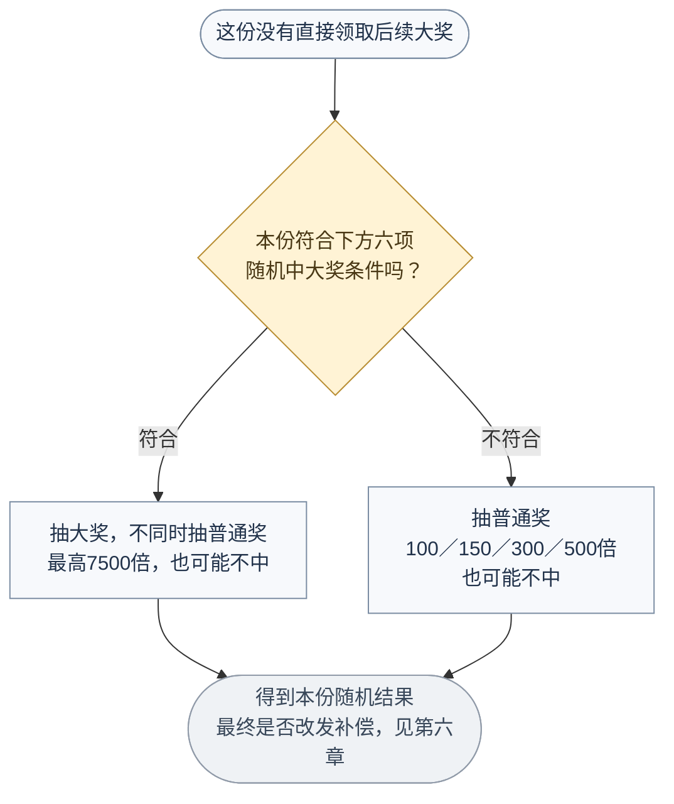
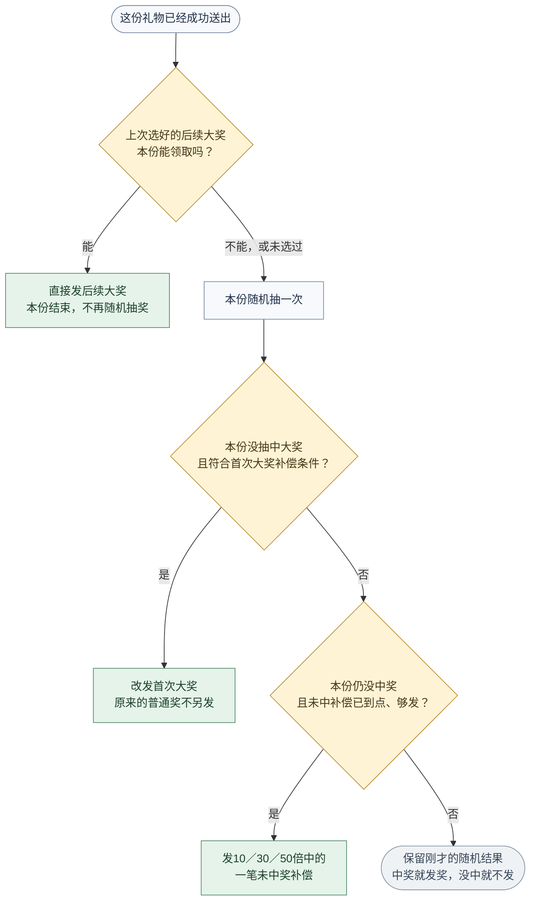
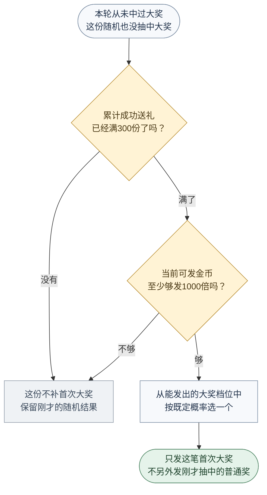
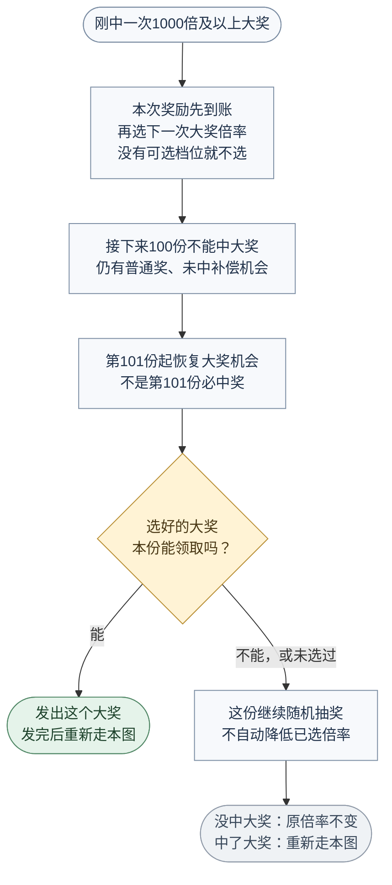
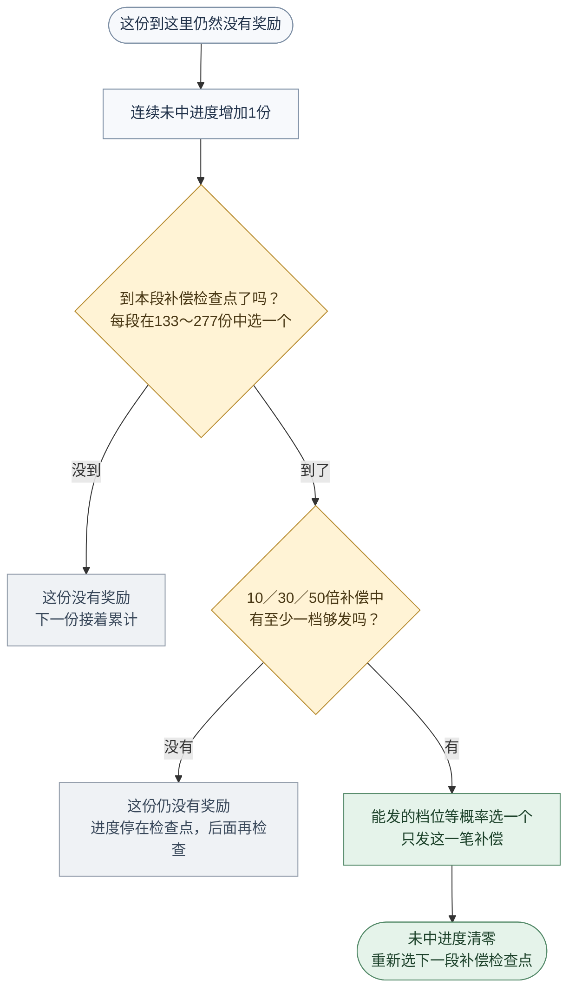
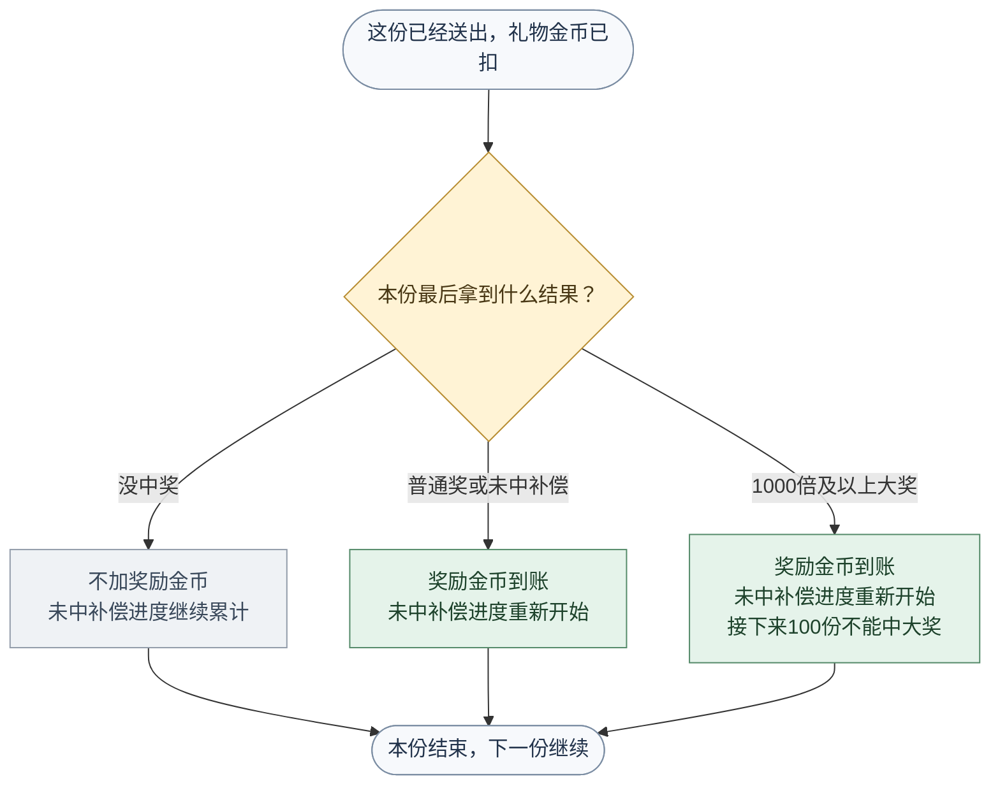

# 高倍幸运礼物开奖与返奖需求文档

> 规则基线：当前 B 策略，A 仅在第九章保留参数对照。  
> 范围：说明用户送礼后拿到什么奖励、什么时候补偿、中奖后接下来会怎样。依据为当前模拟算法，不表示线上服务端已经实现。  
> 金币为无现金价值的体验虚拟币；真实账号资产及线上发奖闭环见第十章待确认。

## 一、送一份礼物，会发生什么？

### 1.1 先记住三句话

- **送出一份，扣一份礼物的金币，得到一份结果。**连送多份，也一份一份处理；没能成功送出的，不扣费，也不推进中奖或补偿进度。
- **一份最多只发一笔奖励。**普通奖、大奖和补偿不会一起叠加发。
- **中了奖，金币加回用户余额；没中奖，这份礼物的金币照常花掉。**不是没有中奖就不扣费。

本文把1000倍及以上称为“大奖”；100／150／300／500倍称为“普通奖”。

### 1.2 全部策略串联的业务全景图

**从上往下沿实线读本份礼物，沿右侧虚线回到下一份。**不是把四种策略各抽一次，而是按图中的先后顺序，只留下一个最终结果。

这张图把**共用发奖额度 → 后续大奖优先 → 随机抽奖 → 首次大奖替换 → 连续未中补偿 → 唯一结算 → 影响下一份**接在一起。所有判断和出口都在同一张图中，下面的细分图只作局部放大，不需要靠它们拼主流程。

[放大查看完整全景图](业务流程图/总业务全景图.svg)

#### 从全景图看，几条策略究竟怎样互相影响？

| 策略之间的关联 | 同一份或下一份具体会发生什么 |
|---|---|
| 后续大奖优先于随机抽奖 | 选好的大奖本份已能领取，就直接发；本份不再抽随机奖，也不再检查首次大奖和未中补偿。领不了，才继续后面的流程 |
| 随机大奖与首次补偿不叠加 | 随机已抽中1000倍及以上，保留这个大奖；随机只有普通奖或未中，才继续检查首次补偿 |
| 首次补偿可以替换普通奖 | 本轮没中过大奖且首次补偿满足条件，就改发首次大奖；刚才抽中的普通奖不另发。否则仍保留原随机结果 |
| 未中补偿排在所有其他奖励之后 | 只有前面仍然没让本份中奖，才推进未中进度并检查小额补偿；中途任何正奖都会结束这一段等待 |
| 三种大奖来由，汇入同一套后续规则 | 后续大奖、随机大奖、首次大奖补偿，都会增加大奖次数、关闭首次补偿、开启接下来100份等待，并尝试选择下一次倍率 |
| 等待期只挡大奖，不挡小奖 | 大奖后接下来100份仍可有普通奖和未中补偿；每成功送一份推进等待，第101份才恢复大奖机会 |
| 所有奖励竞争同一份可返金币和预算 | 没有独立大奖储备。普通奖和未中补偿也会减少可返金币及预算，因此可能推迟、甚至让已经选好的大奖无法兑现 |
| 随机大奖能替换已经选好的下一次倍率 | 原目标还发不起时继续随机；若先随机中了另一个大奖，就发这个随机大奖，再重选下一次倍率，原目标被替换 |
| 本份发完奖，下一份条件就变了 | 任何中奖都会重选未中补偿检查点；大奖还会改变等待期和下次倍率。下一份按最新累计、预算和进度，从图顶重新判断 |

**四类奖励共用额度，但不共用全部门槛。**累计送礼600,000金币和已发不超过60%这两项，只限制随机中大奖，不限制首次大奖补偿和后续大奖直接领取。预算归零也不会自动停止扣费送礼，图中保留这一现状。

### 1.3 四种奖励，分别是什么？

| 奖励来由 | 什么情况下会有 | 对应细分流程 |
|---|---|---|
| 随机中奖 | 本份随机抽中普通奖或大奖，也可能抽不中 | 第五章 |
| 首次大奖补偿 | 本轮还没中过大奖；从累计第300份起检查，金币够发时补第一次大奖 | 7.1 |
| 后续大奖 | 中过大奖后，选好下一次倍率；等待期结束、金币够发且次数未满时，直接领取 | 7.2～7.3 |
| 连续未中奖补偿 | 连续没有奖励，到了本段检查点，金币够发时补10／30／50倍中的一笔 | 7.4 |

**第300份不是“必出大奖”，133～277份也不是“无条件必中奖”。**到了检查点，还要够发奖励。

后续细则中的“自然开奖”就是随机抽奖；“初始超高倍保底”就是首次大奖补偿；“锁定目标保底”就是后续大奖。名称不同，不是多了几种奖。

### 1.4 运营最常问的几个问题

| 想知道什么 | 看哪里 |
|---|---|
| 为什么这份不能抽大奖？ | 第五章：随机中奖条件 |
| 几种奖励同时满足，最后发哪一个？ | 第六章：本份只发一笔 |
| 一直没中过大奖，什么时候补？ | 7.1：首次大奖 |
| 中过一次后，下一次大奖怎么来？ | 7.2～7.3：后续大奖 |
| 连续没奖励，什么时候补一个小奖？ | 7.4：连续未中奖补偿 |
| 为什么份数到了，奖励还是发不出？ | 第四章：本份可发金币限制 |
| 中奖后，下一份有什么变化？ | 第八章 |

## 二、业务对象与统计范围

### 2.1 业务对象与归属

| 对象 | 当前算法口径 | 与其他对象的关系 |
|---|---|---|
| 一份礼物 | 最小扣费、开奖和结算单位 | 产生一个最终倍率，最多一笔正奖励 |
| 一批礼物 | 多份礼物按顺序逐份处理 | 前一份结算后，再判断后一份；不合并随机 |
| 本轮玩法累计 | 一组累计投入、累计返奖、成功份数及补偿状态 | 各价格共用；当前无日、周、月自动重置 |
| 奖励预算 | 约束本轮还能发出的金币总额 | 所有正奖共用；每次返奖扣实际金额 |
| 中奖事件 | 最终倍率大于0的结果 | 记录当时单价、份数、倍率、金额和来源 |

“本轮”指算法维护的一份累计过程，不等于已确认的线上用户生命周期。账号、礼物、收礼人、房间和跨设备的归属关系尚待确认，不能默认各自独立或全站共用。

### 2.2 核心数据定义

| 数据 | 业务定义 | 初始状态 | 更新方式与用途 |
|---|---|---|---|
| 可消费余额 | 当前可用于下一份礼物的金币 | 体验初始余额10,000,000；不视为线上赠币政策 | 送礼扣单价，中奖加奖励；补充余额不等于增加投入 |
| 累计投入 | 本轮所有成功送礼的价格合计 | 0 | 每成功一份加本份单价；用于计算奖励空间及自然资格 |
| 累计返奖 | 本轮所有已结算奖励合计 | 0 | 所有奖励来源统一累计 |
| 累计成功份数 | 本轮成功扣费开奖的礼物份数 | 0 | 每成功一份加1；初始保底按此判断，不按可清零的连送数 |
| 剩余冷却份数 | 尚需经历多少份成功送礼才能恢复超高倍资格 | 0 | 超高倍后置100；后续成功份数逐份递减 |
| 超高倍中奖次数 | 本轮最终倍率不低于1000倍的次数 | 0 | 自然、初始、锁定来源统一累计 |
| 连续未中计数 | 用于补偿检查的连续0倍计数 | 0 | 0倍加1，最多到当前目标；任何正奖清零 |
| 连续未中目标 | 当前这一段未中补偿检查点 | 133～277中等概率抽一个整数 | 初始化及任何正奖后重新生成 |
| 锁定超高倍目标 | 下一次优先检查的固定超高倍率 | 空 | 超高倍结算后生成；普通正奖不重抽 |
| 当前礼物单价 | 本份扣费和奖励计算采用的价格 | 默认600 | 使用第三章九档价格；切价不拆分累计 |
| 剩余奖励预算 | 本轮还能支出的奖励金币 | 93,000,000 | 所有正奖按实际金额扣减，无自动补充 |
| 中奖历史 | 本轮最终正奖励事件 | 空 | 正奖追加；0倍及失败份不产生中奖事件 |

### 2.3 统计与状态边界

本轮没有按日、周、月自动重置。自然开奖权重不因等待时间、赠送速度或当前操作段的连送数提高；累计成功份数、冷却、未中进度分别按各自规则推进。

初始超高倍资格、冷却、自然超高倍资格、锁定目标与连续未中进度是不同维度，不合并成单一用户等级。某条路径不可用，不代表其余路径全部关闭。

## 三、当前参数

| 参数 | 当前取值 | 作用边界 |
|---|---:|---|
| 礼物价格 | 40／80／120／200／400／600／1000／2000／3000金币 | 默认600；只选择当前赠送单价 |
| 累计奖励空间比例 | 93% | 累计投入乘该比例后向下取整，再扣累计返奖 |
| 自然超高倍累计投入门槛 | 600,000金币 | 只用于自然超高倍资格池 |
| 自然超高倍累计返奖率上界 | 60%，含等号 | 按已计入本份投入、未计入本份奖励的账务判断 |
| 超高倍冷却 | 100份成功赠送 | 中奖当份不占冷却；接下来100份均禁超高倍 |
| 超高倍次数上限 | 每轮1000次 | 达到后关闭自然超高倍与超高倍保底；连续未中补偿继续 |
| 单次奖励金币上限 | 4,500,000金币 | 所有奖励来源共用；超过的档位剔除，不截成部分奖励 |
| 本轮初始奖励预算 | 93,000,000金币 | 当前算法的一份独立预算；线上归属待确认 |
| 初始超高倍开始检查点 | 累计第300份，含本份 | 无截止份数；仍需可支付与无冷却 |
| 连续未中目标范围 | 133～277份，含两端 | 每轮等概率选一个整数，锁定至下一次正奖 |
| 连续未中补偿倍率 | 10／30／50倍 | 可支付档位等权；不参与自然基础池 |

以上是当前算法取值，不表示已建设运营配置、参数发布或热更新能力。

## 四、奖励额度与计算口径

### 4.1 单份开奖的计算时点

本份先通过余额和数值限制检查，再扣除单价、增加累计投入及成功份数。以下开奖前计算均使用“已计入本份价格、尚未结算本份奖励”的数据。

| 指标 | 计算方式 | 精度与边界 |
|---|---|---|
| 开奖前累计返奖率 | 历史累计返奖÷已计入本份的累计投入 | 自然超高倍资格按实际比例判断，不按显示值取整 |
| 可释放奖励空间 | 最大值（0，向下取整〔已计入本份的累计投入×93%〕－历史累计返奖） | 金币整数；先对比例结果取整，再扣返奖 |
| 本份奖励上限 | 最小值（可释放奖励空间，4,500,000，本轮剩余预算） | 所有自然奖、超高倍保底、连续未中补偿共用 |
| 某档奖励金币 | 当前礼物单价×该档倍率 | 等于本份上限可保留；大于则剔除 |
| 开奖后累计返奖率 | 更新后的累计返奖÷更新后的累计投入 | 供下一份资格判断；本份不再重新开奖 |
| 开奖后奖励空间 | 最大值（0，向下取整〔累计投入×93%〕－更新后的累计返奖） | 中奖后按实际奖励减少空间 |

余额、奖励空间与剩余预算是三个不同约束。余额足够才能赠送；奖励空间决定累计允许发多少；预算限制本轮总奖励支出。补充余额只改变消费能力，不计累计投入、不补奖励空间或预算。

### 4.2 额度过滤

1. 先确定本份需要使用的概率池或保底路径，再按本份上限筛选倍率。
2. 100倍至500倍基础奖同样受限；10／30／50倍补偿也无透支例外。
3. 自然池保留有效的0倍档位。没有可支付正奖时仍可接受余额足够的赠送，本份结果为0倍。
4. 本轮预算归零后，仍可继续扣费赠送，但全部奖励路径均因无支付额度而无法发正奖；没有自动停止送礼或补充预算规则。
5. 发出奖励前完成额度筛选，结算后只扣实际金币，不通过事后截奖或回收把奖励压回上限。

### 4.3 价格对最高可付超高倍率的影响

以下仅按4,500,000金币单次上限列出；实际还需个人空间、剩余预算及路径资格满足。

| 当前价格 | 单次上限允许的超高倍率 |
|---|---|
| 40／80／120／200／400／600 | 1000／2000／3000／5000／7500 |
| 1000 | 1000／2000／3000 |
| 2000 | 1000／2000 |
| 3000 | 1000 |

7500倍是玩法整体最高倍率，不代表九档单价都能开出。

### 4.4 计算示例

假设当前单价600金币，计入本份后累计投入5,000,000金币，历史累计返奖350,000金币，剩余预算不少于4,500,000金币，本份自然超高倍资格与无冷却条件均满足：

| 处理 | 计算或结果 |
|---|---|
| 个人奖励空间 | 向下取整（5,000,000×93%）－350,000＝4,300,000金币 |
| 7500倍 | 600×7500＝4,500,000金币，超过本份空间，剔除 |
| 5000倍 | 600×5000＝3,000,000金币，可保留，但不保证随机命中 |
| 假设最终命中5000倍 | 累计返奖变为3,350,000金币；预算减少3,000,000金币 |
| 中奖后 | 累计返奖率67%；剩余奖励空间1,300,000金币；超高倍次数加1，进入100份冷却并生成下一锁定目标 |

从零累计、固定价格且此前没有返奖时，第108份才达到可支付100倍的空间。连续未中补偿不早于其随机目标133～277份，因此前107份没有可执行正奖路径。第300份只开始检查初始超高倍；最低1000倍单看空间也至少需要1076份同价投入，期间返过奖还会推迟，不能写成“第300份必出超高倍”。

## 五、自然开奖与概率池

### 5.1 池选择规则

每份未触发锁定目标保底时，先重新判断自然超高倍资格。以下条件必须同时满足：

- 本份开始时剩余冷却为0。
- 计入本份后的累计投入不少于600,000金币。
- 开奖前累计返奖率不高于60%。
- 可释放奖励空间不少于“当前价格×1000”。
- 本轮超高倍中奖次数少于1000次。
- 本轮剩余预算不少于“当前价格×1000”。

**全部满足时，使用“0倍＋超高倍率”的资格池；不满足时，使用“0倍＋基础倍率”的基础池。两池互斥切换，不是基础池追加超高倍率。**

因此，自然超高倍资格池中不抽100／150／300／500倍；自然基础池中不抽1000倍及以上。自然抽样后的初始保底和连续未中补偿仍按第六、七章裁决。

自然资格每份重新判断，没有额外退出阈值、进入后保持期或动态概率调节。恰好60%时符合，超过60%时不符合；基础中奖、后续新增投入均可能改变下一份资格。

### 5.2 这份抽普通奖，还是有机会抽大奖？

自然超高倍资格成立，也仍需通过单次上限过滤。**先选池，再过滤；不会在过滤后把两个池合并。**

### 5.3 B策略基础池

| 结果 | 原始权重 | 未过滤概率 | 未过滤返奖贡献 |
|---|---:|---:|---:|
| 0倍 | 14,928,750 | 99.525% | 0个百分点 |
| 100倍 | 60,000 | 0.400% | 40个百分点 |
| 150倍 | 7,500 | 0.050% | 7.5个百分点 |
| 300倍 | 2,250 | 0.015% | 4.5个百分点 |
| 500倍 | 1,500 | 0.010% | 5个百分点 |
| 合计 | 15,000,000 | 100% | 57个百分点 |

57%为该模板在未过滤、无保底覆盖时的理论返奖率，不是整轮实际返奖率。

### 5.4 自然超高倍资格池

| 结果 | 原始权重 | 未过滤概率 |
|---|---:|---:|
| 0倍 | 14,992,588 | 99.95058667% |
| 1000倍 | 4,227 | 0.02818000% |
| 2000倍 | 1,691 | 0.01127333% |
| 3000倍 | 846 | 0.00564000% |
| 5000倍 | 423 | 0.00282000% |
| 7500倍 | 225 | 0.00150000% |
| 合计 | 15,000,000 | 100%（分项显示存在舍入） |

该模板未过滤理论返奖率约92.9967%。资格池出现的频率、本份额度过滤及保底覆盖都会改变实际结果，表内概率不是所有送礼份数上的最终中奖概率。

### 5.5 过滤与随机选择

- 将本池中“倍率×当前价格”超过本份奖励上限的档位剔除，保留正权重档位。
- **某保留档最终抽样概率＝该档原始权重÷所有保留档位原始权重之和。** 分母包括0倍。
- 额度过滤掉的正奖权重不转入0倍，而是对保留档位重新归一化。
- 仅在A切换为B的模板调整中，减少的150／300／500倍权重被加入基础池0倍。这与单次开奖的额度过滤是两件事。
- 正常自然池0倍具有正权重，不会因全部正奖超额而成为空池；仅剩0倍时结果确定为0。
- 同一份只取一个抽样结果。若随后被初始保底或连续未中补偿替换，只结算最终结果，不额外发自然抽样的小奖。
- 连送不是固定“每若干份中奖一次”；除已定义的补偿外，普通权重不因当前连送数或真实等待长度动态提高。

## 六、一份礼物，最后到底发哪一笔奖？

### 6.1 按这个顺序，只留下一个结果

| 顺序 | 先看什么 | 本份怎么发 |
|---|---|---|
| 1 | 后续大奖能领了吗？ | 能领就直接发，结束本份；不能领才继续随机抽奖 |
| 2 | 随机有没有直接抽中大奖？ | 抽中了就发这个大奖，不另加补偿 |
| 3 | 没抽中大奖，但能补首次大奖吗？ | 能补就改发首次大奖；刚才即使抽中普通奖，也不再另发 |
| 4 | 这份仍没有奖励，能领未中补偿吗？ | 到补偿点且金币够发，就发一笔10／30／50倍补偿 |
| 5 | 上面都没改发其他奖励 | 保留随机结果：普通奖照发，没中就没有奖励 |

### 6.2 奖励选择顺序图

**图中“能领”都表示对应条件已经满足，不是只看送礼份数。每个发奖出口都只发一笔，后续变化见第八章。**

### 6.3 各路径的门槛不能混用

| 判断项 | 自然超高倍 | 初始超高倍保底 | 锁定目标保底 | 连续未中补偿 |
|---|---|---|---|---|
| 本轮超高倍次数 | 少于1000 | 必须为0 | 大于0且少于1000 | 不受此次数上限关闭 |
| 冷却必须为0 | 是 | 是 | 是 | 否，冷却内仍可补偿 |
| 累计投入至少600,000 | 是 | 否 | 否 | 否 |
| 累计返奖率不高于60% | 是 | 否 | 否 | 否 |
| 累计成功份数至少300 | 不单独要求 | 是 | 不单独要求 | 不单独要求 |
| 额外要求 | 先进入超高池，再自然抽样 | 自然结果小于1000；有可付超高档 | 已有有效固定目标且本份支付得起 | 前述路径后仍0倍，未中计数达到目标 |
| 共用空间／单次上限／预算 | 是 | 是 | 是 | 是 |

**不满足自然超高倍的60%或600,000门槛，不等于初始／锁定保底也不能发。**

## 七、保底与连续未中补偿

### 7.1 初始超高倍保底

**适用范围：** 本轮超高倍中奖次数为0。初始的“从未命中”以本轮累计为准，不是已确认的跨设备或账号终身规则。

本份必须同时满足：

1. 计入本份后，累计成功份数不少于300。
2. 本份开始时不处于超高倍冷却。
3. 本份未执行锁定目标保底，自然结果小于1000倍。
4. 空间至少可支付当前价格的1000倍，且经过单次上限、预算过滤后至少保留一个超高倍率。

从可支付的1000／2000／3000／5000／7500倍中，按第五章对应正奖原始权重抽取一个。该抽取不带0倍；即只有1000倍可付时，初始保底确定取1000倍。

- 第300份开始持续检查，超过1000份仍有效，无固定最晚中奖份数。
- 不要求累计投入达到600,000金币，也不受自然资格60%返奖率门槛约束。
- 若自然抽到基础正奖，仍可被初始保底覆盖；最终只发超高倍奖。
- 首次超高倍无论来自自然还是初始保底，均退出初始路径，随后使用锁定目标逻辑。
- 条件不足则保留自然结果，不借空间、不借预算、不对历史补发。

#### 首次大奖补偿流程图

**第300份开始检查，不是第300份必出。**这条补偿不要求累计送礼达到600,000金币，也不要求返奖率低于60%；但必须不在大奖等待期，且至少够发1000倍。

### 7.2 锁定目标的生成

每次最终命中1000倍及以上，先完成该次返奖并扣减预算，再生成下一锁定目标：

1. 使用该次赠送的当前价格。
2. 仅考虑单次上限与**已扣除本次奖励后的剩余预算**。
3. 从二者可支付的超高倍率中，按原始正奖权重抽取目标；不按当时剩余个人空间筛选。
4. 没有可选倍率时，目标为空。

因此，锁定目标可以高于当前空间可释放的倍率，需要后续投入逐渐积累。普通基础奖和连续未中补偿会共同消耗空间，但不重新抽取锁定目标。

所有超高档都可选时，目标权重为4,227／1,691／846／423／225，不是五档等概率；可选档变化后只在保留档之间归一化。

### 7.3 锁定目标的执行与保持

本份须同时满足：目标为有效超高倍率、本轮曾中超高倍、本份开始冷却为0、超高倍次数少于1000、目标奖励不超过本份上限。

满足时直接结算目标倍率，跳过自然抽样；不要求60%自然资格门槛或600,000金币累计投入门槛。

| 场景 | 当前处理 |
|---|---|
| 空间不足或冷却未结束 | 目标保留；本份按其他可执行路径处理 |
| 自然超高倍先于锁定目标命中 | 按自然倍率结算，并根据结算后状态生成新的目标，替换原目标 |
| 切换价格 | 目标倍率保留，目标所需金币改按新价格计算；不重抽、不降档 |
| 新价格导致目标超过单次上限或预算 | 该目标暂不能执行；不会自动换成可付低目标；其他自然路径仍重新判断 |
| 后续预算降至目标以下 | 继续保留目标；没有预算补充机制，也不自动作废重抽 |
| 目标为空 | 不在每份赠送或切价时自动补抽；若后续自然命中超高倍，才再次生成 |
| 次数达到1000 | 已存目标不再执行；是否仍显示目标不改变次数限制 |

固定目标并非“专款预留”。本份初始保底、锁定目标与连续未中补偿均不绕过共同额度。

#### 中过一次大奖以后，下一次怎么来？

**先选倍率，不等于留好了金币。**后面金币不够时不自动降档；本轮中大奖达到1000次后，不再发大奖，普通奖和未中补偿仍可继续。

**目标生成与目标兑现分两步：生成时不要求空间够，兑现时必须空间够。目标只是倍率，不冻结对应金币。**

### 7.4 连续未中补偿

**目标生成：** 初始化或任何正奖结算后，在133～277之间等概率抽取一个整数，作为接下来这一段未中奖等待的锁定目标。

**逐份推进：** 锁定或初始保底未执行，且自然结果为0时，未中计数增加1，最大保留到当前目标。然后判断是否达到目标。

**补偿执行：** 计数达标后，在10／30／50倍中筛选奖励不超过本份上限的档位，剩余档等权随机，不含0倍。

| 可支付情况 | 本份补偿结果 |
|---|---|
| 三档都可支付 | 三档各为三分之一 |
| 仅10倍与30倍可支付 | 两档各为二分之一 |
| 仅10倍可支付 | 确定10倍 |
| 无档可支付 | 保留0倍，计数停在目标；下份若仍自然未中则再次检查 |

任意正奖，包括自然基础奖、自然超高倍、两类超高倍保底、连续未中补偿，都会将计数清零并重抽下一目标。达到目标后，如果下份先自然中奖，则按该正奖处理，不额外叠加补偿。

连续未中补偿不增加超高倍次数，不新建100份冷却；若原本处于冷却，本份正常消耗一份冷却。超高倍已达1000次时，这条补偿路径仍继续。

#### 连续没奖励，什么时候补一个小奖？

这里的计数会封顶，不能用它代表完整实际等待长度。133～277是补偿检查目标，**不是无条件最晚必中奖份数**。

### 7.5 切价与补偿的共同边界

切换价格不清累计投入、累计返奖、累计成功份数、连续未中计数、连续未中目标、初始检查进度、超高倍次数、冷却或锁定目标；剩余预算也不恢复。后续每份按新单价扣费、计算奖励并重新判断可支付性。

累计成功份数与累计投入可以包含不同价格；“最低1076份允许1000倍空间”等固定价推导不适用于混合价格过程。

## 八、逐份结算与状态推进

### 8.1 结算顺序

| 顺序 | 业务处理 |
|---|---|
| 1 | 检查余额是否不少于当前单价；检查赠送前累计投入是否已经大于1,000,000,000,000金币 |
| 2 | 检查通过：余额扣单价；累计投入加单价；累计成功份数加1 |
| 3 | 按第六章得到唯一最终倍率，奖励金币＝本份单价×最终倍率 |
| 4 | 累计返奖加奖励；余额加奖励；本轮预算扣奖励 |
| 5 | 正奖清未中计数并重抽目标；0倍保留本次推进后的计数 |
| 6 | 若最终倍率不低于1000：超高倍次数加1、冷却置100、生成下一锁定目标 |
| 7 | 否则，若本份开始时有冷却，则冷却减1；无冷却保持0 |
| 8 | 正奖加入中奖历史；本份结束，下一份读取全部最新累计与状态 |

### 8.2 账务恒等式

- 本份结算后余额＝本份前余额－当前价格＋本份奖励。
- 本份后累计投入＝本份前累计投入＋当前价格。
- 本份后累计返奖＝本份前累计返奖＋本份奖励。
- 本份后剩余预算＝本份前剩余预算－本份奖励。
- 0倍只扣礼物价格，不增加返奖、不消耗奖励预算。
- 失败份不增加投入、成功份数、未中计数或冷却进度；此前同批已成功份数不回滚。

### 8.3 冷却与次数边界

若第某份命中超高倍，该份结束置100；后续第1～100份成功赠送均以“本份开始有冷却”处理。第100份结束减到0，**第101份**才重新允许自然超高倍或锁定目标执行。

冷却按成功赠送份数推进，不按点击、批次数、时间或充值次数推进。冷却期间可抽基础正奖并可执行连续未中补偿，均需可支付。

本轮第1000次超高倍可以正常结算，并按现有流程设置冷却及生成目标；后续因次数已达上限不再执行超高倍路径。基础奖和连续未中补偿继续，预算及空间限制仍有效。

### 8.4 这份结束后，下一份有什么变化？

图里只看用户感受到的变化。任何中奖都会消耗对应预算；普通奖和未中补偿不重选已选好的大奖倍率。若本来就在大奖等待期，每份成功送礼算完成其中1份；刚中大奖的这一份不算入后面的100份。

### 8.5 各结果的状态变化表

| 本份结果 | 余额／投入／返奖／预算 | 未中计数与目标 | 超高倍次数 | 冷却 | 锁定超高倍目标 |
|---|---|---|---|---|---|
| 送礼前检查失败 | 全部不变 | 不变 | 不变 | 不变 | 不变 |
| 成功送礼，最终0倍 | 扣单价，投入加单价；返奖、预算不变 | 计数加1并封顶；目标不变 | 不变 | 原有冷却减1 | 不变 |
| 成功送礼，最终为基础奖或未中补偿 | 扣单价后加奖励；投入加单价；返奖加奖励、预算扣奖励 | 清零计数，重抽目标 | 不变 | 原有冷却减1 | 不变 |
| 成功送礼，最终为超高倍 | 按超高倍奖励更新四项账务 | 清零计数，重抽目标 | 加1 | 设为100，中奖当份不再减1 | 按结算后预算生成新目标 |

“原有冷却减1”仅指本份开始时冷却大于0；没有冷却则保持0。每份成功送礼均增加1个累计成功份数。

### 8.6 批量处理的业务边界

- 多份礼物逐份处理，不整批预扣、不合并开奖。
- 前一份奖励入账后，可以用于同批后续份的消费。
- 同批前几份已成功、下一份余额不足时，只停止未处理部分；已扣费开奖的结果保留。
- 送礼前累计投入已经大于1,000,000,000,000金币时，当前算法拒绝下一份；恰好等于仍可送本份，因此不是严格封顶。正式线上金额边界与异常账务处理见第十章。

### 8.7 典型场景：沿流程核对结果

| 场景与前提 | 本份走哪条路 | 结果及后效 |
|---|---|---|
| 首次保底：固定单价600；本份后累计1162份、投入697,200、历史返奖48,000（来自连续未中补偿）；无冷却、无超高记录、预算充足；自然结果0倍 | 空间600,396；可付1000倍600,000，付不起2000倍1,200,000；初始覆盖 | 最终1000倍；仅发600,000，不叠加自然基础奖；超高次数加1，冷却100，再生成目标 |
| 固定目标尚不可付：已有2000倍目标；单价600；本份上限900,000；其他锁定条件满足 | 目标需1,200,000，锁定不执行；继续自然路径 | 不改成1000倍；若本份没有自然超高，继续保留2000倍目标 |
| 冷却的最后一份：本份开始剩余冷却1，其他自然超高条件都满足 | 本份仍不能超高，只能基础开奖及未中补偿 | 本份结束冷却减到0；下一份才恢复超高路径 |
| 未中目标已到但预算仅5,000；单价600；自然结果0倍 | 最低10倍补偿需6,000，不能支付 | 最终0倍，计数停在目标；后续仍按可支付条件检查，不借预算 |
| 已有7500倍目标，切价到3000 | 目标需22,500,000，超过单次上限4,500,000 | 目标保留但不可执行；其他自然路径照常判断，不自动重抽或降档 |
| 预算归零但余额仍不少于单价 | 送礼前校验仍可通过；所有正奖均不可支付 | 仍扣单价并增加投入、份数；最终0倍；线上是否接受这种消费须另确认 |

## 九、A／B差异与生效边界

### 9.1 唯一策略差异

| 倍率 | A版原始权重 | B版原始权重 | A版未过滤概率 | B版未过滤概率 |
|---|---:|---:|---:|---:|
| 0倍 | 14,910,000 | 14,928,750 | 99.400% | 99.525% |
| 100倍 | 60,000 | 60,000 | 0.400% | 0.400% |
| 150倍 | 15,000 | 7,500 | 0.100% | 0.050% |
| 300倍 | 9,000 | 2,250 | 0.060% | 0.015% |
| 500倍 | 6,000 | 1,500 | 0.040% | 0.010% |

A基础模板未过滤理论返奖率93%，B为57%。减少的36个百分点为基础模板理论返奖贡献差异，并非每轮实际必少返36个百分点，也不是直接追加给2000倍及以上的固定概率。

当前没有为高目标冻结空间，也没有暂停1000倍自然奖。中档奖减少后，共同空间可能更易积累，但不保证2000倍及以上在固定次数出现。

### 9.2 参数变更与历史口径

- 当前正文按B策略；两策略的其他开奖、额度、保底、冷却和次数规则相同。
- 已有累计使用B参数后，后续开奖采用新权重；历史已结算奖励不重算、不补发。
- 同一累计过程可能包含策略变更前后的结果。现有中奖事件未固化完整策略版本，不能视为已经支持按版本完整拆分统计。
- 线上配置何时生效、已有固定目标是否迁移、如何追溯版本，见第十章；不据此定义后台发布或自动分流能力。

## 十、线上待确认事项

本章只区分“当前算法有确定行为”与“真实服务端业务尚未定案”，不改变前述算法。

| 编号 | 待确认事项 | 当前算法或材料边界 | 上线前需要定案的业务问题 |
|---|---|---|---|
| U01 | 账号、礼物与周期归属 | 一份累计内各价格共用；无日／周／月自动重置 | 按用户、礼物还是策略组累计；是否跨设备共用；重置周期与存量迁移 |
| U02 | 预算归属与耗尽出口 | 每轮累计的初始预算93,000,000；预算耗尽仍接受有余额送礼 | 是否多人共享、何时补充；无预算时是否允许继续消费；如何结束或恢复 |
| U03 | 重复消费与并发结算 | 仅核实了单份算法顺序，未形成线上唯一结算闭环 | 同一笔重复请求如何识别；并发送礼谁先推进累计；不得重复扣费或返奖的处理方案 |
| U04 | 扣费、派奖或记录失败 | 当前没有真实账号资产链及服务端失败恢复规则 | 扣费成功但派奖失败如何恢复；重试是否沿用原结果；退款、撤销与补偿如何影响累计、预算和保底 |
| U05 | 无法兑现或为空的锁定目标 | 不降档、不重抽；目标可长期停留；空目标不主动补抽 | 线上是否接受该行为；若不接受，何时重抽、按哪份单价和预算生成 |
| U06 | 金额、异常数据与追溯 | 当前有送礼前投入检查；并无完整账务一致性与奖励入账溢出保护 | 合法金额范围；异常状态如何处理与恢复；中奖事件是否需覆盖全部消费及版本快照 |
| U07 | 配置生效与存量目标 | 当前规则为固定算法参数，非完整发布机制 | 生效时点、批中变更、已有目标迁移、历史版本与回滚；是否继续采用当前B参数 |

**当前可用于确认开奖算法及业务规则；在归属、并发、重复处理、资产失败恢复与预算出口定案前，不能当作真实资产线上发奖的完整开发冻结稿。**
