# 高倍幸运礼物全服共享池需求文档（开发与测试版）

| 文档信息 | 内容 |
|---|---|
| 版本 | V1.0，服务端核心业务逻辑 |
| 适用对象 | 服务端开发、测试 |
| 需求范围 | 逐份扣费、公共额度计算、开奖、返奖、个人策略、状态推进、结算与对账 |

## 一、需求概述与范围

### 1.1 业务目标

多个用户共用一个公共奖励池。个人与全服投入、返奖、成功份数、大奖次数及计提统计，统一按UTC+3最近30个自然日滚动；公共资金池也按同一窗口重算；仅大奖发放状态、冷却、目标及未中进度／检查点独立保留。每份礼物独立扣费、计算窗口额度、开奖和返奖；批量赠送复用同一逐份规则。

### 1.2 核心模块

| 模块 | 处理范围 |
|---|---|
| 资金约束 | 个人近30自然日106%返奖额度、全服近30自然日投入按可配置大盘期望值比例计算公共资金池、4,500,000金币单奖上限 |
| 开奖策略 | 基础池与自然池互斥；首次大奖、后续目标、连续未中补偿按优先级产生唯一奖励 |
| 个人状态 | 窗口RTP控制98%暂停／90%恢复；完整100份冷却、目标、未中进度／检查点和暂停记忆独立保留；大奖次数及首次资格按近30自然日判断 |
| 结算与对账 | 成功份扣费、窗口金额重算、返奖及状态推进；失败份不推进；两级窗口统计、公共池额度与单份结果核对 |

本文只定义上述服务端业务规则。并发重复处理、资产中途失败、退款和正式配置变更等尚未确认的决策集中列于第七章，不将其写成已实现能力。

## 二、业务对象与累计口径

### 2.1 业务对象

| 对象 | 定义 | 归属与约束 |
|---|---|---|
| 用户 | 个人窗口统计与持续策略状态的归属主体 | 各用户独立；不因他人中奖而清空本人状态 |
| 一份礼物 | 最小扣费、计提、开奖、结算单位 | 成功一份只产生一个最终倍率，最多一笔正奖励 |
| 一批礼物 | 按指定份数逐份执行 | 不整批预扣，不共用一个开奖结果；前份返奖可用于后份消费 |
| 公共奖励池 | MAX（0，⌊近30自然日全服投入×大盘期望值比例⌋－近30自然日全服实际返奖） | 所有参与用户共用；不含启动资金、不结转窗口外额度；不为已选目标预留金币 |
| 个人策略状态 | 大奖发放状态、冷却、目标、未中进度及随机检查点；独立于30日统计窗口保存 | 各用户独立；不同单价共用；首次资格另按窗口大奖记录判断 |
| 单份结算结果 | 包括0倍在内的一份成功结果 | 对应当份价格、倍率、奖励来源及两级账务变化 |

### 2.2 累计归属与周期

**统一窗口**：采用UTC+3。每份以本份处理开始时的业务时刻为锚点，窗口覆盖含当日在内的最近30个自然日，从最早一日00:00起，截至该业务时刻已发生的成功结算结果；不包含未来时段。每日00:00移出最早一天，不按自然月、不按连续720小时，也不每满30天整批清零。同一份内不切换窗口；同批下一份重新确定业务时刻及窗口。

**窗口示例**：UTC+3的2026-11-02处理一份时，窗口从2026-10-04 00:00起截至本份业务时刻；2026-11-03的新份从2026-10-05 00:00起，移出2026-10-04整日。当前统计、公共资金池和相关资格据此重算；过去已结算结果不改写。

| 数据／判断类别 | 时间口径 | 跨日与滚出处理 |
|---|---|---|
| 个人／全服投入、实际返奖、成功份数、大奖次数 | 本份固定30自然日窗口内的成功记录；大奖只计最终倍率≥1000且实际到账的份 | 新份进入、窗口外记录退出；0倍也计投入和成功份数 |
| 全服计提额度、公共资金池 | 计提额度＝⌊近30自然日全服投入×大盘期望值比例⌋；公共资金池＝MAX（0，⌊近30自然日全服投入×大盘期望值比例⌋－近30自然日全服实际返奖） | 每份及窗口移动后重新计算；计提额度不扣返奖，公共池才扣返奖；不使用窗口外记录或旧池余额 |
| 个人／全服RTP、个人可返、60万投入、300份、1000次等判断 | 全部使用本份同一30自然日窗口 | 开奖前投入和成功份数含本份，返奖尚不含本份奖；奖后计入本份实际奖励 |
| 首次大奖资格 | 用户当前窗口内已到账≥1000倍大奖次数为0，且窗口成功份数≥300 | 旧大奖全部滚出后可重新检查窗口首次；仍须通过独立保留的冷却、发放状态和金额条件 |
| 冷却、后续目标、未中进度／检查点、大奖暂停记忆 | 按用户独立保存，不随30日窗口滚动 | 不因跨日、记录滚出、时间流逝、充值、切价或重新读取而清零、重抽或自动消耗 |
| 可消费余额、原始账务与单份结果 | 用户当前真实资产及已经发生的结算事实 | 不按窗口清空钱包，不删除或撤销历史记录，不因窗口额度变化退钱、追奖或重发 |
| 单价、权重、比例、阈值、每份校验及请求内计数 | 当前份使用的配置／实际值与当前请求进度 | 不是历史累计，不作每日清零；涉及累计与资格的输入只取当前30日窗口；请求成功数只在请求开始置0 |

- 九档价格共用本人窗口统计和独立策略；全服汇总同一公共池、同一窗口的所有用户记录。
- 跨日重算统计、公共池和窗口首次资格，但不自动发奖、消耗冷却、推进未中或重抽目标／检查点。下一成功份计入投入后，再按当前窗口RTP更新大奖发放状态。
- 用户窗口大奖次数从1000回落到999，仅解除次数限制；回落到0时可重新检查窗口首次，不能绕过保留的冷却或暂停状态。
- 充值只增加真实可消费余额，不计送礼投入、计提额度、个人可返或策略进度；切价不清窗口记录或独立策略。
- 公共资金池是本玩法按窗口计算的可发奖额度，不代表银行或钱包资产；窗口外收入、返奖和历史结余均不参与本次额度计算。
- 窗口移动可能改变公共池、个人可返及RTP；额度不足0按0，不追回已发奖励，不产生欠奖。账号、礼物组归属与存量迁移见第七章。

## 三、核心规则

### 3.1 参数定义与生效

| 参数 | 当前取值 | 适用范围／生效规则 |
|---|---|---|
| 统计窗口 | 30个自然日，UTC+3 | 含当日至当前业务时刻；每日滚动，暂按本版固定口径 |
| 礼物价格 | 40／80／120／200／400／600／1000／2000／3000金币 | 按当份实际礼物单价计算；不同价格档共用本人窗口统计与持续策略状态 |
| 个人窗口返奖额度比例 | 106% | 所有正奖共用；按当前窗口投入／返奖计算剩余额度，不是保底 |
| 大盘期望值比例 | 默认93%，需要可配置；范围0%～100%，最多两位小数 | 公共池采用统一大盘期望值比例计算当前窗口投入对应的计提额度；变更生效及窗口内存量处理见第七章 |
| 大奖暂停／恢复阈值 | 98%／90%，均含等号 | 个人30自然日窗口RTP；所有1000倍及以上路径共用 |
| 自然大奖投入／RTP门槛 | 本人窗口投入≥600,000；开奖前窗口RTP≤60% | 仅自然大奖，不约束首次与后续目标路径 |
| 单次奖励上限 | 4,500,000金币 | 所有来源共用；不把超额奖截成部分奖励 |
| 首次大奖检查点 | 本人窗口成功份数≥300，含当份 | 当前窗口内已到账≥1000倍大奖次数为0才检查；份数、大奖记录滚出后按当前窗口重新判断 |
| 大奖冷却／次数上限 | 完整100个成功份／本人窗口内1000次 | 窗口第1000次可正常发；达到1000期间禁大奖，旧记录滚出后可重评 |
| 连续未中检查点 | 133～277之间等概率整数 | 初始化及任意正奖后重新抽一个检查点 |
| 连续未中补偿 | 10／30／50倍 | 使用保底池原始权重，按可支付档位归一选择 |
| 四套概率模板 | 自然池、基础池、保底池、随机大奖池／新人大奖池 | 各套倍率权重独立配置；自然池与基础池的未过滤理论RTP均为93%；另外两套按倍率升序、概率严格递减；默认值见3.6 |

大盘期望值比例及3.6四套概率模板明确需要配置；其余阈值不因本次调整自动成为配置项。配置变更生效、在途份与存量影响见第七章。

### 3.2 核心字段与公式

**统一口径**：金额单位为金币；“近30日”指UTC+3下本份固定的最近30个自然日。投入只计成功扣费礼物单价，实际返奖只计成功到账奖励，充值不计投入；个人只计本人，全服只计同一公共池全部用户。

**取值时点**：公式直接读取计算当时的窗口统计。开奖前：投入和成功份数已含本份，实际返奖尚不含本份奖励；奖后：投入不重复增加，实际返奖已含本份奖励。首次／后续资格在本份奖励到账前检查，不提前计入随机候选或目标。失败份不推进账务或策略。

**读法**：`MIN`取最小值，`MAX`取最大值，`⌊ ⌋`向下取整；大盘期望值比例默认93%，需要可配置。

**公共资金池＝MAX（0，⌊近30自然日全服投入×大盘期望值比例⌋－近30自然日全服实际返奖）。** 只有这一笔窗口额度；开奖前与奖后的区别，仅在于是否已扣除本份奖励。

| 字段 | 公式／口径 | 必要说明 |
|---|---|---|
| 本份业务时刻／窗口起点 | 窗口起点＝UTC+3本份日期前第29日00:00；终点＝本份固定业务时刻 | 同份不切窗；同批下一份重新取时刻 |
| 可消费余额 | 用户份后余额＝用户份前可消费余额－本份单价＋本份单价×本份最终倍率 | 真实可消费资产，不随统计窗口清零；失败不变 |
| 窗口投入 | 30日投入＝同窗口各成功份单价之和 | 个人／全服分别统计；开奖前含本份 |
| 窗口实际返奖 | 30日实际返奖＝同窗口各成功份的“单价×最终倍率”之和 | 个人／全服分别统计；奖前不含本份奖，奖后含本份奖 |
| 窗口成功份数 | 30日成功份数＝同窗口成功扣费并完成开奖的记录条数 | 个人／全服分别统计；含本份，0倍也算，失败不计 |
| 窗口大奖次数 | 30日大奖次数＝同窗口最终倍率≥1000且已到账的记录条数 | 个人／全服分别统计；候选与未兑现目标不计 |
| 个人窗口RTP | 个人RTP＝近30日个人实际返奖÷近30日个人投入 | 开奖前、奖后分别取当时统计；投入为0时不计算，不按0%判断 |
| 全服窗口实际RTP | 全服RTP＝近30日全服实际返奖÷近30日全服投入 | 开奖前、奖后分别取当时统计；投入为0时不计算 |
| 个人可返金币 | 个人可返金币＝MAX（0，⌊近30日个人投入×106%⌋－近30日个人实际返奖） | 所有正奖共用；开奖前判断可付空间，奖后刷新剩余额度 |
| 全服窗口计提额度 | 计提额度＝⌊近30日全服投入×大盘期望值比例⌋ | 按窗口总投入统一取整，不逐份取整相加；尚未减返奖 |
| 本份计提增量 | 本份计提增量＝⌊本份投入后30日全服投入×大盘期望值比例⌋－⌊本份投入前30日全服投入×大盘期望值比例⌋ | 两个投入值使用同一固定窗口；只统计计提额度增加，不作为公共池叠加基数 |
| 开奖前公共资金池 | 开奖前公共资金池＝MAX（0，⌊近30日全服投入×大盘期望值比例⌋－近30日全服实际返奖） | 读取开奖前统计：已含本份投入，尚不含本份奖励 |
| 奖后公共资金池 | 奖后公共资金池＝MAX（0，⌊近30日全服投入×大盘期望值比例⌋－近30日全服实际返奖） | 读取奖后统计：已含本份投入及本份实际返奖；不重复加减本份 |
| 本份奖励上限 | 本份完整奖励上限＝MIN（ MAX（0，⌊近30日个人投入×106%⌋－近30日个人实际返奖）， MAX（0，⌊近30日全服投入×大盘期望值比例⌋－近30日全服实际返奖）， 4,500,000） | 使用开奖前统计；个人、公共、单奖三项取最小值；完整支付，不拆奖 |
| 本份奖励金币 | 本份奖励＝本份单价×本份最终倍率 | 仅一个最终结果；0倍为0 |
| 窗口内是否已中大奖 | 本份奖前近30日个人实际到账大奖次数＞0为是，否则为否 | 大奖指最终倍率≥1000；候选与未兑现目标不计，不保存终身首次标记 |

**精度规则**：金币为整数。个人额度按窗口投入乘106%向下取整；公共额度按窗口全服投入乘当前适用大盘期望值比例向下取整，再分别减窗口实际返奖。不是逐份取整之和；每日窗口移动后直接用新窗口重算，不带入窗口外小数尾差或结余。大盘期望值比例正式变更的生效及存量处理见第七章。

**支付约束**：钱包余额决定能否消费；个人可返、公共资金池和单奖上限共同决定能否完整发奖。公共池不足0显示0，但每次均从窗口原始投入和返奖重新计算，不把上次截成0后的数值作为下份基数。窗口实际返奖高于计提额度时，新增投入先抵消该差额，未形成正额度前不能发正奖。

**窗口变动边界**：旧投入滚出可降低额度，旧实际返奖滚出可释放窗口额度；只改变当前可发额度，不改变已结算结果或钱包真实资产。个人窗口返奖可能因投入滚出而高于106%，全服窗口RTP也可能高于大盘期望值比例；相应可发额度归0，不追回既有奖励，也不补充额度。

### 3.3 个人策略状态

| 状态字段 | 初始值 | 更新与保留规则 |
|---|---|---|
| 大奖发放状态 | 允许检查 | 以当前窗口RTP按3.4滞回；暂停／恢复记忆按用户独立保存，不随30日窗口清空 |
| 用户近30自然日大奖次数 | 当前窗口内实际次数，无记录为0 | 本份≥1000倍到账后计入；旧大奖滚出后减少；所有来源共用 |
| 窗口内是否已中大奖 | 由当前窗口大奖记录计算 | 份前窗口大奖次数为0可检查窗口首次；大于0进入后续目标资格判断，不保存终身首次标记 |
| 剩余冷却份数 | 0 | 本份成功且≥1000倍：冷却设100份，中奖本份不抵扣；本份成功且＜1000倍：奖后剩余冷却份数＝MAX（0，份前剩余冷却份数－1）；失败保留；不随窗口滚动清零 |
| 后续大奖目标倍率 | 空 | 大奖后生成，符合条件时补选空目标；已有目标不因窗口滚动、普通奖、切价或池不足重抽 |
| 连续未中计数 | 0 | 本份正奖清0；本份成功0倍：未中份数＝MIN（份前未中份数＋1，本轮补偿触发份数）；失败保留；进度不随窗口滚动清零 |
| 连续未中检查点 | 133～277随机整数 | 初始化或任意正奖结算后等概率抽取；其余保留，不因每日滚动或重复检查重抽 |

大奖次数和窗口首次资格按近30自然日实际成功记录滚动；冷却、目标、未中进度／检查点及大奖暂停记忆按用户独立保留。两类数据不能互相替代。

仅实际结算到账的≥1000倍大奖才改变窗口大奖次数；抽到候选倍率、保存目标或未实际发奖均不计入。

当用户窗口大奖次数回落到0，已有后续目标仍保存，但在窗口内尚无已到账大奖时不补选、不兑现后续目标，改按窗口首次／自然路径判断；独立保留的冷却和暂停状态仍生效。再次实际中得任一来源大奖后，按奖后规则生成的新目标替换旧目标。

### 3.4 大奖暂停／恢复

| 精确个人窗口RTP | 原状态 | 判定后状态 |
|---|---|---|
| ≥98% | 任意 | 暂停 |
| ≤90% | 任意 | 开放 |
| 90%＜RTP＜98% | 开放 | 保持开放 |
| 90%＜RTP＜98% | 暂停 | 保持暂停 |
| 窗口投入为0 | 已有发放状态 | 不计算RTP，保留原状态；新用户仍按初始允许检查处理 |

**判定时点**：先刷新本份UTC+3窗口统计，扣费前保留已有暂停记忆；当份成功投入后、开奖前按窗口RTP判定一次；奖励结算后在同一窗口立即再判定。窗口跨日回落只改变统计，不单独推进状态；下一成功份再按当前窗口重评。合法奖励可使RTP越过98%，该笔照常完整发放，随后记为暂停；本份仍须满足按窗口计算的106%剩余可返额度。

**暂停期间**：关闭自然、首次、后续三种大奖兑现；普通奖和10／30／50倍补偿继续。冷却按成功份推进；目标保留，空目标仍可按3.7补选，但不能发大奖。不累积欠发大奖，恢复后不追补暂停期结果。

**状态保留**：按用户保存；变更单价、充值、重新登录或重新读取数据均不清除。已有数据缺少大奖发放状态时，按赠送前窗口RTP初始化：≥98%暂停，其余或窗口投入为0允许检查，不倒推历史触线；已有发放状态在中间带保留原值。只读查询和送礼校验失败不改变该状态。

### 3.5 奖励路径与门槛

| 判断项 | 自然大奖 | 首次大奖补偿 | 后续大奖目标 | 连续未中补偿 |
|---|---|---|---|---|
| 本人大奖发放状态开放 | 必须 | 必须 | 兑现必须；补选可暂停 | 不要求 |
| 本份开始时用户剩余冷却份数为0 | 必须 | 必须 | 必须 | 不要求 |
| 用户近30自然日大奖次数 | 少于1000次 | 份前为0次 | 份前大于0且少于1000次 | 不受1000次大奖上限限制 |
| 本人窗口投入≥600,000 | 必须 | 不要求 | 不要求 | 不要求 |
| 用户开奖前窗口RTP≤60% | 必须 | 不要求 | 不要求 | 不要求 |
| 本人窗口成功份数≥300 | 不单独要求 | 必须，含当份 | 不单独要求 | 不要求 |
| 特有条件 | 个人、公共均够当前价×1000 | 未执行后续目标，随机结果＜1000，存在可付大奖档 | 目标有效且完整可付 | 前面仍0倍，未中计数达标，存在可付补偿档 |
| 三重金额上限 | 均须满足 | 均须满足 | 兑现须满足 | 均须满足 |

自然大奖的600,000与60%门槛不移植到首次或后续路径。98%是暂停线，90%是恢复线，60%是自然池资格线，三者不能混用。

### 3.6 自然开奖与四套概率模板

未直接兑现后续目标时，自然开奖只选**自然池**或**基础池**之一随机一次；进入自然大奖的条件仍按3.5，不把四池合并抽取。**保底池**仅用于连续未中补偿；**随机大奖池／新人大奖池**共用一套独立正奖概率，仅用于首次大奖选档、后续目标补选及大奖后生成目标。名称含“新人”，不额外创造新人专属资格或独立的第五套池。

四套模板分别配置各倍率的原始权重，不共用自然池正奖权重。**某档概率＝该档原始权重÷本池权重总和；模板RTP＝Σ（倍率×该档概率）**。自然池、基础池的未过滤模板RTP均设为93%；保底池、随机大奖池／新人大奖池按倍率从小到大、概率从高到低严格递减。模板RTP与“大盘期望值比例”分别用于概率期望和公共额度计算，不把四池的期望叠加。

以下均是**未过滤原始权重和理论概率**。每套独立归一为100%，不能跨池加总。筛去不可完整支付的倍率后，按本次剩余档位的该池**原始权重**重新归一；正奖被筛掉的权重不转入0倍。具体倍率与单奖、个人和公共额度约束仍按3.2、3.5、3.7执行。

**基础池：0／100／150／300／500倍。**

| 倍率 | 原始权重 | 未过滤概率 | 理论RTP贡献 |
|---:|---:|---:|---:|
| 0 | 14,883,500 | 99.22333333% | 0.00000000% |
| 100 | 98,500 | 0.65666667% | 65.66666667% |
| 150 | 12,000 | 0.08000000% | 12.00000000% |
| 300 | 3,500 | 0.02333333% | 7.00000000% |
| 500 | 2,500 | 0.01666667% | 8.33333333% |
| 合计 | 15,000,000 | 100%（分项显示有舍入） | 93.00000000% |

**自然池：0／1000／2000／3000／5000／7500倍。**

| 倍率 | 原始权重 | 未过滤概率 | 理论RTP贡献 |
|---:|---:|---:|---:|
| 0 | 14,992,581 | 99.95054000% | 0.00000000% |
| 1000 | 4,235 | 0.02823333% | 28.23333333% |
| 2000 | 1,691 | 0.01127333% | 22.54666667% |
| 3000 | 846 | 0.00564000% | 16.92000000% |
| 5000 | 423 | 0.00282000% | 14.10000000% |
| 7500 | 224 | 0.00149333% | 11.20000000% |
| 合计 | 15,000,000 | 100%（分项显示有舍入） | 93.00000000% |

自然与基础池在**不做金额筛选、仅执行各自一次原始随机**的条件下，理论RTP均精确为**93%**（按原始整数权重验算）；这不是个人保底、整轮实际RTP或大盘期望值比例所限定公共资金池之外的额外返奖额度。基础池正奖合计概率约0.77666667%，自然池正奖合计概率约0.04946%；两者中奖密度不同，即使理论RTP相同也不可互相替代。

**保底池：10／30／50倍。** 仅在连续未中补偿触发且前述结果仍为0倍时使用；池内无0倍。

| 倍率 | 原始权重 | 可选档齐全时的条件概率 |
|---:|---:|---:|
| 10 | 600 | 60.00000000% |
| 30 | 300 | 30.00000000% |
| 50 | 100 | 10.00000000% |
| 合计 | 1,000 | 100% |

**随机大奖池／新人大奖池：1000／2000／3000／5000／7500倍。** 用于首次大奖选档、后续目标补选及大奖后生成下一目标；池内无0倍；首次大奖选档与后续目标生成共用**同一套**概率，不拆分第五套。

| 倍率 | 原始权重 | 可选档齐全时的条件概率 |
|---:|---:|---:|
| 1000 | 6,000 | 61.85567010% |
| 2000 | 2,400 | 24.74226804% |
| 3000 | 900 | 9.27835052% |
| 5000 | 300 | 3.09278351% |
| 7500 | 100 | 1.03092784% |
| 合计 | 9,700 | 100%（分项显示有舍入） |

保底与随机／新人大奖均满足**倍率越高、原始权重及条件概率越低**。它们只在各自路径资格成立、且过滤后仍有可付正奖档时选择倍率；无资格或无可付档不把这两张正奖表当作自然开奖。两池全档可选时的条件期望分别为20倍和约1623.71134倍，**不是93%理论RTP，也不能与自然／基础池的93%相加**；最终返奖仍须受个人106%额度、公共资金池与4,500,000金币单奖上限约束。

1. 先选自然或基础池，再逐档检查正奖。只有以下三项同时满足才保留；等于限额也可发：
   - 个人：本份单价×候选倍率≤⌊近30日个人投入×106%⌋－近30日个人实际返奖。
   - 公共：本份单价×候选倍率≤MAX（0，⌊近30日全服投入×大盘期望值比例⌋－近30日全服实际返奖）。
   - 单奖：本份单价×候选倍率≤4,500,000金币。
2. 概率只在本次可选档内计算：
   - 自然或基础随机：某倍率概率＝该档在**所选池**的原始权重÷该池本次保留档原始权重之和（含0倍）；剔除档概率为0，其权重不转入0倍。
   - 首次大奖／后续目标补选／大奖后生成下一目标：从**随机大奖池／新人大奖池**取本次可选正奖档的原始权重归一（不含0倍），不再复用自然池正奖权重。
   - 连续未中补偿：从**保底池**取本次可付10／30／50倍档原始权重归一（不含0倍），不再等权。
   - 只有1个可选档则确定该档；无可选正奖档不执行对应正奖选择。已有目标符合兑现条件时直接发，不重抽。
3. 自然池和基础池始终保留正权重0倍；所选池所有正奖不可付时，确定0倍。保底与随机／新人大奖池没有0倍，不可向0倍转移剔除权重。不给四池合并开奖。
4. 普通奖权重不随连续赠送次数、未中奖等待长度、送礼速度或批次数自动增加；补偿仅按已定义路径执行。四张模板的配置变更生效及在途份处理仍按第七章待确认边界，不因本次权重调整默认为追溯历史。

### 3.7 首次、后续目标与未中补偿

**首次大奖补偿**

- 用户份前30自然日内未实际结算过≥1000倍大奖，且本份所在30自然日窗口成功份数≥300时持续检查，无第1000份截止；用户近30自然日成功份数回落不足300时暂不触发，重新达标再查。
- 依3.5通过大奖发放状态、冷却及资金校验后，从可支付的1000／2000／3000／5000／7500倍中按3.6随机大奖池／新人大奖池的原始权重选择，不含0倍。
- 仅1000倍可付时确定取1000倍。随机普通奖可被首次大奖替换，但不另发普通奖；本份随机结果已是≥1000倍则不替换。
- 当前窗口内任一来源实际结算过≥1000倍大奖，就不再走窗口首次路径；该用户所有旧大奖滚出后，可重新检查窗口首次，仍须满足窗口300份、冷却、发放状态及金额条件。条件不足保留随机结果，不记欠奖。

**后续目标：生成与兑现分离**

| 动作 | 触发条件 | 处理 |
|---|---|---|
| 大奖后生成下一目标 | 最终≥1000倍完成入账后 | 按当份价格、单奖上限与奖后公共池筛选大奖档；用3.6随机大奖池／新人大奖池原始权重选一个，没有档位则为空；不按即时个人额度筛 |
| 空目标补选 | 用户份前30自然日内已实际结算过≥1000倍大奖、用户近30自然日大奖次数＜1000、本份开始时用户剩余冷却份数为0、目标为空；本份成功投入并刷新窗口额度后 | 依当前价、单奖上限与当时公共池重新筛选；暂停也能补选；没有档位继续为空，后份再试 |
| 目标兑现 | 用户份前30自然日大奖次数大于0且少于1000、允许检查大奖、本份开始时剩余冷却份数为0、目标有效且完整可付 | 优先直接发，跳过随机；同份补选后满足条件也可兑现 |
| 已有目标不可付 | 个人额度／公共池不足，或切价后超单奖上限 | 保留倍率，不降档、不重抽；本份转随机及其后续路径 |
| 随机先中其他大奖 | 原目标当份未兑现，之后随机中了≥1000倍 | 发随机大奖；按奖后状态生成新目标，替换原目标 |

目标只是倍率，不是专款。切价按新价格计算目标金额；变更单价、充值或重新读取数据不会直接补选。普通奖及未中补偿不重抽既有目标。本用户窗口内第1000次大奖后仍可能生成目标，用户近30自然日大奖次数满1000期间不兑现；旧记录滚出使该用户近30自然日大奖次数不足1000后，仍按保存的目标、冷却和其他条件重新判断，仅大奖次数降到0才重新检查窗口首次资格。

**连续未中补偿**

- 只有前述路径后仍为0倍，才将未中计数加1，最多保留到本段目标。
- 达到目标时筛选10／30／50倍中完整可付档位，按3.6保底池原始权重重新归一选择，无0倍；仅一档可付则确定该档。
- 全部发不起时最终0倍，进度停在目标；下份仍为自然0倍才再查，若先自然中奖则不另叠加补偿。
- 任意正奖均清计数并在133～277重抽下一目标。补偿不增加大奖次数、不新建100份冷却；原有冷却正常消耗。
- 133～277是检查点，不是最晚必中奖承诺；封顶计数不代表实际完整等待长度。

### 3.8 冷却、次数与改价

| 场景 | 确定行为 |
|---|---|
| 某份中≥1000倍 | 该份结算后用户近30自然日大奖次数加1、用户窗口内已中大奖状态更新为“是”、冷却置100；中奖当份不抵扣新冷却 |
| 后续第1～100份成功赠送 | 均以开始时有冷却处理，禁止全部大奖；第100份结束减至0 |
| 后续第101份 | 只解除冷却约束，仍须允许检查大奖及对应路径、金额条件满足 |
| 失败份、充值、时间流逝 | 不消耗冷却、不增加成功份数或推进未中；自然日变化仍会使旧记录退出窗口统计 |
| 本用户窗口内第1000次大奖 | 可正常结算并执行大奖后状态变化；用户近30自然日大奖次数≥1000期间只保留基础奖和未中补偿，滚出后可重评大奖资格 |
| 改价 | 不重置现有窗口统计，按窗口刷新首次资格；保留未中进度与检查点、冷却、已有大奖目标及暂停记忆；窗口仍按自然日正常滚动；公共池不恢复、不额外计提 |

仅看单奖4,500,000上限时，40／80／120／200／400／600六档价格可支持全部大奖倍率；价格1000仅支持1000／2000／3000倍，2000仅支持1000／2000倍，3000仅支持1000倍。实际还须个人及公共金额够付。整体最高7500倍不代表每档价格都可开7500倍。

## 四、业务策略流程与结算

### 4.1 业务策略全景与闭环

**读图顺序**：①确定UTC+3窗口、单份校验与状态快照 → ②扣费、窗口计提额度及可付金额 → ③开奖前大奖发放状态 → ④目标补选与兑现 → ⑤互斥选池及一次随机 → ⑥首次大奖覆盖 → ⑦仅0倍才未中补偿 → ⑧唯一结果结算 → ⑨奖后状态及下一份。

**图内变量取值时点**：
- 图中投入、实际返奖、计提额度、公共资金池、成功份数、大奖次数、RTP及首次／后续资格均取本份固定的30自然日窗口；仅冷却、目标、未中进度／检查点及大奖发放记忆独立保留。
- **本份开始时用户剩余冷却份数**在扣费前保存，本份资格始终读这个值；不能先减1再决定是否允许大奖。
- **个人窗口投入／全服窗口投入／窗口成功份数**在成功扣费后已含本份；**个人窗口返奖／全服窗口返奖**在⑧前不含本份奖励。图内可付金额和用户开奖前窗口RTP均按此时点计算。
- **大奖发放状态**只限制1000倍及以上大奖：暂停时后续目标、自然大奖、首次大奖均不可发，基础奖及10／30／50倍未中补偿继续判断；允许检查不等于必中奖，仍查冷却、次数、资金与策略条件。90%＜RTP＜98%沿用已保存的发放状态。**本份大奖可兑现资格**在③明确计算，之后目标／自然／首次路径复用；补选目标不要求处于“允许检查大奖”状态。
- **五档大奖**为1000／2000／3000／5000／7500倍；目标仅存倍率，不预留资金。自然随机用3.6自然池，首次大奖及后续目标用3.6随机大奖池／新人大奖池，未中补偿用3.6保底池；各池仅在本路径可付档内按原始权重归一。

**连线含义**：绿色结果通道仅汇总已确定的唯一结果，不继续执行旁边策略、不叠加奖励。⑨三类结果互斥；灰虚线仅表示同批已有计划的下一份重新从①开始。新的用户请求须再次发起，不自动赠送。并发、扣费后资产失败、退款和配置变更仍按第七章待确认，不在图中擅定新规则。 

```mermaid
%%{init: {"theme": "base", "htmlLabels": false, "fontFamily": "PingFang SC, Microsoft YaHei, sans-serif", "themeVariables": {"fontFamily": "PingFang SC, Microsoft YaHei, sans-serif", "fontSize": "17px", "primaryTextColor": "#20324a", "lineColor": "#74889d", "clusterBkg": "#fafcff", "clusterBorder": "#c6d1df"}, "flowchart": {"curve": "linear", "nodeSpacing": 25, "rankSpacing": 30, "wrappingWidth": 440, "padding": 14}, "maxEdges": 250}}%%
flowchart TD
 A(["开始单份／批量请求<br/>本次实际成功份数＝0；单份计划＝1"]) --> WTIME["① 固定UTC+3本份时刻及最近30自然日窗口；<br/>同份不切窗；同批下一份重取时刻；<br/>个人只计本人，全服只计本公共池；<br/>投入、实际返奖、份数、大奖次数均读取本窗口当前值；<br/>MIN取小，MAX取大，⌊ ⌋向下取整；<br/>金币为整数；<br/>大盘期望值比例默认93%，需要可配置"]
 WTIME --> V{"用户存在？"}
 V -- 否 --> FAIL
 V -- 是 --> VB{"可消费余额≥本份单价？"}
 VB -- 否 --> FAIL
 VB -- 是 --> VI{"预测奖励入账仍为安全整数？"}
 VI -- 否 --> FAIL(["本份失败，停止本次剩余计划<br/>本份账务／全部策略状态不变<br/>已成功份保留，不回滚；返回本次实际成功份数"])
 VI -- 是 --> WINDOW["读取本份30自然日窗口内的成功记录；<br/>汇总个人／全服投入、实际返奖、成功份数及大奖次数；<br/>用户份前窗口大奖次数为0：可检查窗口首次；<br/>窗口外记录不计入本份额度和资格，历史结算不改写"]
 WINDOW --> PREP["读取用户独立保存的策略状态；<br/>冷却、目标、未中进度／检查点和暂停记忆不随窗口滚动；<br/>仅首次初始化：冷却0、目标空、未中0；<br/>补偿触发份数从133～277等概率抽取；<br/>窗口大奖次数归0不触发整套策略重新初始化"]
 PREP --> INITSTATE["读取用户已保存的大奖发放状态<br/>新用户初始允许检查大奖；已有发放状态直接沿用<br/>仅已有状态缺失时，按赠送前窗口RTP初始化：<br/>≥98%暂停；其余／窗口投入为0允许检查，不倒推历史"]
 INITSTATE --> MEM
 MEM["记录用户本份开始时的策略快照；<br/>记录此时剩余大奖冷却份数及已保存发放状态；<br/>读取目标及未中进度／检查点；<br/>读取用户份前30日大奖次数，决定首次／后续资格"] --> PAY["② 本份成功扣费；<br/>用户扣费后余额＝用户扣费前余额－本份单价；<br/>个人／全服近30日投入各增加本份单价；<br/>个人／全服近30日成功份数各增加1；<br/>后续支付判断均读取此时的开奖前统计；<br/>本份投入已计入，本份奖励尚未计入"]
 PAY --> CALCP["个人可返金币＝MAX（0，⌊近30日个人投入×106%⌋<br/>－近30日个人实际返奖）；<br/>读取开奖前统计：投入含本份，实际返奖不含本份奖"]
 CALCP --> CALCG["全服计提额度＝⌊近30日全服投入<br/>×大盘期望值比例⌋；<br/>开奖前公共资金池＝MAX（0，⌊近30日全服投入<br/>×大盘期望值比例⌋<br/>－近30日全服实际返奖）；<br/>使用开奖前统计，已含本份投入；<br/>从原始金额重算，不承接旧池余额；<br/>窗口实际返奖高于计提额度时，公共池为0"]
 CALCG --> CAP["本份完整奖励上限＝MIN（<br/>MAX（0，⌊近30日个人投入×106%⌋<br/>－近30日个人实际返奖），<br/>MAX（0，⌊近30日全服投入<br/>×大盘期望值比例⌋<br/>－近30日全服实际返奖），<br/>4,500,000金币）；<br/>使用开奖前统计；候选奖励＝本份单价×候选倍率；<br/>完整支付，不拆奖"]
 CAP --> RTP["用户开奖前RTP＝<br/>近30日个人实际返奖÷近30日个人投入；<br/>此时投入已含本份，实际返奖尚不含本份奖；<br/>成功投入后分母为正，按实际精度判断"]
 RTP --> STATE["③ 更新该用户本份大奖发放状态<br/>RTP≥98%：暂停发放1000倍及以上大奖<br/>RTP≤90%：允许继续检查大奖条件<br/>90%＜RTP＜98%：此前暂停仍暂停，此前允许仍允许<br/>暂停时基础奖／10、30、50倍补偿仍照常判断"]
 STATE --> QUAL
 QUAL["用户本份可兑现大奖，须同时满足三项：<br/>用户未暂停发放大奖<br/>本份开始时用户剩余冷却份数＝0<br/>用户近30自然日大奖次数＜1000<br/>只记录判断结果，不提前消耗冷却份数"] --> T{"④ 用户已保存的后续大奖目标倍率为空？"}
 T -- 否：使用已有目标 --> D
 T -- 是 --> TR{"用户份前30自然日内已实际结算≥1000倍大奖？<br/>用户近30自然日大奖次数＜1000？<br/>本份开始时剩余大奖冷却份数＝0？"}
 TR -- 否：本份不补选目标 --> NQ
 TR -- 是 --> TC["后续目标候选：1000／2000／3000／5000／7500倍；<br/>保留本份单价×候选倍率≤<br/>MIN（MAX（0，⌊近30日全服投入<br/>×大盘期望值比例⌋<br/>－近30日全服实际返奖），4,500,000金币）的档位；<br/>读取开奖前统计；不查个人额度；<br/>暂停也可补选；不预留资金"]
 TC --> TE{"该用户可选的后续目标倍率非空？"}
 TE -- 是 --> TP["从随机大奖池／新人大奖池中，<br/>按可付档原始权重选择目标；<br/>仅一档时确定该档；无0倍"]
 TE -- 否 --> TEM["目标继续为空，跳过目标兑现检查<br/>直接进入随机选池条件；下次符合条件再补选"]
 TP --> D
 TEM --> NQ
 D{"用户份前30自然日内已实际结算≥1000倍大奖？<br/>用户后续目标倍率属于五档有效大奖？"}
 D -- 是 --> DQ{"用户本份允许兑现目标大奖？<br/>用户未暂停发放大奖<br/>本份开始时用户剩余冷却份数＝0<br/>用户近30自然日大奖次数＜1000<br/>以上三项同时满足"}
 DQ -- 否：只走基础池 --> BLOCK["本份不发1000倍及以上大奖，目标保留<br/>直接使用基础池，基础奖与未中补偿仍继续"]
 BLOCK --> B
 DQ -- 是：检查目标金额 --> DM{"目标大奖能否完整支付？<br/>本份单价×用户已保存目标倍率须同时不超过：<br/>个人：⌊近30日个人投入×106%⌋－近30日个人实际返奖；<br/>公共：⌊近30日全服投入<br/>×大盘期望值比例⌋－近30日全服实际返奖；<br/>单奖：4,500,000金币"}
 DM -- 是 --> DW["最终倍率＝目标倍率<br/>来源＝后续目标；不再随机／首次／未中"]
 D -- 否：无有效目标可兑 --> NQ
 DM -- 否 --> DN["目标金额不可付，保留原倍率<br/>大奖资格已通过，直接检查自然池其他门槛<br/>不降档、不重抽；另中大奖才替换"]
 DN --> NI
 NQ{"⑤ 用户本份允许检查自然大奖？<br/>用户未暂停发放大奖<br/>本份开始时用户剩余冷却份数＝0<br/>用户近30自然日大奖次数＜1000<br/>以上三项同时满足"}
 NQ -- 否：基础池 --> B
 NQ -- 是：检查自然池门槛 --> NI{"用户窗口投入（含本份）≥600,000？"}
 NI -- 否 --> B
 NI -- 是 --> NR{"用户开奖前窗口RTP≤60%？"}
 NR -- 否 --> B
 NR -- 是 --> NM{"最低1000倍大奖能否完整支付？<br/>本份单价×1000须同时不超过：<br/>个人：⌊近30日个人投入×106%⌋－近30日个人实际返奖；<br/>公共：⌊近30日全服投入<br/>×大盘期望值比例⌋－近30日全服实际返奖；<br/>单奖：4,500,000金币"}
 NM -- 否 --> B["只选基础池<br/>倍率0／100／150／300／500"]
 NM -- 是 --> U["只选自然池<br/>倍率0／1000／2000／3000／5000／7500"]
 B --> FILTER
 U --> FILTER
 FILTER["在选定随机池内逐档检查正奖；<br/>本份单价×候选倍率须同时不超过：<br/>个人：⌊近30日个人投入×106%⌋－近30日个人实际返奖；<br/>公共：⌊近30日全服投入<br/>×大盘期望值比例⌋－近30日全服实际返奖；<br/>单奖：4,500,000金币；<br/>0倍始终保留；剔除权重不转入0倍"] --> DRAW["在选定且过滤后的池仅抽一次；<br/>某倍率概率＝该档原始权重<br/>÷本次全部保留档原始权重之和（含0倍）；<br/>仅剩0倍则确定0倍；两池不叠抽"]
 DRAW --> FH{"⑥ 用户份前30自然日内未实际结算过<br/>1000倍及以上大奖？<br/>用户近30自然日成功份数≥300（含本份）？"}
 FH -- 否 --> KEEP
 FH -- 是 --> FR{"随机倍率＜1000？"}
 FR -- 否：已随机中自然大奖 --> RW
 FR -- 是 --> FQ{"该用户本份大奖可兑现资格成立？"}
 FQ -- 否 --> KEEP
 FQ -- 是 --> FC["窗口首次候选：1000／2000／3000／5000／7500倍；<br/>本份单价×候选倍率须同时不超过：<br/>个人：⌊近30日个人投入×106%⌋－近30日个人实际返奖；<br/>公共：⌊近30日全服投入<br/>×大盘期望值比例⌋－近30日全服实际返奖；<br/>单奖：4,500,000金币；<br/>不查自然大奖60万投入／60%RTP门槛"]
 FC --> FE{"该用户可付的首次大奖候选档位非空？"}
 FE -- 否 --> KEEP
 FE -- 是 --> FW["从随机大奖池／新人大奖池中，<br/>按可付档原始权重选一档，无0倍；<br/>最终倍率＝所选档，来源＝首次大奖；<br/>替换随机普通奖／0倍，不叠发原奖"]
 KEEP["本份最终倍率暂取随机倍率，来源＝随机；<br/>本份成功大奖到账前不提前改变窗口大奖次数；<br/>窗口内已有大奖则不再触发窗口首次；<br/>旧大奖全部滚出后，可重新检查窗口首次；<br/>仍须满足窗口300份、冷却、发放状态及金额条件"] --> POS{"最终倍率＞0？"}
 POS -- 是 --> RW["最终倍率＝随机倍率，来源＝随机<br/>保留基础正奖或自然大奖"]
 POS -- 否 --> MC["⑦ 仅本份仍为0倍时推进该用户连续未中进度<br/>用户连续未中份数<br/>＝MIN（用户份前连续未中份数＋1，<br/>用户本轮补偿触发份数）<br/>沿用已保存的133～277触发份数，本步骤不重抽"]
 MC --> MR{"用户连续未中份数<br/>≥该用户本轮补偿触发份数？"}
 MR -- 否 --> Z1["最终倍率＝0<br/>保存用户连续未中份数及本轮补偿触发份数"]
 MR -- 是 --> MF["未中补偿候选：10／30／50倍；<br/>本份单价×候选倍率须同时不超过：<br/>个人：⌊近30日个人投入×106%⌋－近30日个人实际返奖；<br/>公共：⌊近30日全服投入<br/>×大盘期望值比例⌋－近30日全服实际返奖；<br/>单奖：4,500,000金币；<br/>补偿不受大奖暂停、大奖冷却或大奖次数上限限制"]
 MF --> ME{"该用户可付的未中补偿候选档位非空？"}
 ME -- 否 --> Z2["最终倍率＝0，用户连续未中份数封顶保留<br/>保留该用户原补偿触发份数，不重抽、不记欠奖<br/>下一份先执行全部正常策略<br/>仅最终仍为0倍时，再检查未中补偿"]
 ME -- 是 --> MW["可付补偿档按保底池原始权重归一选一档（无0倍）<br/>仅一档则确定该档<br/>最终倍率＝该档，来源＝连续未中补偿"]
 DW --> J1(("结果"))
 FW --> J2(("结果"))
 RW --> J3(("结果"))
 MW --> J4(("汇总"))
 Z1 --> J4
 Z2 --> J4
 J1 --> J2
 J2 --> J3
 J3 --> J4
 J4 --> BOOK["⑧ 本份唯一结算；<br/>本份奖励＝本份单价×本份最终倍率；<br/>用户份后余额＝用户份前可消费余额<br/>－本份单价＋本份单价×本份最终倍率；<br/>个人／全服近30日实际返奖各增加本份奖励；<br/>投入和成功份数已在②增加，此处不重复增加；<br/>奖后公共资金池＝MAX（0，⌊近30日全服投入<br/>×大盘期望值比例⌋<br/>－近30日全服实际返奖）；<br/>此处读取奖后统计，实际返奖已含本份奖；<br/>0倍仍算成功赠送"]
 BOOK --> GR["用户奖后RTP＝<br/>近30日个人实际返奖÷近30日个人投入；<br/>实际返奖已含本份奖励，投入不重复增加；<br/>≥98%暂停后续大奖；≤90%允许继续检查；<br/>90%＜RTP＜98%沿用用户开奖前发放状态；<br/>本份合法奖完整发，不回退至扣费前记忆"]
 GR --> RESULT{"⑨ 用户本份实际结算的最终倍率属于哪一类？"}
 RESULT -- 等于0 --> S0["保留用户已推进的连续未中份数，不重复加1；<br/>保留用户本轮连续未中补偿触发份数；<br/>本份不增加用户近30自然日大奖次数；<br/>保留用户已保存的后续大奖目标倍率；<br/>用户奖后大奖发放剩余冷却份数<br/>＝MAX（0，用户份前<br/>大奖发放剩余冷却份数－1）"]
 RESULT -- 大于0且小于1000 --> S1["用户连续未中份数重置为0；<br/>从133～277等概率抽取该用户下一轮未中补偿触发份数；<br/>本份不增加用户近30自然日大奖次数；<br/>保留用户已保存的后续大奖目标倍率；<br/>用户奖后大奖发放剩余冷却份数<br/>＝MAX（0，用户份前<br/>大奖发放剩余冷却份数－1）"]
 RESULT -- 大于等于1000 --> S2["用户连续未中份数重置为0；<br/>从133～277等概率抽取下一轮补偿触发份数；<br/>用户奖后30日大奖次数＝用户份前30日大奖次数＋1；<br/>本份大奖到账后窗口内已中大奖状态为是；<br/>用户奖后大奖发放剩余冷却份数设100；<br/>中奖本份不扣减新设100份冷却；<br/>自然、窗口首次、后续目标大奖均按此处理"]
 S2 --> NT["下一目标候选：1000／2000／3000／5000／7500倍；<br/>保留本份单价×候选倍率≤<br/>MIN（MAX（0，⌊近30日全服投入<br/>×大盘期望值比例⌋<br/>－近30日全服实际返奖），4,500,000金币）的档位；<br/>此处读取奖后统计，实际返奖已含本份奖；<br/>不查奖后个人额度；不预留资金"]
 NT --> NEXTTARGET["更新用户下一次后续大奖的目标倍率；<br/>本步骤只保存目标，不再次开奖、不再次派奖；<br/>有候选档：从随机大奖池／新人大奖池中，<br/>按可选档原始权重选择一档；<br/>仅一档时确定选择；无候选档时目标置空；<br/>新目标或空值均替换原目标；<br/>保存目标不预留公共池资金"]
 NEXTTARGET --> LIMIT
 LIMIT["用户近30自然日内第1000次大奖仍照常结算；<br/>仍设置该用户100份大奖发放冷却，并按上一步更新目标；<br/>该用户近30自然日大奖次数≥1000期间：<br/>禁止该用户兑现≥1000倍大奖；<br/>禁止为该用户补选空目标；<br/>已有目标不因达到次数上限而清空；<br/>旧大奖记录滚出窗口，使该用户大奖次数不足1000后：<br/>重新检查大奖资格，仍须满足大奖发放冷却及其他条件"]
 S0 --> DONE
 S1 --> DONE
 LIMIT --> DONE
 DONE["保存本份结果、固定窗口快照及独立个人策略；<br/>本次请求实际成功赠送份数增加1；<br/>本份已到账奖励可用于同批下一份；<br/>冷却、目标、未中进度／检查点及发放记忆不随窗口清零；<br/>下份重算窗口累计、公共池、RTP及首次／后续资格"] --> MORE{"本次请求是否还有未处理的计划赠送份数？"}
 MORE -- 有 --> NEXT["处理同批下一份前，重新取UTC+3业务时刻和窗口，回到①；<br/>若某份开始时用户大奖发放剩余冷却份数＝1：<br/>该份仍禁止发放≥1000倍大奖；<br/>该份成功结束后，用户大奖发放剩余冷却份数才减至0；<br/>用户上次大奖结算后的第1～100个成功份均禁止发大奖；<br/>第101个成功份仅解除大奖发放冷却限制，仍检查其他资格"]
 MORE -- 没有 --> END(["本次请求结束，返回该请求实际成功赠送份数；<br/>等待用户发起新请求，不自动重复赠送"])
 NEXT -. 同批下一份 .-> WTIME
 classDef main fill:#e8f0fa,stroke:#5b7da8,color:#203f64,stroke-width:1.5px;
 classDef ask fill:#fff3d3,stroke:#c99a36,color:#5b430e,stroke-width:1.5px;
 classDef result fill:#e8f5ed,stroke:#4d956e,color:#184e32,stroke-width:1.5px;
 classDef note fill:#f3f5f8,stroke:#a0adbd,color:#40536d;
 classDef bus fill:#4d956e,stroke:#4d956e,color:#ffffff,stroke-width:1px;
 classDef stop fill:#fdebed,stroke:#c96975,color:#7a2534;
 class A,WTIME,WINDOW,PREP,INITSTATE,MEM,PAY,CALCP,CALCG,CAP,RTP,STATE,QUAL,FILTER,DRAW,BOOK,GR,DONE,END main;
 class V,VB,VI,T,TR,TE,D,DQ,DM,NQ,NI,NR,NM,FH,FR,FQ,FE,POS,MR,ME,RESULT,MORE ask;
 class DW,FW,RW,MW result;
 class TC,TP,TEM,BLOCK,DN,B,U,FC,KEEP,MC,MF,Z1,Z2,S0,S1,S2,NT,NEXTTARGET,LIMIT,NEXT note;
 class J1,J2,J3,J4 bus;
 class FAIL stop;
 linkStyle 66 stroke:#4d956e,stroke-width:2px;
 linkStyle 67 stroke:#4d956e,stroke-width:2px;
 linkStyle 68 stroke:#4d956e,stroke-width:2px;
 linkStyle 69 stroke:#4d956e,stroke-width:2px;
 linkStyle 70 stroke:#4d956e,stroke-width:2px;
 linkStyle 71 stroke:#4d956e,stroke-width:2px;
 linkStyle 72 stroke:#4d956e,stroke-width:2px;
 linkStyle 73 stroke:#4d956e,stroke-width:2px;
 linkStyle 74 stroke:#4d956e,stroke-width:2px;
 linkStyle 75 stroke:#4d956e,stroke-width:2px;
 linkStyle 90 stroke:#a5afbc,stroke-width:1px;
```

#### 4.1.1 策略如何互相衔接

| 判断入口 | 条件成立 | 条件不成立／暂时不能执行 | 下一次如何继续 |
|---|---|---|---|
| 大奖发放状态 | 用户开奖前窗口RTP≤90%恢复；≥98%暂停 | 中间区保留本人的原大奖发放状态，使用当前窗口RTP，不以单份结果比例替代 | 奖后立即重评并保存；下一成功份计入投入后再评。恢复只恢复资格，不追补历史、不保证本份大奖。 |
| 用户剩余冷却份数与用户近30自然日大奖次数 | 本份开始时用户剩余冷却份数为0且用户近30自然日大奖次数＜1000，才能进入各大奖兑现检查 | 本份开始仍有冷却、暂停发放大奖或用户近30自然日大奖次数已满1000，均不兑现大奖；基础奖、未中补偿仍继续 | 非大奖成功份消耗用户本份开始时剩余冷却份数；本份开始时用户剩余冷却份数为1的当份仍禁大奖，下份才解除。用户近30自然日大奖次数达到1000期间禁大奖；旧记录滚出后该用户近30自然日大奖次数不足1000，只解除次数条件。 |
| 空目标补选 | 用户份前30自然日内已实际结算过≥1000倍大奖、用户近30自然日大奖次数＜1000、本份开始时用户剩余冷却份数为0且目标空：按当前价、公共池与单奖上限补选 | 无可选档则继续空；已有目标不补选。暂停不阻止符合条件的空目标补选；个人额度不参与选目标 | 同份补选后即可再判断兑现；仍空则下一符合条件的成功份重试。充值、切价本身不直接触发补选。 |
| 后续目标兑现 | 份前窗口内有已到账大奖且少于1000次；目标完整可付、用户未暂停大奖、开始时冷却0：直接确定大奖 | 窗口内无大奖、目标为空、暂停、冷却未完、次数满1000，或金额不满足：不兑现，转随机 | 已有目标独立保留；窗口内无大奖时改查窗口首次／自然路径，不因资格回落清目标；本份另中任何大奖后用奖后新目标替换 |
| 自然大奖／基础池选择 | 共用大奖资格、本人窗口投入≥600,000、用户开奖前窗口RTP≤60%、最低大奖可付：仅抽自然池 | 任一自然条件不满足：仅抽基础池；不是整份失败，也不是先后抽两池 | 本份先过滤不可付档再抽一次；结果进入首次检查。下份用最新窗口统计和公共资金池重新选池，不沿用上份资格。 |
| 首次大奖 | 用户份前30自然日内未实际结算过≥1000倍大奖、用户近30自然日成功份数≥300、允许检查大奖、本份开始时用户剩余冷却份数为0、随机结果＜1000且有可付大奖：替换随机结果 | 未达份数、暂不可付或资格不足：保留随机结果；本份随机倍率已≥1000时也不替换 | 用户当前30自然日窗口内仍未实际结算过≥1000倍大奖且用户近30自然日成功份数仍达标，则下一成功份继续检查，无第1000份截止；当前窗口内任一来源实际结算过大奖后进入后续目标资格判断；所有旧大奖滚出后可重新检查窗口首次。 |
| 连续未中补偿 | 前面仍0倍，计数达到本段133～277检查点，且存在可付10／30／50倍：按保底池可付档原始权重选一档 | 未达点则保存进度；达点发不起则计数封顶、检查点保留，最终0倍 | 下一份先走正常策略；仅仍为0倍才重新检查。若先得到任意正奖，就清零重抽，不再叠加补偿。 |

**金额与概率边界**：所有实际正奖必须同时满足个人窗口106%剩余额度、公共池可发及4,500,000金币单奖上限，不拆奖、不透支。自然池／基础池过滤后保留0倍并按所选池原权重重新归一；首次及目标补选按随机大奖池／新人大奖池可付正奖权重，未中补偿按保底池可付档权重。

#### 4.1.2 各结果怎样影响下一份

| 本份最终结果 | 未中进度／检查点 | 用户窗口大奖次数／剩余冷却份数 | 后续目标 | 下一份重新判断的边界 |
|---|---|---|---|---|
| 校验失败 | 都不变 | 都不变 | 不补选、不改变 | 不改变大奖发放状态；再次送礼重新校验。 |
| 成功0倍 | 只加1次并封顶，保留本段检查点 | 本份不新增用户近30自然日大奖次数；用户本份开始时剩余冷却份数＞0，本份成功后才减1 | 既有或本份已补选的目标保留 | 达点未付不形成欠奖；后份仍0倍才再查补偿。 |
| 基础正奖／未中补偿 | 清0，在133～277重抽下一检查点 | 本份不新增用户近30自然日大奖次数；用户本份开始时剩余冷却份数＞0，本份成功后才减1，不新建冷却 | 不因普通正奖重抽 | 普通奖也可能使个人RTP触98%，奖后必须保存暂停状态。 |
| 任一来源≥1000倍 | 同上 | 用户近30自然日大奖次数加1、用户窗口内已中大奖状态更新为“是”；新冷却设100，中奖当份不抵扣这100份 | 按当前价、奖后公共池及单奖上限生成下一目标；有档替换旧目标，无档置空，不看即时个人额度 | 后续完整100个成功份禁大奖，第101份仅解除冷却；仍检查该用户大奖发放状态、近30自然日大奖次数、对应路径条件及资金。 |
| 窗口内第1000次大奖 | 同上 | 正常处理，用户近30自然日大奖次数到1000、冷却设100 | 仍执行奖后选目标，可能有值也可能空 | 用户近30自然日大奖次数达到1000期间只留基础奖／未中补偿；旧记录滚出后可重评，不清冷却／目标；大奖次数降到0才重新检查窗口首次。 |

所有成功结果都以同一窗口的实际奖后RTP立即重评98%／90%发放状态，并保存供下一份读取。图中闭环仅覆盖已确认策略规则；并发、扣费后资产失败、退款和配置变更仍按第七章待确认，不在图中擅定恢复方案。

### 4.2 各策略判断与回退路径

各策略的逐项判断与回退连线已统一画在4.1总流程图中。本节保留对应规则说明；后续目标规则见4.7，大奖发放状态规则见3.4。各路径只产生本份唯一结果，统一进入账务与奖后状态分区。

#### 4.2.1 自然大奖与基础池：逐条件筛选、互斥抽奖

自然大奖的600,000投入与60%RTP只约束自然池，不向首次大奖或后续目标移植。即使本次随机结果为0倍，仍须先检查首次大奖，不能直接提前进入未中补偿。

#### 4.2.2 首次大奖：替换、等待与退出

未达检查条件时不取消首次资格、不记欠奖；继续保留本份随机结果。用户当前窗口内通过任一来源实际结算≥1000倍大奖后退出窗口首次路径，不仅是“首次补偿”这一来源才退出；当窗口大奖次数回落到0后，可在其他条件满足时重新检查。

#### 4.2.3 连续未中补偿：累积、封顶、重试与重置

检查点已到但发不起时保留本段检查点；后份仍0倍才重试。等待期间先得到任何正奖，均清零重抽，而不是先发该正奖再补发原补偿。

### 4.3 结算校验与状态后效

**前置校验**：按UTC+3固定本份窗口；用户存在、当前真实余额够一份，并确保可能的奖励入账仍可安全保存为整数。失败不写入成功统计、不推进账务与持续策略；窗口统计仍可能随自然日变化而减少，不是失败导致推进。

| 最终结果 | 账务 | 未中状态 | 大奖／冷却／目标 |
|---|---|---|---|
| 校验失败 | 全部不变 | 不变 | 不变，不补选、不改大奖发放状态 |
| 成功0倍 | 扣单价；两级窗口投入、成功份数增加；无返奖 | 计数推进并封顶 | 本份不新增用户近30自然日大奖次数；用户本份开始时剩余冷却份数减1；原目标保留，空目标可能已补选 |
| 普通正奖或未中补偿 | 扣单价后加实际奖励；两级窗口实际返奖增加，公共池按窗口公式重算 | 清零、重抽检查点 | 本份不新增用户近30自然日大奖次数；用户本份开始时剩余冷却份数减1；不重抽已有目标 |
| ≥1000倍 | 同上 | 清零、重抽检查点 | 用户近30自然日大奖次数加1、用户窗口内已中大奖状态更新为“是”、冷却置100、按奖后公共资金池生成下一目标 |

“用户本份开始时剩余冷却份数减1”仅在本份开始时用户剩余冷却份数＞0时发生。成功份投入后及奖后均按3.4处理大奖发放状态；普通奖也可能触发暂停。

### 4.4 对账恒等式

以下统计均使用本份固定的UTC+3近30自然日窗口；支付判断读取开奖前统计，奖后核对读取奖后统计，均按3.2取值；金币向下取整。

- 用户份后可消费余额＝用户份前可消费余额－本份单价＋本份单价×本份最终倍率；窗口滚动本身不增减钱包资产。
- 同窗口、同判定时刻，全服投入／实际返奖／成功份数／大奖次数，分别等于所有用户对应值之和。
- 个人额度：本份单价×本份最终倍率≤MAX（0，⌊近30日个人投入×106%⌋－近30日个人实际返奖）；投入滚出导致窗口RTP高于106%时，不追回历史奖励。
- 30日全服计提额度＝⌊近30自然日全服投入×大盘期望值比例⌋；不是窗口内逐份取整相加，也不从窗口外累计计算。
- 开奖前公共资金池＝MAX（0，⌊近30日全服投入×大盘期望值比例⌋－近30日全服实际返奖）；本份奖励不得超过此金额。
- 奖后公共资金池＝MAX（0，⌊近30日全服投入×大盘期望值比例⌋－近30日全服实际返奖）；不能把开奖前截为0的额度再直接加本份计提增量。
- 窗口滚动后，从新窗口投入及实际返奖直接重算额度；不承接旧窗口结余，不叠加启动资金，不改写过去已结算结果。

**计算样例（仅核对公式，不是中奖承诺）**：单价600；同一窗口计入本份后，用户投入5,000,000、发奖前实际返奖350,000；全服投入10,000,000、发奖前实际返奖5,000,000；大盘期望值比例93%；其他大奖条件满足。

| 处理 | 计算结果 |
|---|---|
| 个人可返 | 5,000,000×106%－350,000＝4,950,000金币 |
| 公共资金池 | 10,000,000×93%－5,000,000＝4,300,000金币 |
| 本份上限与筛选 | 上限4,300,000；7500倍需4,500,000被剔除，5000倍需3,000,000可保留 |
| 假设最终5000倍 | 仅发3,000,000；个人窗口返奖3,350,000、个人可返1,950,000；全服窗口返奖8,000,000、公共资金池1,300,000 |
| 后效 | 用户窗口RTP为67%；窗口大奖次数加1，冷却设100；按奖后公共资金池选下一目标，不再次派奖 |

**不足0的例子**：窗口全服投入1,000、实际返奖1,000、大盘期望值比例93%，公共池为MAX（0，930－1,000）＝0。下份投入40且0倍后，公共池为MAX（0，⌊1,040×93%⌋－1,000）＝0，不是把原来的0加37后变成37。只有窗口净额重新为正，才出现可发空间。

0倍仍扣费并计入窗口投入。公共池为0不自动停送；先计入本份投入，再按同窗原始投入／实际返奖重算可发金额。窗口RTP可能因旧投入滚出而超过大盘期望值比例，不保证任何个人RTP达到93%或106%。

### 4.5 批量处理

每份完成后再处理下一份；每份重新固定业务时刻与UTC+3窗口。批中跨00:00时，下一份先移出过期日记录，再读取窗口金额、份数和次数；不得整批沿用首份窗口，也不得在同一份中途切窗。余额不足等失败只停止尚未成功的部分，已成功份不回滚。批量实际成功数才写入成功事实，并计入对应窗口统计，计划份数、请求次数、批次数均不等于成功份数。

### 4.6 奖后状态推进

未中、冷却、大奖次数和目标分别推进，不能把“本份没中大奖”误当作“全部状态不变”。4.1总图的奖后状态分区从唯一结果完成账务入账后开始，前置校验失败不进入该分区。

用户窗口内第1000次大奖仍正常结算并生成奖后状态。用户近30自然日大奖次数满1000时禁大奖，目标不能绕过上限；旧记录滚出后不足1000可重新检查，但不会消耗用户本份开始时剩余冷却份数、重抽目标；大奖次数降到0则可重新检查窗口首次资格。

### 4.7 后续目标的补选与兑现

补选与兑现是两步：补选只看公共可发与单奖上限，兑现还要检查个人可返及大奖发放状态。两者都使用本份投入并刷新窗口额度后的金额；大奖后的下一目标使用奖后公共池。

#### 4.7.1 空目标补选：与目标兑现分开判断

目标为空、用户份前30自然日内已实际结算过≥1000倍大奖、用户近30自然日大奖次数＜1000且本份开始时用户剩余冷却份数为0时，在成功投入并刷新窗口额度后逐档补选；只筛公共可发与单奖上限，暂停也可选，不按个人即时额度筛，不预留资金。完整判断及所有失败去向已接入4.1总图。

#### 4.7.2 目标兑现：资格、金额及失败去向逐项判断

目标兑现逐项检查用户份前30自然日内已实际结算过≥1000倍大奖、用户近30自然日大奖次数＜1000、本份开始时用户剩余冷却份数为0、允许检查大奖、有效倍率及完整三重金额约束；通过后跳过其他策略，失败保留目标并转随机。最终另中任何大奖时，在统一奖后状态中生成新目标替换旧目标，无档置空；其他结果保留目标。完整判断已接入4.1总图。

## 五、结算结果与统计口径

### 5.1 单份结果

| 字段 | 说明 | 统计方式 | 数据来源 |
|---|---|---|---|
| 用户 | 本份礼物的赠送者 | 单份归属 | 本份送礼主体 |
| 本份后个人／全服窗口成功份数 | 本份固定窗口下的成功份数快照 | 本份成功各增加1；跨日滚出可下降，不作为终身递增份序或重复处理依据 | 两级窗口成功统计 |
| 当份单价 | 本份实际使用的礼物价格 | 单份值，后续变价不改历史 | 当份礼物 |
| 最终倍率 | 本份唯一结算倍率，含0倍 | 单份值 | 4.1总图唯一结果 |
| 实际奖励金币 | 当份单价×最终倍率 | 单份整数金币 | 本份结算 |
| 奖励来源 | 后续目标、首次大奖、未中补偿、自然正奖或0倍 | 与最终结果对应，来源之间不叠加奖励 | 最终命中的分支 |
| 发生时间／窗口范围 | 本份固定业务时刻及UTC+3窗口起点 | 原始成功份按该业务日期归入窗口；单份快照不随之后跨日改写 | 本份业务时刻与统计窗口 |
| 开奖前可付额度 | 计入当份投入后、发奖前的个人可返、公共可发及本份上限 | 当份判定值 | 3.2资金公式 |
| 本份计提增量／公共池前后额度 | 本份投入引起的窗口计提额度增量、开奖前／奖后公共资金池 | 该份固定窗口下的快照；后续窗口移动不改写该份记录，当前额度重新计算 | 本份窗口投入、实际返奖与大盘期望值比例 |
| 本人奖后可返额度 | 本份结算后的个人可返金币 | 单份结果值 | 本份窗口投入与返奖快照 |

### 5.2 统计与历史

- 成功0倍与成功正奖均计入窗口投入与成功份数，并参与窗口计提额度计算；只有正奖增加窗口返奖；窗口外成功事实仍保留于原始账本。
- 中奖记录只包含最终倍率大于0的结果，不能用中奖条数代替全部成功份数，也不能仅用中奖记录恢复全部投入明细。
- 两级窗口统计均以同一UTC+3时间范围的实际成功事实为准，所有送礼入口使用相同口径；窗口外事实仍保留，不删除历史账务。
- 每份结果保存当时窗口范围、额度、用户近30自然日大奖次数及公共资金池前后值；后续跨日不重算旧份结算。当前统计与历史结果快照不能混读。
- 历史结算的单价、倍率与实际奖励不因后续变价或充值重算、补发。正式规则变更及历史版本处理见第七章。

## 六、边界场景与异常处理

| 场景／前提 | 确定结果 |
|---|---|
| UTC+3进入下一自然日 | 移出最早一日；重算窗口统计、公共资金池、个人可返、RTP及首次资格；冷却、目标、未中进度／检查点和暂停记忆独立保留，不自动发奖 |
| 旧大奖滚出，窗口大奖次数1000降到999 | 解除次数上限约束；仍查冷却、发放状态、金额和路径；窗口内仍有大奖，不走首次 |
| 旧大奖全部滚出，用户窗口大奖次数为0 | 可重新检查窗口首次，仍须窗口成功份数≥300及其他条件；原有冷却、目标、未中进度和暂停记忆不清零；后续目标暂不补选或兑现 |
| 用户窗口无大奖，成功份数300回落到299 | 暂不触发窗口首次；本份成功后重新达到300且其他条件满足，可再检查 |
| 旧投入滚出，窗口返奖高于窗口投入106% | 个人可返归0；不追回历史奖励、不增加欠奖，后续有完整空间才发正奖 |
| 旧全服投入滚出 | 按新窗口投入与实际返奖重算公共池；计提额度降低，可发空间可能减少或归0，不保留窗口外结余 |
| 旧全服实际返奖滚出 | 按新窗口原始金额重算公共池，可发空间可能增加；不重发该旧奖励，不改钱包资产 |
| 全服窗口实际返奖高于计提额度 | 公共池为0；后续投入先抵消窗口差额，不能把0作为余额再直接叠加本份计提增量 |
| 窗口投入为0 | RTP不做除法、不按0%恢复；大奖发放记忆保留；下一成功份投入后按有效分母重评 |
| 长期未送礼返回，用户窗口数据已空 | 本人窗口累计和大奖次数为0；冷却、目标、未中进度／检查点及发放记忆仍保留；不足300份不触发窗口首次，不能当成全部状态初始化的新用户 |
| 同批跨UTC+3 00:00 | 前份用已固定窗口完成；下一份重取窗口并重算公共池、统计和资格；本请求成功份数不归零 |
| 公共池当前0，用户余额够一份 | 仍扣费并计入窗口投入，再按窗口公式重算；可发空间仍不足则正奖不保留，最终可为0倍 |
| 用户窗口无大奖、成功份数已达300，但不足1000倍金额 | 不强制窗口首次大奖；保留随机结果，后份继续检查，无最晚截止 |
| 大奖发放状态暂停，窗口RTP回落95% | 保持暂停；普通奖及未中补偿继续 |
| 大奖发放状态暂停，本份投入后精确窗口RTP＝90% | 发奖前恢复，本份可继续检查大奖条件，不保证中奖 |
| 普通奖后窗口RTP到98%，下份投入后降97% | 暂停记忆独立保留；97%仍处中间带，不能误恢复 |
| 目标空、份前窗口内有大奖、冷却0，公共池够选目标但个人额度不足 | 可补选并保存；不预留公共额度，不兑现；暂停也不阻止符合条件的补选 |
| 已有2000倍目标、单价600、本份上限900,000 | 目标需1,200,000，不能降成1000倍；转随机，未中其他大奖则保留目标 |
| 已有7500倍目标，切价3000 | 需22,500,000，超单奖上限；保留但不兑现，其他路径正常判断 |
| 本份开始时剩余大奖冷却1份 | 本份仍禁大奖；成功结束才减0，下份才解除冷却限制 |
| 未中检查点已到、单价600、重算后公共池5,000 | 最低补偿需6,000，最终0倍；未中计数封顶、检查点保留 |
| 批次第k份成功，第k＋1份余额不足 | 保留前k份结果和状态，只停止未成功部分，不透支、不回滚已发奖 |
| 任意正奖且未中检查点已到 | 只发该正奖；未中清0并重抽检查点，不叠加补偿 |
| 本人窗口已达1000次大奖 | 所有大奖不发，基础奖／未中补偿继续；已有目标不绕过上限；旧大奖滚出后再判断 |

## 七、服务端接入待确认

以下仅列核心算法接入的未决项，不改变已确认的30自然日计算口径及独立策略保留规则。

| 主题 | 已确定基线 | 待确认边界 |
|---|---|---|
| 账号、礼物组与累计归属 | 用户独立、九档共UTC+3近30自然日统计；窗口内大奖决定首次／后续资格；冷却、目标、未中及暂停记忆独立保留 | 正式账号／礼物组及跨房间／设备归属；窗口数据回填、旧终身首次标记不再参与资格判断、独立策略迁移 |
| 公共资金池 | MAX（0，⌊近30自然日全服投入×可配置大盘期望值比例⌋－近30自然日全服实际返奖）；默认93%；不加启动资金，不结转窗口外额度 | 正式支付资金来源、低额度的运营处理；实际资金与本玩法窗口发奖额度的核对，不另加未确认的发奖约束 |
| 并发与重复处理 | 每份固定UTC+3窗口，读取最新窗口投入、实际返奖、公共池和独立策略，不复用上一份旧额度 | 多用户共享额度的结算先后、同用户并发、跨设备重复请求及结果未知时的查询、重试口径 |
| 资产中途失败与退款 | 前置校验失败无副作用，批中已成功份保留 | 扣费后派奖失败、超时、退款／撤销对钱包、窗口投入／实际返奖、公共池、大奖次数和独立策略的恢复方式 |
| 已有目标长期不可付 | 独立保留、不降档、不重抽；无窗口大奖时暂不补选或兑现后续目标 | 如需修改长期不可兑目标的行为，另明确触发条件和迁移，不按空目标处理 |
| 金额与数据边界 | 金币整数，窗口总投入乘比例统一取整，前置金额安全校验；历史单份结果保留但不参与窗口外资格 | 正式总量边界、30日成功记录与独立策略依据的保存、异常修复、历史数据不足时的回填与迁移 |
| 配置变更与生效 | 大盘期望值比例与四套概率模板必须可配置；自然池、基础池模板RTP均为93%；保底池及随机大奖池／新人大奖池的正奖概率按倍率递减；默认权重见3.6 | 其他可配项；大盘期望值比例及四套权重变更的生效时点、在途份与当前窗口存量影响、目标及状态迁移、发布和回滚 |
