# 高倍幸运礼物全服共享池需求文档（开发与测试版）

| 文档信息 | 内容 |
|---|---|
| 版本 | V1.0，服务端核心业务逻辑 |
| 适用对象 | 服务端开发、测试 |
| 需求范围 | 逐份扣费、公共计提、开奖、返奖、个人策略、状态推进、结算与对账 |

## 一、需求概述与范围

### 1.1 业务目标

多个用户共用一个公共奖励池。个人与全服投入、返奖、成功份数、大奖次数及计提统计，统一按UTC+3最近30个自然日滚动；实际公共资金与个人策略状态连续保留。每份礼物独立扣费、计提、开奖和返奖；批量赠送复用同一逐份规则。

### 1.2 核心模块

| 模块 | 处理范围 |
|---|---|
| 资金约束 | 个人30自然日窗口返奖额度（106%）、公共默认93%计提、真实公共资金连续结转、4,500,000金币单奖上限 |
| 开奖策略 | 基础池与自然大奖池互斥；首次大奖、后续目标、连续未中补偿按优先级产生唯一奖励 |
| 个人状态 | 窗口RTP控制98%暂停／90%恢复、完整100份冷却、用户近30自然日大奖次数、历史首次标记与目标／未中进度保留 |
| 结算与对账 | 成功份扣费、计提、返奖及状态推进；失败份不推进；两级窗口统计、真实资金与单份结果核对 |

本文只定义上述服务端业务规则。并发重复处理、资产中途失败、退款和正式配置变更等尚未确认的决策集中列于第七章，不将其写成已实现能力。

## 二、业务对象与累计口径

### 2.1 业务对象

| 对象 | 定义 | 归属与约束 |
|---|---|---|
| 用户 | 个人窗口统计与持续策略状态的归属主体 | 各用户独立；不因他人中奖而清空本人状态 |
| 一份礼物 | 最小扣费、计提、开奖、结算单位 | 成功一份只产生一个最终倍率，最多一笔正奖励 |
| 一批礼物 | 按指定份数逐份执行 | 不整批预扣，不共用一个开奖结果；前份返奖可用于后份消费 |
| 公共奖励池 | 真实资金余额连续结转，按每份实际计提增加、实际派奖扣减 | 所有参与用户共用；不按用户划分固定预算，不为已选目标预留金币 |
| 个人策略状态 | 大奖发放状态、冷却、目标、未中进度及用户历史大奖已结算标记；用户近30自然日大奖次数单独统计 | 按用户保存；不同单价共用一套状态 |
| 单份结算结果 | 包括0倍在内的一份成功结果 | 对应当份价格、倍率、奖励来源及两级账务变化 |

### 2.2 累计归属与周期

**统一窗口**：采用UTC+3。每份以本份处理开始时的业务时刻为锚点，窗口覆盖含当日在内的最近30个自然日，从最早一日00:00起，截至该业务时刻已发生的成功结算结果；不包含未来时段。每日00:00移出最早一天，不按自然月、不按连续720小时，也不每满30天整批清零。同一份内不切换窗口；同批下一份重新确定业务时刻及窗口。

**窗口示例**：UTC+3的2026-11-02处理一份时，窗口从2026-10-04 00:00起截至本份业务时刻；2026-11-03的新份从2026-10-05 00:00起，移出2026-10-04整日。前一日已结算结果不重算，真实池与持续策略不重置。

| 数据／判断类别 | 时间口径 | 跨日与滚出处理 |
|---|---|---|
| 个人／全服投入、返奖、成功份数、大奖次数 | 当前30自然日窗口内对应成功份；大奖次数只统计最终倍率≥1000的成功份 | 新份进入，窗口外记录退出统计；0倍也计投入与成功份数 |
| 窗口计提统计 | 当前窗口内各成功份的实际计提金币之和 | 仅统计范围滚动，不改变真实公共资金 |
| 个人／全服RTP、个人可返、60万投入、300份、1000次等判断 | 使用本份同一窗口的数据；开奖前投入和成功份数已含本份，返奖尚未含本份奖 | 每份按最新窗口重新判断，不沿用上一自然日的资格 |
| 冷却、目标、未中计数／检查点、大奖暂停记忆 | 当前用户持续保存的策略状态 | 不因跨日、记录滚出、时间流逝、充值、切价或重新读取而清零、重抽或自动消耗 |
| 用户历史大奖已结算标记 | 用户账号历史中，任一来源≥1000倍大奖成功结算后永久记为“是” | 不随窗口回落；用户近30自然日大奖次数为0不等于用户账号历史从未实际结算过≥1000倍大奖 |
| 可消费余额、真实公共池余额、资金账本、单份结果 | 当前实际资产／原始发生事实 | 资产连续结转，历史记录不因滚出统计窗口而删除、撤销、返还或重发 |
| 单价、权重、比例、金额阈值、每份校验及请求内计数 | 按本份实际值与本版规则／当前请求判断 | 不是30天过期参数；用户存在、当前余额、安全整数等校验仍在每份执行；本次实际成功数仅在请求开始置0，跨日不归零 |

- 同一用户九档价格共用一套窗口统计与持续策略；全服统计汇总同一公共池、同一窗口内所有用户的对应结果。
- 跨日只刷新窗口统计，不据此自动发奖、推进冷却／未中、补选目标或清除暂停记忆。下一成功份投入后，用当前窗口RTP重评发放状态。
- 用户近30自然日大奖次数由1000回落到不足1000后，只解除次数限制；仍须满足持续保留的冷却、发放状态、对应策略和资金条件。
- 首次补偿必须“用户账号历史从未实际结算过≥1000倍大奖＋窗口成功份数≥300”；用户历史已实际结算过≥1000倍大奖，但用户近30自然日大奖次数为0，只能按自然／后续目标路径检查，不能再次享首次补偿。
- 充值仅增加真实可消费余额，不计送礼投入、计提、个人可返或策略进度。改价不重置窗口内已有记录或持续策略。
- 本版计提比例下，每份实际计提仍按资金账本全程累计取整差额计算，跨日保留取整连续性。该资金账本只用于真实资金核对和计提取整，不作为30自然日策略资格基数。
- 窗口移动可能使投入和返奖减少、RTP或可返额度改变；个人可返低于0按0处理，不因过期返还已花金币、追回已发奖励或重算历史结算。实际公共资金不随窗口统计增加或减少。
- 正式账号、礼物组、跨房间／设备归属及存量数据迁移见第七章。

## 三、核心规则

### 3.1 参数定义与生效

| 参数 | 当前取值 | 适用范围／生效规则 |
|---|---|---|
| 统计窗口 | 30个自然日，UTC+3 | 含当日至当前业务时刻；每日滚动，暂按本版固定口径 |
| 礼物价格 | 40／80／120／200／400／600／1000／2000／3000金币 | 按当份实际礼物单价计算；不同价格档共用本人窗口统计与持续策略状态 |
| 个人窗口返奖额度比例 | 106% | 所有正奖共用；按当前窗口投入／返奖计算剩余额度，不是保底 |
| 全服计提比例 | 默认93%；算法允许0%～100%，最多两位小数 | 同一公共池采用统一比例；正式变更生效及历史影响见第七章 |
| 公共池启动额度 | 默认0；算法允许0～1,000,000,000,000整数金币 | 不计投入、个人额度或RTP分母；正式资金来源见第七章 |
| 大奖暂停／恢复阈值 | 98%／90%，均含等号 | 个人30自然日窗口RTP；所有1000倍及以上路径共用 |
| 自然大奖投入／RTP门槛 | 本人窗口投入≥600,000；开奖前窗口RTP≤60% | 仅自然大奖，不约束首次与后续目标路径 |
| 单次奖励上限 | 4,500,000金币 | 所有来源共用；不把超额奖截成部分奖励 |
| 首次大奖检查点 | 本人窗口成功份数≥300，含当份 | 仅用户账号历史从未实际结算过≥1000倍大奖时检查；用户近30自然日成功份数回落后按当前值重新判断 |
| 大奖冷却／次数上限 | 完整100个成功份／本人窗口内1000次 | 窗口第1000次可正常发；达到1000期间禁大奖，旧记录滚出后可重评 |
| 连续未中检查点 | 133～277之间等概率整数 | 初始化及任意正奖后重新抽一个检查点 |
| 连续未中补偿 | 10／30／50倍 | 可支付档位之间等权选择 |

上述阈值与权重为本版规则基线，不表示均提供后台配置。正式配置项、变更生效与存量影响见第七章。

### 3.2 核心字段与公式

每条公式直接列出原始业务金额、取值时点及范围，不以“个人可返”“公共可发”“本份计提”等其他计算结果代替展开。下式“本份前”的30自然日数据，均使用本份开始时固定的UTC+3窗口并排除本份；加本份单价后包含本份投入，奖前不含本份奖励。各处“成功赠送金币合计”均为对应成功份实际扣费礼物单价之和，不含充值；真实资产余额、已保存策略状态、实际单价、最终倍率及适用计提比例是直接读取的原始输入；金币均为整数，向下取整只作用于标出的括号范围。失败份不执行成功结算公式。

| 字段 | 说明 | 完整计算表达 | 原始输入来源 |
|---|---|---|---|
| 本份业务时刻／窗口起点 | 固定本份统计范围 | 窗口起点＝UTC+3本份业务日期往前第29日00:00；窗口终点＝本份开始时固定的业务时刻；同份不切窗 | 业务时间与原始成功记录 |
| 可消费余额 | 用户本份成功结算后的真实可消费金币 | 用户本份后可消费余额＝用户本份扣费前可消费余额－本份单价＋本份单价×本份最终结算倍率；失败份保持原余额 | 用户实际资产与最终倍率 |
| 窗口投入 | 个人与本池全服分别统计 | 当前30自然日投入＝该统计主体在本份固定窗口内每一成功份实际单价之和；开奖前在本份前的合计上增加本份单价；失败与充值不计 | 成功送礼原始记录 |
| 窗口返奖 | 个人与本池全服分别统计 | 当前30自然日返奖＝该统计主体在本份固定窗口内每一已成功结算份的单价×该份最终结算倍率之和；开奖前不含本份待发奖励，奖后加入本份单价×本份最终结算倍率 | 成功结算原始记录 |
| 窗口成功份数 | 0倍也属于成功赠送 | 当前30自然日成功份数＝该统计主体在本份固定窗口内成功扣费并完成开奖的原始记录条数；本份成功增加1，失败增加0 | 个人或本池全服成功记录 |
| 窗口大奖次数 | 个人与本池全服分别统计 | 当前30自然日大奖次数＝该统计主体在本份固定窗口内最终结算倍率≥1000的成功记录条数；只选出目标或未实际结算不计次 | 实际成功结算的大奖记录 |
| 个人窗口RTP | 按当前判断时点的原始成功事实计算 | 个人窗口RTP＝本份固定30自然日窗口内该用户已到账奖励金币总和÷同窗口该用户成功赠送金币总和；分母为0时无有效比值，不以0%参与判断 | 用户原始成功记录 |
| 全服窗口实际RTP | 同池全部用户，不含启动资金 | 全服窗口实际RTP＝本份固定30自然日窗口内本池全部用户已到账奖励金币总和÷同窗口本池全部用户成功赠送金币总和；分母为0时无有效比值 | 本池全部用户原始成功记录 |
| 个人可返金币 | 本份发奖前，已计入本份投入 | 个人本份可返金币＝最大值（0，向下取整〔（本份前用户近30自然日成功赠送金币合计＋本份单价）×106%〕－本份前用户近30自然日已到账奖励金币合计）；奖后剩余额度＝最大值（0，向下取整〔（本份前用户近30自然日成功赠送金币合计＋本份单价）×106%〕－本份前用户近30自然日已到账奖励金币合计－本份单价×本份最终结算倍率） | 本份前用户窗口成功事实与本份单价 |
| 资金账本全程投入／实际计提／实际返奖 | 连续账本，不能代替30日策略统计 | 全程投入＝本池自实验／账本开始以来全部成功赠送份实际单价之和；全程实际计提＝全部成功份原始入池金币之和；全程实际返奖＝全部成功份单价×各自最终结算倍率之和；均不因窗口滚出而删除 | 全程原始资金记录 |
| 本份实际计提 | 本份新增公共资金，按连续累计取整差额 | 本份实际计提金币＝向下取整〔（本份前本池全程成功赠送金币合计＋本份单价）×本池计提比例（默认93%）〕－向下取整〔本份前本池全程成功赠送金币合计×本池计提比例（默认93%）〕；不是本份单价独立乘比例后取整 | 本池全程成功赠送金额与本份单价 |
| 全服窗口计提 | 仅统计，不重建真实余额 | 全服窗口计提＝对当前固定30自然日窗口内本池每一成功份，分别求〔向下取整（该份结算后本池全程成功赠送金币合计×该份适用计提比例）－向下取整（该份结算前本池全程成功赠送金币合计×该份适用计提比例）〕后相加 | 全程资金原始发生事实；比例变更仍待确认 |
| 公共池真实余额／可发金币 | 连续真实资金，不用窗口收入重建 | 本份开奖前公共池可发金币＝本份前公共池真实余额＋向下取整〔（本份前本池全程成功赠送金币合计＋本份单价）×本池计提比例（默认93%）〕－向下取整〔本份前本池全程成功赠送金币合计×本池计提比例（默认93%）〕；本份奖后公共池真实余额＝本份前公共池真实余额＋向下取整〔（本份前本池全程成功赠送金币合计＋本份单价）×本池计提比例（默认93%）〕－向下取整〔本份前本池全程成功赠送金币合计×本池计提比例（默认93%）〕－本份单价×本份最终结算倍率 | 本份前实际资产、全程成功赠送金额及本份价格／倍率 |
| 本份奖励上限 | 所有实际正奖共用，不拆奖、不透支 | 本份完整奖励上限＝最小值〔最大值（0，向下取整〔（本份前用户近30自然日成功赠送金币合计＋本份单价）×106%〕－本份前用户近30自然日已到账奖励金币合计），本份前公共池真实余额＋向下取整〔（本份前本池全程成功赠送金币合计＋本份单价）×本池计提比例（默认93%）〕－向下取整〔本份前本池全程成功赠送金币合计×本池计提比例（默认93%）〕，4,500,000金币〕 | 原始用户窗口成功事实、连续资金账本与本份单价 |
| 本份奖励金币 | 唯一结果，不叠加多个来源 | 本份实际奖励金币＝本份单价×本份最终结算倍率；最终倍率为0时奖励为0金币 | 本份实际价格与最终结算倍率 |
| 用户历史大奖已结算标记 | 账号历史事实，不随30日滚动重置 | 用户历史大奖已结算标记＝是，当且仅当账号历史存在至少一条最终结算倍率≥1000且已成功入账的记录；否则为否；候选或待兑现目标不算 | 账号历史成功大奖入账事实 |

**精度规则**：金币为整数。个人可返按窗口总投入乘106%取整后减窗口返奖；本份实际计提按连续资金账本累计取整差额计算，不能把各份独立取整后相加，也不能在每天窗口移动时重新起算计提小数。窗口计提统计与“窗口投入×比例后取整”可能有取整差额，以实际计提记录之和为准。正式比例变更见第七章，未确认前不追溯历史改价或计提。

**资金约束**：余额控制当前能否消费；个人可返控制当前窗口下本份奖励；公共池控制真实能否支付。真实公共可发不能用“启动额度＋窗口计提－窗口返奖”替代。旧返奖滚出窗口不会释放真实金币，旧投入滚出也不扣走池中已存在资金；启动额度只进入真实资金账本一次，不因每日滚动重复注入。

**窗口变动边界**：旧投入滚出后，窗口返奖可能已经高于窗口投入的106%，这不是新发奖；个人可返归0，后续只能在新空间足额时发正奖，不追回既有奖励。106%约束适用于本份新增奖励的可付空间，不能声明窗口移动后任何时刻RTP都不超过106%。

### 3.3 个人策略状态

| 状态字段 | 初始值 | 更新与保留规则 |
|---|---|---|
| 大奖发放状态 | 允许检查 | 以当前窗口RTP按3.4滞回；每人独立持久保存，不按30天清空 |
| 用户近30自然日大奖次数 | 当前窗口内实际次数，无记录为0 | 本份≥1000时计入；旧大奖滚出后减少；所有来源共用，不用终身次数替代 |
| 用户历史大奖已结算标记 | 否 | 用户通过任一来源首次实际结算≥1000倍大奖后永久为是；不因用户近30自然日大奖次数归0而恢复首次资格 |
| 剩余冷却份数 | 0 | 用户奖后大奖发放剩余冷却份数＝100（本份成功且最终结算倍率≥1000）；＝最大值（0，用户本份开始时已保存的大奖发放剩余冷却份数－1）（本份成功且最终倍率＜1000）；＝用户本份开始时已保存值（本份失败）；中奖本份不消耗新设100份 |
| 后续大奖目标倍率 | 空 | 大奖后生成，符合条件时恢复空目标；已有目标不因普通奖、切价或池不足重抽 |
| 连续未中计数 | 0 | 用户本份结束后连续未中份数＝0（本份成功且最终倍率＞0）；＝最小值（本份前用户已保存的连续未中份数＋1，本份前用户已保存的133～277未中补偿触发份数）（本份成功且最终倍率＝0）；本份失败保留原值 |
| 连续未中目标 | 133～277随机整数 | 用户本轮连续未中补偿触发份数＝从133～277全部整数中等概率抽取的1个整数（初始化或本份最终实际结算正奖后）；否则保留本份前已保存整数；不是每次检查都重抽 |

用户历史大奖已结算标记仅在≥1000倍大奖成功结算入账后置为“是”；仅抽到候选倍率、选出待兑现目标或未实际发奖，均不置为“是”。

除用户近30自然日大奖次数按发生记录滚动统计外，上述策略状态持续保留，均归属当前用户，是并行维度，不是单一用户等级。大奖暂停、冷却、目标存在、首次资格、自然资格和连续未中进度分别判断。

### 3.4 大奖暂停／恢复

| 精确个人窗口RTP | 原状态 | 判定后状态 |
|---|---|---|
| ≥98% | 任意 | 暂停 |
| ≤90% | 任意 | 开放 |
| 90%＜RTP＜98% | 开放 | 保持开放 |
| 90%＜RTP＜98% | 暂停 | 保持暂停 |
| 窗口投入为0 | 已有发放状态 | 不计算RTP，保留原状态；新用户仍按初始允许检查处理 |

**判定时点**：先刷新本份UTC+3窗口统计，扣费前保留已有暂停记忆；当份成功投入后、开奖前按窗口RTP判定一次；奖励结算后在同一窗口立即再判定。窗口跨日回落只改变统计，不单独推进状态；下一成功份再按当前窗口重评。合法奖励可使RTP越过98%，该笔照常完整发放，随后记为暂停；本份仍须满足按窗口计算的106%剩余可返额度。

**暂停期间**：关闭自然、首次、后续三种大奖兑现；普通奖和10／30／50倍补偿继续。冷却按成功份推进；目标保留，空目标仍可按3.7补选，但不能发大奖。不累积欠发大奖，恢复后不追补暂停期结果。

**状态保留**：按用户保存；变更单价、充值、重新登录或重新读取数据均不清除。已有数据缺少大奖发放状态时，按赠送前窗口RTP初始化：≥98%暂停，其余或窗口投入为0允许检查，不倒推历史触线；已有发放状态在中间带保留原值。只读查询和送礼校验失败不改变该状态。

### 3.5 奖励路径与门槛

| 判断项 | 自然大奖 | 首次大奖补偿 | 后续大奖目标 | 连续未中补偿 |
|---|---|---|---|---|
| 本人大奖发放状态开放 | 必须 | 必须 | 兑现必须；补选可暂停 | 不要求 |
| 本份开始时用户剩余冷却份数为0 | 必须 | 必须 | 必须 | 不要求 |
| 用户近30自然日大奖次数／用户历史大奖已结算标记 | 用户近30自然日大奖次数少于1000次 | 用户账号历史从未实际结算过≥1000倍大奖，且用户近30自然日大奖次数少于1000 | 用户历史已实际结算过≥1000倍大奖且用户近30自然日大奖次数少于1000次；即使该用户近30自然日大奖次数为0也可判断 | 不受用户近30自然日1000次大奖上限限制 |
| 本人窗口投入≥600,000 | 必须 | 不要求 | 不要求 | 不要求 |
| 用户开奖前窗口RTP≤60% | 必须 | 不要求 | 不要求 | 不要求 |
| 本人窗口成功份数≥300 | 不单独要求 | 必须，含当份 | 不单独要求 | 不要求 |
| 特有条件 | 个人、公共均够当前价×1000 | 未执行后续目标，随机结果＜1000，存在可付大奖档 | 目标有效且完整可付 | 前面仍0倍，未中计数达标，存在可付补偿档 |
| 三重金额上限 | 均须满足 | 均须满足 | 兑现须满足 | 均须满足 |

自然大奖的600,000与60%门槛不移植到首次或后续路径。98%是暂停线，90%是恢复线，60%是自然池资格线，三者不能混用。

### 3.6 自然开奖与概率模板

未直接兑现后续目标时，只随机抽一次：3.5自然大奖条件全部满足用大奖池，否则用基础池。两池互斥，不是先抽基础奖再抽大奖。

| 倍率 | 基础池原始权重 | 基础池未过滤概率 | 自然大奖池原始权重 | 大奖池未过滤概率 |
|---|---:|---:|---:|---:|
| 0 | 14,928,750 | 99.52500000% | 14,992,588 | 99.95058667% |
| 100 | 60,000 | 0.40000000% | — | — |
| 150 | 7,500 | 0.05000000% | — | — |
| 300 | 2,250 | 0.01500000% | — | — |
| 500 | 1,500 | 0.01000000% | — | — |
| 1000 | — | — | 4,227 | 0.02818000% |
| 2000 | — | — | 1,691 | 0.01127333% |
| 3000 | — | — | 846 | 0.00564000% |
| 5000 | — | — | 423 | 0.00282000% |
| 7500 | — | — | 225 | 0.00150000% |
| 合计 | 15,000,000 | 100% | 15,000,000 | 100%（分项显示有舍入） |

1. 先选定基础池或自然大奖池，再剔除满足“本份单价×候选倍率＞最小值〔最大值（0，向下取整〔（本份前用户近30自然日成功赠送金币合计＋本份单价）×106%〕－本份前用户近30自然日已到账奖励金币合计），本份前公共池真实余额＋向下取整〔（本份前本池全程成功赠送金币合计＋本份单价）×本池计提比例（默认93%）〕－向下取整〔本份前本池全程成功赠送金币合计×本池计提比例（默认93%）〕，4,500,000金币〕”的档位；等于右侧完整金额上限时保留。
2. 自然随机某倍率抽中概率＝该倍率在本次所选基础池或自然大奖池中的原始权重÷本次所选池实际参加抽取的所有倍率原始权重之和（含0倍，逐档完整支付筛选后统计）；被剔除倍率的概率为0，权重不转入0倍。首次大奖／后续目标补选中某候选倍率被选概率＝该倍率在大奖池的原始正奖权重÷本次实际参加该次选择的全部大奖候选倍率原始正奖权重之和（不含0倍）；连续未中补偿某候选倍率被选概率＝1÷本次实际可完整支付的10／30／50倍候选档位个数；候选只有1档则确定选中，无候选不进行该次选择。已有目标通过兑现条件时直接结算，不按此概率再次抽取。
3. 自然池始终保留正权重0倍；所有正奖不可付时，确定0倍。不跳过扣费计提，也不合并两张池。
4. 基础模板未过滤理论RTP为57%；自然大奖模板约92.9967%。模板理论值不是整轮实际RTP，也不是任何用户的保底。
5. 普通奖权重不随连续赠送次数、未中奖等待长度、送礼速度或批次数自动增加。补偿仅按已定义路径执行。

### 3.7 首次、后续目标与未中补偿

**首次大奖补偿**

- 用户账号历史从未实际结算过≥1000倍大奖，且本份所在30自然日窗口成功份数≥300时持续检查，无第1000份截止；用户近30自然日成功份数回落不足300时暂不触发，重新达标再查。
- 依3.5通过大奖发放状态、冷却及资金校验后，从可支付的1000／2000／3000／5000／7500倍中按大奖正奖原始权重选择，不含0倍。
- 仅1000倍可付时确定取1000倍。随机普通奖可被首次大奖替换，但不另发普通奖；本份随机结果已是≥1000倍则不替换。
- 用户通过任一来源首次实际结算≥1000倍大奖后，永久退出首次补偿路径，进入后续目标逻辑。条件不足保留随机结果，不透支、不补历史。

**后续目标：生成与兑现分离**

| 动作 | 触发条件 | 处理 |
|---|---|---|
| 大奖后生成下一目标 | 最终≥1000倍完成入账后 | 按当份价格、单奖上限与奖后公共池筛选大奖档；用大奖正奖原始权重选一个，没有档位则为空；不按即时个人额度筛 |
| 空目标补选 | 用户历史已实际结算过≥1000倍大奖、用户近30自然日大奖次数＜1000、本份开始时用户剩余冷却份数为0、目标为空；本份成功投入计提后 | 依当前价、单奖上限与当时公共池重新筛选；暂停也能补选；没有档位继续为空，后份再试 |
| 目标兑现 | 允许检查大奖、用户近30自然日大奖次数＜1000、本份开始时用户剩余冷却份数为0、目标为有效大奖档且本份完整可付 | 优先直接发，跳过随机；补选后当份满足条件也可兑现 |
| 已有目标不可付 | 个人额度／公共池不足，或切价后超单奖上限 | 保留倍率，不降档、不重抽；本份转随机及其后续路径 |
| 随机先中其他大奖 | 原目标当份未兑现，之后随机中了≥1000倍 | 发随机大奖；按奖后状态生成新目标，替换原目标 |

目标只是倍率，不是专款。切价按新价格计算目标金额；变更单价、充值或重新读取数据不会直接补选。普通奖及未中补偿不重抽既有目标。本用户窗口内第1000次大奖后仍可能生成目标，用户近30自然日大奖次数满1000期间不兑现；旧记录滚出使该用户近30自然日大奖次数不足1000后，仍按保存的目标、冷却和其他条件重新判断，不恢复历史首次资格。

**连续未中补偿**

- 只有前述路径后仍为0倍，才将未中计数加1，最多保留到本段目标。
- 达到目标时筛选10／30／50倍中完整可付档位，剩余档等权选择，无0倍；仅一档可付则确定该档。
- 全部发不起时最终0倍，进度停在目标；下份仍为自然0倍才再查，若先自然中奖则不另叠加补偿。
- 任意正奖均清计数并在133～277重抽下一目标。补偿不增加大奖次数、不新建100份冷却；原有冷却正常消耗。
- 133～277是检查点，不是最晚必中奖承诺；封顶计数不代表实际完整等待长度。

### 3.8 冷却、次数与改价

| 场景 | 确定行为 |
|---|---|
| 某份中≥1000倍 | 该份结算后用户近30自然日大奖次数加1、用户历史大奖已结算标记置为“是”、冷却置100；中奖当份不抵扣新冷却 |
| 后续第1～100份成功赠送 | 均以开始时有冷却处理，禁止全部大奖；第100份结束减至0 |
| 后续第101份 | 只解除冷却约束，仍须允许检查大奖及对应路径、金额条件满足 |
| 失败份、充值、时间流逝 | 不消耗冷却、不增加成功份数或推进未中；自然日变化仍会使旧记录退出窗口统计 |
| 本用户窗口内第1000次大奖 | 可正常结算并执行大奖后状态变化；用户近30自然日大奖次数≥1000期间只保留基础奖和未中补偿，滚出后可重评大奖资格 |
| 改价 | 不重置现有窗口统计，保留历史首次标记、未中进度与检查点、冷却、已有大奖目标及暂停记忆；窗口仍按自然日正常滚动；公共池不恢复、不额外计提 |

仅看单奖4,500,000上限时，40／80／120／200／400／600六档价格可支持全部大奖倍率；价格1000仅支持1000／2000／3000倍，2000仅支持1000／2000倍，3000仅支持1000倍。实际还须个人及公共金额够付。整体最高7500倍不代表每档价格都可开7500倍。

## 四、业务策略流程与结算

### 4.1 业务策略全景与闭环

**读图顺序**：①确定UTC+3窗口、单份校验与状态快照 → ②扣费、计提及可付金额 → ③开奖前大奖发放状态 → ④目标补选与兑现 → ⑤互斥选池及一次随机 → ⑥首次大奖覆盖 → ⑦仅0倍才未中补偿 → ⑧唯一结果结算 → ⑨奖后状态及下一份。

**图内变量取值时点**：
- 图中投入、返奖、成功份数、大奖次数及其派生判断均使用本份固定的30自然日窗口；真实余额连续结转。历史首次标记、目标、冷却、未中进度与发放记忆持续保留，不按窗口清零。
- **本份开始时用户剩余冷却份数**在扣费前保存，本份资格始终读这个值；不能先减1再决定是否允许大奖。
- **个人窗口投入／全服窗口投入／窗口成功份数**在成功扣费后已含本份；**个人窗口返奖／全服窗口返奖**在⑧前不含本份奖励。图内可付金额和用户开奖前窗口RTP均按此时点计算。
- **大奖发放状态**只限制1000倍及以上大奖：暂停时后续目标、自然大奖、首次大奖均不可发，基础奖及10／30／50倍未中补偿继续判断；允许检查不等于必中奖，仍查冷却、次数、资金与策略条件。90%＜RTP＜98%沿用已保存的发放状态。**本份大奖可兑现资格**在③明确计算，之后目标／自然／首次路径复用；补选目标不要求处于“允许检查大奖”状态。
- **五档大奖**为1000／2000／3000／5000／7500倍；目标仅存倍率，不预留资金。图内“大奖正奖原权重”分别为4227／1691／846／423／225；两池完整权重沿用3.6，补偿按可付档等权。

**连线含义**：绿色结果通道仅汇总已确定的唯一结果，不继续执行旁边策略、不叠加奖励。⑨三类结果互斥；灰虚线仅表示同批已有计划的下一份重新从①开始。新的用户请求须再次发起，不自动赠送。并发、扣费后资产失败、退款和配置变更仍按第七章待确认，不在图中擅定新规则。 

```mermaid
%%{init: {"theme": "base", "htmlLabels": false, "fontFamily": "PingFang SC, Microsoft YaHei, sans-serif", "themeVariables": {"fontFamily": "PingFang SC, Microsoft YaHei, sans-serif", "fontSize": "17px", "primaryTextColor": "#20324a", "lineColor": "#74889d", "clusterBkg": "#fafcff", "clusterBorder": "#c6d1df"}, "flowchart": {"curve": "linear", "nodeSpacing": 25, "rankSpacing": 30, "wrappingWidth": 440, "padding": 14}, "maxEdges": 250}}%%
flowchart TD
 A(["开始单份／批量请求<br/>本次实际成功份数＝0；单份计划＝1"]) --> WTIME["① 固定本份业务时刻，按UTC+3确定窗口<br/>含当日至当前时刻的最近30个自然日<br/>同一份内不切窗，同批下一份重新取时刻"]
 WTIME --> V{"用户存在？"}
 V -- 否 --> FAIL
 V -- 是 --> VB{"可消费余额≥本份单价？"}
 VB -- 否 --> FAIL
 VB -- 是 --> VI{"预测奖励入账仍为安全整数？"}
 VI -- 否 --> FAIL(["本份失败，停止本次剩余计划<br/>本份账务／全部策略状态不变<br/>已成功份保留，不回滚；返回本次实际成功份数"])
 VI -- 是 --> WINDOW["读取本份30自然日窗口统计<br/>个人／全服投入、返奖、成功份数及大奖次数<br/>另读全服窗口计提；滚出只减统计<br/>不增减真实资产、不重置策略"]
 WINDOW --> PREP["读取用户持续保存的个人策略状态<br/>以下初始值仅用于新用户：历史大奖已结算标记＝否<br/>剩余冷却份数＝0，后续大奖目标倍率为空，连续未中份数＝0<br/>补偿触发份数从133～277等概率抽取；已有状态不重置"]
 PREP --> INITSTATE["读取用户已保存的大奖发放状态<br/>新用户初始允许检查大奖；已有发放状态直接沿用<br/>仅已有状态缺失时，按赠送前窗口RTP初始化：<br/>≥98%暂停；其余／窗口投入为0允许检查，不倒推历史"]
 INITSTATE --> MEM
 MEM["记录用户本份开始时的策略快照<br/>记录此时用户剩余冷却份数<br/>保留用户已保存的大奖发放状态<br/>读取用户窗口大奖次数、历史大奖已结算标记、目标及未中进度"] --> PAY["② 本份成功扣费并记录原始投入；<br/>用户扣费后余额＝用户本份扣费前可消费余额－本份单价；<br/>用户开奖前30日投入＝本份前用户近30自然日成功赠送金币合计＋本份单价；<br/>全服开奖前30日投入＝本份前本池近30自然日成功赠送金币合计＋本份单价；<br/>个人／全服窗口成功记录各增加本份1条，0倍也属于成功份"]
 PAY --> CALCP["个人本份可返金币＝最大值（0，<br/>向下取整〔<br/>（本份前用户近30自然日成功赠送金币合计<br/>＋本份单价）<br/>×106%〕<br/>－本份前用户近30自然日已到账奖励金币合计）；<br/>按本份固定窗口汇总；奖前不含本份待发奖励"]
 CALCP --> CALCG["本份实际计提金币＝向下取整〔<br/>（本份前本池全程成功赠送金币合计<br/>＋本份单价）<br/>×本池计提比例（默认93%）〕<br/>－向下取整〔<br/>本份前本池全程成功赠送金币合计<br/>×本池计提比例（默认93%）〕；<br/>本份开奖前公共池可发金币＝本份前公共池真实余额<br/>＋向下取整〔<br/>（本份前本池全程成功赠送金币合计<br/>＋本份单价）<br/>×本池计提比例（默认93%）〕<br/>－向下取整〔<br/>本份前本池全程成功赠送金币合计<br/>×本池计提比例（默认93%）〕；<br/>窗口计提按各成功份连续取整差额汇总，不重建真实余额"]
 CALCG --> CAP["本份完整奖励上限＝最小值〔最大值（0，<br/>向下取整〔<br/>（本份前用户近30自然日成功赠送金币合计<br/>＋本份单价）<br/>×106%〕<br/>－本份前用户近30自然日已到账奖励金币合计），<br/>本份前公共池真实余额<br/>＋向下取整〔<br/>（本份前本池全程成功赠送金币合计<br/>＋本份单价）<br/>×本池计提比例（默认93%）〕<br/>－向下取整〔<br/>本份前本池全程成功赠送金币合计<br/>×本池计提比例（默认93%）〕，<br/>4,500,000金币〕；<br/>候选奖励金币＝本份单价×候选倍率；<br/>完整支付，不拆奖、不透支"]
 CAP --> RTP["用户本份开奖前窗口RTP＝本份前用户近30自然日已到账奖励金币合计<br/>÷（本份前用户近30自然日成功赠送金币合计<br/>＋本份单价）；<br/>使用本份固定窗口；本份成功投入后分母为正；<br/>比较实际精度，不取展示四舍五入值"]
 RTP --> STATE["③ 更新该用户本份大奖发放状态<br/>RTP≥98%：暂停发放1000倍及以上大奖<br/>RTP≤90%：允许继续检查大奖条件<br/>90%＜RTP＜98%：此前暂停仍暂停，此前允许仍允许<br/>暂停时基础奖／10、30、50倍补偿仍照常判断"]
 STATE --> QUAL
 QUAL["用户本份可兑现大奖，须同时满足三项：<br/>用户未暂停发放大奖<br/>本份开始时用户剩余冷却份数＝0<br/>用户近30自然日大奖次数＜1000<br/>只记录判断结果，不提前消耗冷却份数"] --> T{"④ 用户已保存的后续大奖目标倍率为空？"}
 T -- 否：使用已有目标 --> D
 T -- 是 --> TR{"用户历史已实际结算过≥1000倍大奖？<br/>用户近30自然日大奖次数＜1000？<br/>本份开始时用户剩余冷却份数＝0？"}
 TR -- 否：本份不补选目标 --> NQ
 TR -- 是 --> TC["后续目标候选来自1000／2000／3000／5000／7500倍；<br/>只保留满足下式的候选倍率：<br/>本份单价×候选倍率≤最小值〔本份前公共池真实余额<br/>＋向下取整〔<br/>（本份前本池全程成功赠送金币合计<br/>＋本份单价）<br/>×本池计提比例（默认93%）〕<br/>－向下取整〔<br/>本份前本池全程成功赠送金币合计<br/>×本池计提比例（默认93%）〕，<br/>4,500,000金币〕；<br/>不检查用户个人返奖额度；暂停也可补选；不预留资金"]
 TC --> TE{"该用户可选的后续目标倍率非空？"}
 TE -- 是 --> TP["按大奖正奖原权重选一个目标倍率<br/>仅一档时确定该档；无0倍"]
 TE -- 否 --> TEM["目标继续为空，跳过目标兑现检查<br/>直接进入随机选池条件；下次符合条件再补选"]
 TP --> D
 TEM --> NQ
 D{"用户历史已实际结算过≥1000倍大奖？<br/>用户后续目标倍率属于五档有效大奖？"}
 D -- 是 --> DQ{"用户本份允许兑现目标大奖？<br/>用户未暂停发放大奖<br/>本份开始时用户剩余冷却份数＝0<br/>用户近30自然日大奖次数＜1000<br/>以上三项同时满足"}
 DQ -- 否：只走基础池 --> BLOCK["本份不发1000倍及以上大奖，目标保留<br/>直接使用基础池，基础奖与未中补偿仍继续"]
 BLOCK --> B
 DQ -- 是：检查目标金额 --> DM{"用户本份目标奖励是否完整可付？<br/>本份单价×用户已保存目标倍率<br/>≤最小值〔最大值（0，<br/>向下取整〔<br/>（本份前用户近30自然日成功赠送金币合计<br/>＋本份单价）<br/>×106%〕<br/>－本份前用户近30自然日已到账奖励金币合计），<br/>本份前公共池真实余额<br/>＋向下取整〔<br/>（本份前本池全程成功赠送金币合计<br/>＋本份单价）<br/>×本池计提比例（默认93%）〕<br/>－向下取整〔<br/>本份前本池全程成功赠送金币合计<br/>×本池计提比例（默认93%）〕，<br/>4,500,000金币〕？"}
 DM -- 是 --> DW["最终倍率＝目标倍率<br/>来源＝后续目标；不再随机／首次／未中"]
 D -- 否：无有效目标可兑 --> NQ
 DM -- 否 --> DN["目标金额不可付，保留原倍率<br/>大奖资格已通过，直接检查自然池其他门槛<br/>不降档、不重抽；另中大奖才替换"]
 DN --> NI
 NQ{"⑤ 用户本份允许检查自然大奖？<br/>用户未暂停发放大奖<br/>本份开始时用户剩余冷却份数＝0<br/>用户近30自然日大奖次数＜1000<br/>以上三项同时满足"}
 NQ -- 否：基础池 --> B
 NQ -- 是：检查自然池门槛 --> NI{"用户窗口投入（含本份）≥600,000？"}
 NI -- 否 --> B
 NI -- 是 --> NR{"用户开奖前窗口RTP≤60%？"}
 NR -- 否 --> B
 NR -- 是 --> NM{"本份最低1000倍大奖是否完整可付？<br/>本份单价×1000<br/>≤最小值〔最大值（0，<br/>向下取整〔<br/>（本份前用户近30自然日成功赠送金币合计<br/>＋本份单价）<br/>×106%〕<br/>－本份前用户近30自然日已到账奖励金币合计），<br/>本份前公共池真实余额<br/>＋向下取整〔<br/>（本份前本池全程成功赠送金币合计<br/>＋本份单价）<br/>×本池计提比例（默认93%）〕<br/>－向下取整〔<br/>本份前本池全程成功赠送金币合计<br/>×本池计提比例（默认93%）〕，<br/>4,500,000金币〕？"}
 NM -- 否 --> B["只选基础池<br/>倍率0／100／150／300／500"]
 NM -- 是 --> U["只选自然大奖池<br/>倍率0／1000／2000／3000／5000／7500"]
 B --> FILTER
 U --> FILTER
 FILTER["在选定随机池内逐档筛选正奖；<br/>仅保留满足下式的候选倍率：<br/>本份单价×候选倍率≤最小值〔最大值（0，<br/>向下取整〔<br/>（本份前用户近30自然日成功赠送金币合计<br/>＋本份单价）<br/>×106%〕<br/>－本份前用户近30自然日已到账奖励金币合计），<br/>本份前公共池真实余额<br/>＋向下取整〔<br/>（本份前本池全程成功赠送金币合计<br/>＋本份单价）<br/>×本池计提比例（默认93%）〕<br/>－向下取整〔<br/>本份前本池全程成功赠送金币合计<br/>×本池计提比例（默认93%）〕，<br/>4,500,000金币〕；<br/>0倍始终保留；剔除权重不转入0倍"] --> DRAW["本份在选定且过滤后的随机池仅抽一次；<br/>某倍率抽中概率＝该倍率在选定池的原始权重<br/>÷（选定池0倍原始权重＋选定池内满足完整支付约束的各正奖原始权重之和）；<br/>仅剩0倍时其概率为100%；两池不叠抽"]
 DRAW --> FH{"⑥ 用户账号历史从未实际结算过<br/>1000倍及以上大奖？<br/>用户近30自然日成功份数≥300（含本份）？"}
 FH -- 否 --> KEEP
 FH -- 是 --> FR{"随机倍率＜1000？"}
 FR -- 否：已随机中自然大奖 --> RW
 FR -- 是 --> FQ{"该用户本份大奖可兑现资格成立？"}
 FQ -- 否 --> KEEP
 FQ -- 是 --> FC["首次候选来自1000／2000／3000／5000／7500倍；<br/>仅保留满足下式的候选倍率：<br/>本份单价×候选倍率≤最小值〔最大值（0，<br/>向下取整〔<br/>（本份前用户近30自然日成功赠送金币合计<br/>＋本份单价）<br/>×106%〕<br/>－本份前用户近30自然日已到账奖励金币合计），<br/>本份前公共池真实余额<br/>＋向下取整〔<br/>（本份前本池全程成功赠送金币合计<br/>＋本份单价）<br/>×本池计提比例（默认93%）〕<br/>－向下取整〔<br/>本份前本池全程成功赠送金币合计<br/>×本池计提比例（默认93%）〕，<br/>4,500,000金币〕；<br/>不检查自然大奖60万投入／60%RTP门槛"]
 FC --> FE{"该用户可付的首次大奖候选档位非空？"}
 FE -- 否 --> KEEP
 FE -- 是 --> FW["按大奖正奖原权重选一档（无0倍）<br/>最终倍率＝所选档，来源＝首次大奖<br/>替换随机普通奖／0倍，不叠发原奖"]
 KEEP["本份最终倍率暂取随机倍率，奖励来源＝随机<br/>用户本份实际结算≥1000倍后永久退出历史首次路径<br/>历史未结算过大奖者，仍需满足近30自然日300份门槛<br/>条件不足保留首次资格；无第1000份截止"] --> POS{"最终倍率＞0？"}
 POS -- 是 --> RW["最终倍率＝随机倍率，来源＝随机<br/>保留基础正奖或自然大奖"]
 POS -- 否 --> MC["⑦ 仅本份仍为0倍时推进该用户连续未中进度<br/>用户连续未中份数<br/>＝最小值（原连续未中份数＋1，本轮补偿触发份数）<br/>沿用已保存的133～277触发份数，本步骤不重抽"]
 MC --> MR{"用户连续未中份数<br/>≥该用户本轮补偿触发份数？"}
 MR -- 否 --> Z1["最终倍率＝0<br/>保存用户连续未中份数及本轮补偿触发份数"]
 MR -- 是 --> MF["未中补偿候选来自10／30／50倍；<br/>仅保留满足下式的候选倍率：<br/>本份单价×候选倍率≤最小值〔最大值（0，<br/>向下取整〔<br/>（本份前用户近30自然日成功赠送金币合计<br/>＋本份单价）<br/>×106%〕<br/>－本份前用户近30自然日已到账奖励金币合计），<br/>本份前公共池真实余额<br/>＋向下取整〔<br/>（本份前本池全程成功赠送金币合计<br/>＋本份单价）<br/>×本池计提比例（默认93%）〕<br/>－向下取整〔<br/>本份前本池全程成功赠送金币合计<br/>×本池计提比例（默认93%）〕，<br/>4,500,000金币〕；<br/>补偿不受大奖暂停、大奖发放冷却或大奖次数上限限制"]
 MF --> ME{"该用户可付的未中补偿候选档位非空？"}
 ME -- 否 --> Z2["最终倍率＝0，用户连续未中份数封顶保留<br/>保留该用户原补偿触发份数，不重抽、不记欠奖<br/>下一份先执行全部正常策略<br/>仅最终仍为0倍时，再检查未中补偿"]
 ME -- 是 --> MW["可付补偿档等权选一档（无0倍）<br/>仅一档则确定该档<br/>最终倍率＝该档，来源＝连续未中补偿"]
 DW --> J1(("结果"))
 FW --> J2(("结果"))
 RW --> J3(("结果"))
 MW --> J4(("汇总"))
 Z1 --> J4
 Z2 --> J4
 J1 --> J2
 J2 --> J3
 J3 --> J4
 J4 --> BOOK["⑧ 本份唯一结算；<br/>本份实际奖励金币＝本份单价×本份最终结算倍率；<br/>用户结算后可消费余额＝用户本份扣费前可消费余额<br/>－本份单价＋本份单价×本份最终结算倍率；<br/>用户奖后30日返奖＝本份前用户近30自然日已到账奖励金币合计<br/>＋本份单价×本份最终结算倍率；<br/>全服奖后30日返奖＝本份前本池近30自然日已到账奖励金币合计<br/>＋本份单价×本份最终结算倍率；<br/>本份奖后公共池真实余额＝本份前公共池真实余额<br/>＋向下取整〔<br/>（本份前本池全程成功赠送金币合计<br/>＋本份单价）<br/>×本池计提比例（默认93%）〕<br/>－向下取整〔<br/>本份前本池全程成功赠送金币合计<br/>×本池计提比例（默认93%）〕<br/>－本份单价×本份最终结算倍率；<br/>最终0倍仍属于成功赠送"]
 BOOK --> GR["用户本份奖后窗口RTP＝（本份前用户近30自然日已到账奖励金币合计<br/>＋本份单价×本份最终结算倍率）<br/>÷（本份前用户近30自然日成功赠送金币合计<br/>＋本份单价）；<br/>RTP≥98%暂停用户后续大奖；RTP≤90%允许继续检查；<br/>90%＜RTP＜98%保留用户开奖前发放状态；<br/>本份合法奖完整发放，不回退至扣费前记忆；<br/>30自然日范围按本份UTC+3业务时刻固定；<br/>赠送金币合计指成功扣费礼物实际单价之和"]
 GR --> RESULT{"⑨ 用户本份实际结算的最终倍率属于哪一类？"}
 RESULT -- 等于0 --> S0["保留用户已推进的连续未中份数，不重复加1；<br/>保留用户本轮连续未中补偿触发份数；<br/>本份不增加用户近30自然日大奖次数；<br/>保留用户已保存的后续大奖目标倍率；<br/>用户奖后大奖发放剩余冷却份数<br/>＝最大值（0，<br/>本份开始时该用户<br/>大奖发放剩余冷却份数－1）"]
 RESULT -- 大于0且小于1000 --> S1["用户连续未中份数重置为0；<br/>从133～277等概率抽取该用户下一轮未中补偿触发份数；<br/>本份不增加用户近30自然日大奖次数；<br/>保留用户已保存的后续大奖目标倍率；<br/>用户奖后大奖发放剩余冷却份数<br/>＝最大值（0，<br/>本份开始时该用户<br/>大奖发放剩余冷却份数－1）"]
 RESULT -- 大于等于1000 --> S2["用户连续未中份数重置为0；<br/>从133～277等概率抽取该用户下一轮未中补偿触发份数；<br/>用户近30自然日大奖次数<br/>＝本份前该用户在当前固定30自然日窗口内<br/>最终结算倍率≥1000且已实际入账的成功记录条数＋1；<br/>用户奖后大奖发放剩余冷却份数设为100；<br/>用户历史大奖已结算标记置为是，永久保留；<br/>中奖本份不扣减新设的100份大奖发放冷却；<br/>以上处理适用于自然、首次及后续目标三种大奖来源"]
 S2 --> NT["用户下一次后续大奖候选来自1000／2000／3000／5000／7500倍；<br/>只保留满足下式的候选倍率：<br/>本份单价×候选倍率≤最小值〔本份前公共池真实余额<br/>＋向下取整〔<br/>（本份前本池全程成功赠送金币合计<br/>＋本份单价）<br/>×本池计提比例（默认93%）〕<br/>－向下取整〔<br/>本份前本池全程成功赠送金币合计<br/>×本池计提比例（默认93%）〕<br/>－本份单价×本份最终结算倍率，<br/>4,500,000金币〕；<br/>本步骤不检查用户奖后个人返奖额度；不预留资金"]
 NT --> NEXTTARGET["更新用户下一次后续大奖的目标倍率；<br/>本步骤只保存目标，不再次开奖、不再次派奖；<br/>有候选档：按大奖原始正奖权重选择一档；<br/>仅一档时确定选择该档；<br/>无候选档时将该用户目标倍率置空；<br/>无论选出新目标或置空，均替换用户原目标倍率；<br/>保存目标不预留公共池资金"]
 NEXTTARGET --> LIMIT
 LIMIT["用户近30自然日内第1000次大奖仍照常结算；<br/>仍设置该用户100份大奖发放冷却，并按上一步更新目标；<br/>该用户近30自然日大奖次数≥1000期间：<br/>禁止该用户兑现≥1000倍大奖；<br/>禁止为该用户补选空目标；<br/>已有目标不因达到次数上限而清空；<br/>旧大奖记录滚出窗口，使该用户大奖次数不足1000后：<br/>重新检查大奖资格，仍须满足大奖发放冷却及其他条件"]
 S0 --> DONE
 S1 --> DONE
 LIMIT --> DONE
 DONE["保存用户本份账务结果与个人策略状态；<br/>本次请求的实际成功赠送份数增加1；<br/>本份已到账奖励可用于同批下一份赠送；<br/>用户大奖发放状态、大奖发放冷却、后续大奖目标倍率<br/>及连续未中进度，不因他人中奖、改价、充值或跨日清空"] --> MORE{"本次请求是否还有未处理的计划赠送份数？"}
 MORE -- 有 --> NEXT["处理同批下一份前，重新取UTC+3业务时刻和窗口，回到①；<br/>若某份开始时用户大奖发放剩余冷却份数＝1：<br/>该份仍禁止发放≥1000倍大奖；<br/>该份成功结束后，用户大奖发放剩余冷却份数才减至0；<br/>用户上次大奖结算后的第1～100个成功份均禁止发大奖；<br/>第101个成功份仅解除大奖发放冷却限制，仍检查其他资格"]
 MORE -- 没有 --> END(["本次请求结束，返回该请求实际成功赠送份数；<br/>等待用户发起新请求，不自动重复赠送"])
 NEXT -. 同批下一份 .-> WTIME
 classDef main fill:#e8f0fa,stroke:#5b7da8,color:#203f64,stroke-width:1.5px;
 classDef ask fill:#fff3d3,stroke:#c99a36,color:#5b430e,stroke-width:1.5px;
 classDef result fill:#e8f5ed,stroke:#4d956e,color:#184e32,stroke-width:1.5px;
 classDef note fill:#f3f5f8,stroke:#a0adbd,color:#40536d;
 classDef bus fill:#4d956e,stroke:#4d956e,color:#ffffff,stroke-width:1px;
 classDef stop fill:#fdebed,stroke:#c96975,color:#7a2534;
 class A,WTIME,WINDOW,PREP,INITSTATE,MEM,PAY,CALCP,CALCG,CAP,RTP,STATE,QUAL,FILTER,DRAW,BOOK,GR,DONE,END main;
 class V,VB,VI,T,TR,TE,D,DQ,DM,NQ,NI,NR,NM,FH,FR,FQ,FE,POS,MR,ME,RESULT,MORE ask;
 class DW,FW,RW,MW result;
 class TC,TP,TEM,BLOCK,DN,B,U,FC,KEEP,MC,MF,Z1,Z2,S0,S1,S2,NT,NEXTTARGET,LIMIT,NEXT note;
 class J1,J2,J3,J4 bus;
 class FAIL stop;
 linkStyle 66 stroke:#4d956e,stroke-width:2px;
 linkStyle 67 stroke:#4d956e,stroke-width:2px;
 linkStyle 68 stroke:#4d956e,stroke-width:2px;
 linkStyle 69 stroke:#4d956e,stroke-width:2px;
 linkStyle 70 stroke:#4d956e,stroke-width:2px;
 linkStyle 71 stroke:#4d956e,stroke-width:2px;
 linkStyle 72 stroke:#4d956e,stroke-width:2px;
 linkStyle 73 stroke:#4d956e,stroke-width:2px;
 linkStyle 74 stroke:#4d956e,stroke-width:2px;
 linkStyle 75 stroke:#4d956e,stroke-width:2px;
 linkStyle 90 stroke:#a5afbc,stroke-width:1px;
```

#### 4.1.1 策略如何互相衔接

| 判断入口 | 条件成立 | 条件不成立／暂时不能执行 | 下一次如何继续 |
|---|---|---|---|
| 大奖发放状态 | 用户开奖前窗口RTP≤90%恢复；≥98%暂停 | 中间区保留本人的原大奖发放状态，使用当前窗口RTP，不以单份结果比例替代 | 奖后立即重评并保存；下一成功份计入投入后再评。恢复只恢复资格，不追补历史、不保证本份大奖。 |
| 用户剩余冷却份数与用户近30自然日大奖次数 | 本份开始时用户剩余冷却份数为0且用户近30自然日大奖次数＜1000，才能进入各大奖兑现检查 | 本份开始仍有冷却、暂停发放大奖或用户近30自然日大奖次数已满1000，均不兑现大奖；基础奖、未中补偿仍继续 | 非大奖成功份消耗用户本份开始时剩余冷却份数；本份开始时用户剩余冷却份数为1的当份仍禁大奖，下份才解除。用户近30自然日大奖次数达到1000期间禁大奖；旧记录滚出后该用户近30自然日大奖次数不足1000，只解除次数条件。 |
| 空目标补选 | 用户历史已实际结算过≥1000倍大奖、用户近30自然日大奖次数＜1000、本份开始时用户剩余冷却份数为0且目标空：按当前价、公共池与单奖上限补选 | 无可选档则继续空；已有目标不补选。暂停不阻止符合条件的空目标补选；个人额度不参与选目标 | 同份补选后即可再判断兑现；仍空则下一符合条件的成功份重试。充值、切价本身不直接触发补选。 |
| 后续目标兑现 | 用户目标对应奖励完整可付，且用户未暂停大奖、近30自然日大奖次数＜1000、本份开始时用户剩余冷却份数为0：直接确定大奖 | 用户目标为空、用户暂停大奖、剩余冷却份数＞0、用户近30自然日大奖次数已达1000，或个人额度／公共资金不足、目标金额超单奖上限：不能兑现，转随机 | 已有目标保留，不降档、不重抽、不预留公共资金；本份后续若另中大奖，按奖后规则生成的新目标替换它。 |
| 自然大奖／基础池选择 | 共用大奖资格、本人窗口投入≥600,000、用户开奖前窗口RTP≤60%、最低大奖可付：仅抽自然大奖池 | 任一自然条件不满足：仅抽基础池；不是整份失败，也不是先后抽两池 | 本份先过滤不可付档再抽一次；结果进入首次检查。下份用最新窗口统计和真实资金重新选池，不沿用上份资格。 |
| 首次大奖 | 用户账号历史从未实际结算过≥1000倍大奖、用户近30自然日成功份数≥300、允许检查大奖、本份开始时用户剩余冷却份数为0、随机结果＜1000且有可付大奖：替换随机结果 | 未达份数、暂不可付或资格不足：保留随机结果；本份随机倍率已≥1000时也不替换 | 用户历史仍未实际结算过≥1000倍大奖且用户近30自然日成功份数仍达标，则下一成功份继续检查，无第1000份截止；用户通过任一来源历史首次实际结算大奖后永久退出首次，进入后续目标逻辑。 |
| 连续未中补偿 | 前面仍0倍，计数达到本段133～277检查点，且存在可付10／30／50倍：选一档 | 未达点则保存进度；达点发不起则计数封顶、检查点保留，最终0倍 | 下一份先走正常策略；仅仍为0倍才重新检查。若先得到任意正奖，就清零重抽，不再叠加补偿。 |

**金额与概率边界**：所有实际正奖必须同时满足个人窗口106%剩余额度、公共池可发及4,500,000金币单奖上限，不拆奖、不透支。自然池／基础池过滤后保留0倍并按保留原权重重新归一；首次及目标补选按大奖正奖权重，未中补偿按可付档等权。

#### 4.1.2 各结果怎样影响下一份

| 本份最终结果 | 未中进度／检查点 | 用户窗口大奖次数／剩余冷却份数 | 后续目标 | 下一份重新判断的边界 |
|---|---|---|---|---|
| 校验失败 | 都不变 | 都不变 | 不补选、不改变 | 不改变大奖发放状态；再次送礼重新校验。 |
| 成功0倍 | 只加1次并封顶，保留本段检查点 | 本份不新增用户近30自然日大奖次数；用户本份开始时剩余冷却份数＞0，本份成功后才减1 | 既有或本份已补选的目标保留 | 达点未付不形成欠奖；后份仍0倍才再查补偿。 |
| 基础正奖／未中补偿 | 清0，在133～277重抽下一检查点 | 本份不新增用户近30自然日大奖次数；用户本份开始时剩余冷却份数＞0，本份成功后才减1，不新建冷却 | 不因普通正奖重抽 | 普通奖也可能使个人RTP触98%，奖后必须保存暂停状态。 |
| 任一来源≥1000倍 | 同上 | 用户近30自然日大奖次数加1、用户历史大奖已结算标记置为“是”；新冷却设100，中奖当份不抵扣这100份 | 按当前价、奖后公共池及单奖上限生成下一目标；有档替换旧目标，无档置空，不看即时个人额度 | 后续完整100个成功份禁大奖，第101份仅解除冷却；仍检查该用户大奖发放状态、近30自然日大奖次数、对应路径条件及资金。 |
| 窗口内第1000次大奖 | 同上 | 正常处理，用户近30自然日大奖次数到1000、冷却设100 | 仍执行奖后选目标，可能有值也可能空 | 用户近30自然日大奖次数达到1000期间只留基础奖／未中补偿；旧记录滚出后可重评，不清冷却／目标，也不恢复历史首次。 |

所有成功结果都以同一窗口的实际奖后RTP立即重评98%／90%发放状态，并保存供下一份读取。图中闭环仅覆盖已确认策略规则；并发、扣费后资产失败、退款和配置变更仍按第七章待确认，不在图中擅定恢复方案。

### 4.2 各策略判断与回退路径

各策略的逐项判断与回退连线已统一画在4.1总流程图中。本节保留对应规则说明；后续目标规则见4.7，大奖发放状态规则见3.4。各路径只产生本份唯一结果，统一进入账务与奖后状态分区。

#### 4.2.1 自然大奖与基础池：逐条件筛选、互斥抽奖

自然大奖的600,000投入与60%RTP只约束自然池，不向首次大奖或后续目标移植。即使本次随机结果为0倍，仍须先检查首次大奖，不能直接提前进入未中补偿。

#### 4.2.2 首次大奖：替换、等待与退出

未达检查条件时不取消首次资格、不记欠奖；继续保留本份随机结果。用户通过任一来源首次实际结算≥1000倍大奖后退出本路径，不仅是“首次补偿”这一来源才退出。

#### 4.2.3 连续未中补偿：累积、封顶、重试与重置

检查点已到但发不起时保留本段检查点；后份仍0倍才重试。等待期间先得到任何正奖，均清零重抽，而不是先发该正奖再补发原补偿。

### 4.3 结算校验与状态后效

**前置校验**：按UTC+3固定本份窗口；用户存在、当前真实余额够一份，并确保可能的奖励入账仍可安全保存为整数。失败不写入成功统计、不推进账务与持续策略；窗口统计仍可能随自然日变化而减少，不是失败导致推进。

| 最终结果 | 账务 | 未中状态 | 大奖／冷却／目标 |
|---|---|---|---|
| 校验失败 | 全部不变 | 不变 | 不变，不补选、不改大奖发放状态 |
| 成功0倍 | 扣单价；两级投入、成功份数增加；无返奖 | 计数推进并封顶 | 本份不新增用户近30自然日大奖次数；用户本份开始时剩余冷却份数减1；原目标保留，空目标可能已补选 |
| 普通正奖或未中补偿 | 扣单价后加实际奖励；两级窗口返奖增加，真实资金只按本份实际奖扣减 | 清零、重抽检查点 | 本份不新增用户近30自然日大奖次数；用户本份开始时剩余冷却份数减1；不重抽已有目标 |
| ≥1000倍 | 同上 | 清零、重抽检查点 | 用户近30自然日大奖次数加1、用户历史大奖已结算标记置为“是”、冷却置100、按奖后真实公共池生成下一目标 |

“用户本份开始时剩余冷却份数减1”仅在本份开始时用户剩余冷却份数＞0时发生。成功份投入后及奖后均按3.4处理大奖发放状态；普通奖也可能触发暂停。

### 4.4 对账恒等式

- 本份后本人真实余额＝用户本份扣费前真实可消费余额－本份单价＋本份单价×本份最终结算倍率；其他人余额不变。
- 同一UTC+3窗口、同一判定时刻下，全服窗口投入／返奖／成功份数／大奖次数，分别等于所有用户对应窗口值之和。
- 本份单价×本份最终结算倍率≤最大值（0，向下取整〔（本份前用户近30自然日成功赠送金币合计＋本份单价）×106%〕－本份前用户近30自然日已到账奖励金币合计）；窗口过期导致旧投入减少时，不用“窗口返奖始终≤窗口投入×106%”反推追回历史奖励。
- 本份实际计提金币＝向下取整〔（本份前本池全程成功赠送金币合计＋本份单价）×本池计提比例（默认93%）〕－向下取整〔本份前本池全程成功赠送金币合计×本池计提比例（默认93%）〕；窗口计提只汇总窗口内成功份的上述原始取整差额。
- 本份奖后公共池真实余额＝本份前公共池真实余额＋向下取整〔（本份前本池全程成功赠送金币合计＋本份单价）×本池计提比例（默认93%）〕－向下取整〔本份前本池全程成功赠送金币合计×本池计提比例（默认93%）〕－本份单价×本份最终结算倍率；本份单价×本份最终结算倍率不得超过〔本份前公共池真实余额＋向下取整〔（本份前本池全程成功赠送金币合计＋本份单价）×本池计提比例（默认93%）〕－向下取整〔本份前本池全程成功赠送金币合计×本池计提比例（默认93%）〕〕，不能透支。
- 窗口滚动本身对真实余额变化＝0；只改变统计归属。全程资金核对仍为“启动额度＋全程实际计提－全程实际返奖”，不能换成最近30自然日的统计值。

**计算样例（仅核对公式，不是中奖承诺）**：单价600；本份固定窗口内、计入本份后个人投入5,000,000、发奖前窗口返奖350,000；真实公共池开奖前可发4,300,000（已含本份实际计提），其他大奖条件满足。真实余额直接读资金账本，不由窗口统计倒推。

| 处理 | 计算结果 |
|---|---|
| 个人可返 | 5,000,000×106%向下取整－350,000＝4,950,000金币 |
| 公共可发 | 真实资金账本开奖前可发4,300,000金币 |
| 本份上限与筛选 | 上限4,300,000；7500倍需4,500,000被剔除，5000倍需3,000,000可保留 |
| 假设最终5000倍 | 仅发3,000,000；个人窗口返奖3,350,000，真实公共池余1,300,000，个人可返1,950,000 |
| 后效 | 同一窗口该用户RTP为67%，用户近30自然日大奖次数加1、用户历史大奖已结算标记永久置为“是”、冷却置100，再按奖后真实公共池选目标 |

0倍仍扣费并贡献本份实际计提。公共池为0不自动停送；先计入当份实际计提，再检查可付档。启动额度不计入窗口投入或RTP分母；真实池连续结转后，全服窗口RTP可能超过计提比例，不据此补充或扣减资金，也不保证任何个人RTP达到93%或106%。

### 4.5 批量处理

每份完成后再处理下一份；每份重新固定业务时刻与UTC+3窗口。批中跨00:00时，下一份先移出过期日记录，再读取窗口金额、份数和次数；不得整批沿用首份窗口，也不得在同一份中途切窗。余额不足等失败只停止尚未成功的部分，已成功份不回滚。批量实际成功数才写入成功事实，并计入对应窗口统计，计划份数、请求次数、批次数均不等于成功份数。

### 4.6 奖后状态推进

未中、冷却、大奖次数和目标分别推进，不能把“本份没中大奖”误当作“全部状态不变”。4.1总图的奖后状态分区从唯一结果完成账务入账后开始，前置校验失败不进入该分区。

用户窗口内第1000次大奖仍正常结算并生成奖后状态。用户近30自然日大奖次数满1000时禁大奖，目标不能绕过上限；旧记录滚出后不足1000可重新检查，但不会消耗用户本份开始时剩余冷却份数、重抽目标或恢复历史首次资格。

### 4.7 后续目标的补选与兑现

补选与兑现是两步：补选只看公共可发与单奖上限，兑现还要检查个人可返及大奖发放状态。两者都使用本份投入计提后的金额；大奖后的下一目标使用奖后公共池。

#### 4.7.1 空目标补选：与目标兑现分开判断

目标为空、用户历史已实际结算过≥1000倍大奖、用户近30自然日大奖次数＜1000且本份开始时用户剩余冷却份数为0时，在成功投入计提后逐档补选；只筛公共可发与单奖上限，暂停也可选，不按个人即时额度筛，不预留资金。完整判断及所有失败去向已接入4.1总图。

#### 4.7.2 目标兑现：资格、金额及失败去向逐项判断

目标兑现逐项检查用户历史已实际结算过≥1000倍大奖、用户近30自然日大奖次数＜1000、本份开始时用户剩余冷却份数为0、允许检查大奖、有效倍率及完整三重金额约束；通过后跳过其他策略，失败保留目标并转随机。最终另中任何大奖时，在统一奖后状态中生成新目标替换旧目标，无档置空；其他结果保留目标。完整判断已接入4.1总图。

## 五、结算结果与统计口径

### 5.1 单份结果

| 字段 | 说明 | 统计方式 | 数据来源 |
|---|---|---|---|
| 用户 | 本份礼物的赠送者 | 单份归属 | 本份送礼主体 |
| 本份后个人／全服窗口成功份数 | 本份固定窗口下的成功份数快照 | 本份成功各增加1；跨日滚出可下降，不作为终身递增份序或重复处理依据 | 两级窗口成功统计 |
| 当份单价 | 本份实际使用的礼物价格 | 单份值，后续变价不改历史 | 当份礼物 |
| 最终倍率 | 本份唯一结算倍率，含0倍 | 单份值 | 4.1总图唯一结果 |
| 实际奖励金币 | 当份单价×最终倍率 | 单份整数金币 | 本份结算 |
| 奖励来源 | 后续目标、首次大奖、未中补偿、自然正奖或0倍 | 与最终结果对应，来源之间不叠加奖励 | 最终命中的分支 |
| 发生时间／窗口范围 | 本份固定业务时刻及UTC+3窗口起点 | 原始成功份按该业务日期归入窗口；单份快照不随之后跨日改写 | 本份业务时刻与统计窗口 |
| 开奖前可付额度 | 计入当份投入后、发奖前的个人可返、公共可发及本份上限 | 当份判定值 | 3.2资金公式 |
| 本份实际计提／公共池前后额度 | 当份实际入池额与处理前后真实可发余额 | 连续资金值；窗口移动不改变余额 | 公共资金账本 |
| 本人奖后可返额度 | 本份结算后的个人可返金币 | 单份结果值 | 本份窗口投入与返奖快照 |

### 5.2 统计与历史

- 成功0倍与成功正奖均计入投入、成功份数和公共计提；只有正奖增加窗口返奖；窗口外成功事实仍保留于原始账本。
- 中奖记录只包含最终倍率大于0的结果，不能用中奖条数代替全部成功份数，也不能仅用中奖记录恢复全部投入明细。
- 两级窗口统计均以同一UTC+3时间范围的实际成功事实为准，所有送礼入口使用相同口径；窗口外事实仍保留，不删除历史账务。
- 每份结果保存当时窗口范围、额度、用户近30自然日大奖次数及真实公共资金前后值；后续跨日不重算旧份结算。当前统计与历史结果快照不能混读。
- 历史结算的单价、倍率与实际奖励不因后续变价或充值重算、补发。正式规则变更及历史版本处理见第七章。

## 六、边界场景与异常处理

| 场景／前提 | 确定结果 |
|---|---|
| UTC+3进入下一自然日 | 移出最早一日，仅刷新窗口统计；真实余额、冷却、目标、未中进度与暂停记忆不清零；下一成功份按新窗口重评 |
| 旧大奖滚出使用户近30自然日大奖次数由1000降为999 | 只解除次数上限约束；仍查冷却、发放状态、资金和路径；历史首次标记不变 |
| 用户历史已实际结算过≥1000倍大奖，用户近30自然日大奖次数为0 | 不重新享首次补偿；已有后续目标与冷却保留，可按当前条件检查自然／后续大奖 |
| 用户账号历史从未实际结算过≥1000倍大奖，且用户近30自然日成功份数由300回落到299 | 暂不触发首次；本份成功后若重新达到300且其他条件满足，可重新检查 |
| 旧投入滚出后窗口返奖高于窗口投入106% | 个人可返归0；不追回历史奖、不增加欠奖，后续有新增可付空间才发正奖 |
| 旧返奖／计提滚出统计窗口 | 只改变窗口统计；不释放已支付金币、不扣走真实池余款，不重复注入启动额度 |
| 窗口投入为0 | RTP不做除法；已有发放状态保留，新用户按初始状态。下一成功份投入后再按有效分母重评 |
| 长期未送礼后返回，窗口数据已空 | 冷却、目标、未中及发放记忆仍保留；历史首次标记不变，不能当成新用户初始化 |
| 同批跨UTC+3 00:00 | 前份沿用已固定窗口完成结算，下一份重新取时刻与窗口；成功份计数不归零 |
| 公共池当前0，用户余额够一份 | 仍成功扣费，先加入本份实际计提，再筛选奖档；发不起则0倍 |
| 用户账号历史从未实际结算过≥1000倍大奖、用户近30自然日成功份数已达300，但不足1000倍金额 | 不强制首次大奖；保留随机结果，后份继续检查，没有最晚截止 |
| 大奖发放状态暂停，RTP回落到95% | 保持暂停；普通奖及未中补偿继续 |
| 大奖发放状态暂停，本份投入后精确RTP＝90% | 发奖前恢复；本份可检查大奖，不必再等一份，但并不保证中奖 |
| 普通奖后RTP到98%，下一份投入后降至97% | 已记暂停，97%仍处中间带，不能误恢复 |
| 用户目标倍率为空、历史已实际结算过≥1000倍大奖、本份开始时用户剩余冷却份数为0，公共池够选目标但用户个人额度不足 | 可补选并保存；不冻结公共金币，不兑现；暂停也不阻止补选 |
| 已有2000倍目标，单价600，本份上限900,000 | 目标需1,200,000，不能改发1000倍；转随机路径，未出其他大奖则保留目标 |
| 已有7500倍目标，切价到3000 | 目标需22,500,000，超过单奖上限，保留但不兑现；其他随机路径仍正常判断 |
| 本份开始时用户剩余冷却份数为1 | 仍禁大奖，成功结束减到0；下一份才解除冷却约束 |
| 未中检查点已到，单价600、计提后公共池仅5,000 | 最低补偿需6,000，最终0倍，未中计数封顶等待 |
| 某批第k份成功后第k＋1份余额不足 | 保留前k份全部账务与策略，只停止未成功部分，不透支、不回滚已发奖 |
| 任意正奖且未中检查点已到 | 只发该正奖，未中计数清零重抽，不另加未中补偿 |
| 本人窗口内已达1000次大奖 | 用户近30自然日大奖次数达到1000期间所有大奖不发，基础奖和未中补偿继续；滚出后可重评，已存目标不绕过当前限制 |

## 七、服务端接入待确认

以下仅保留影响核心算法接入的未决项，不改变第三、四章已确定的计算及状态规则。

| 主题 | 已确定基线 | 待确认边界 |
|---|---|---|
| 账号、礼物组与累计归属 | 用户独立、九档共UTC+3近30自然日统计；真实资金与策略连续保留，历史首次不重置 | 正式账号／礼物组及跨房间／设备归属、存量窗口数据回填、用户历史大奖已结算标记与暂停状态迁移 |
| 公共资金 | 默认启动0、计提93%；用户余额够一份时，先扣费计提再判断奖励 | 正式资金来源、低池额度的运营出口及补资金边界 |
| 并发与重复处理 | 每份固定本份UTC+3窗口后读取最新窗口统计、真实资金与持续策略，不能沿用上一份旧额度或旧窗口 | 多用户争用公共池的结算先后、同用户并发、跨设备重复请求及结果未知时的查询、重试口径 |
| 资产中途失败与退款 | 前置校验失败无副作用；批量中已成功份保留 | 扣费后派奖失败、超时、退款／撤销对余额、两级窗口统计、实际计提、冷却、目标、次数、未中和大奖发放状态的恢复方式 |
| 已有目标长期不可付 | 目标保留、不降档、不重抽；空目标按3.7恢复 | 如需改变已有目标的长期不可兑行为，需明确新触发条件及存量迁移，不按空目标规则处理 |
| 金额与数据边界 | 金币整数、累计取整、前置金额安全校验；当前金额安全校验见4.3 | 正式总量边界、窗口所需成功明细与全程资金／历史首次依据的保存、异常修复及规则版本；历史数据不足时的回填与迁移口径 |
| 配置变更与生效 | 本版阈值和权重按3.1、3.6；当前单价只影响后续份 | 正式可配项、比例变更是否追溯历史累计投入、批中生效时点、已有目标与大奖发放状态迁移、版本发布和回滚 |

